<div align="center">


# Paperless Unified Search

**Paperless-ngx-Dokumente an den Wörtern in ihnen finden, direkt in der Suche von Nextcloud.**

[](https://github.com/Dennis-Otto/paperless-unified-search/releases/latest)
[](https://apps.nextcloud.com/apps/paperless_unified_search)
[](#voraussetzungen)
[](https://github.com/Dennis-Otto/paperless-unified-search/actions/workflows/ci.yml)
[](LICENSE)

[English](README.md) · **Deutsch**

</div>

Paperless Unified Search bringt die OCR- und Volltextsuche von Paperless-ngx in die globale Suche von Nextcloud, ohne Elasticsearch, zweiten Index oder weiteren Container: Paperless antwortet, Nextcloud entscheidet, wer die Datei sieht. Treffer öffnen die passende synchronisierte Datei direkt im Viewer von Nextcloud.


<sub>Die Suche nach Dateien findet die beiden Rechnungen an ihren Namen. Paperless findet auch die Verlängerung der Hausratversicherung: Ihr Text sagt „invoice“, ihr Name nicht.</sub>

<!-- --8<-- [start:two-apps] -->

Zwei Apps, ein Archiv: [Paperless Sync](https://github.com/Dennis-Otto/paperless-sync) schreibt jedes Dokument von Paperless-ngx als Datei eines Nextcloud-Kontos, des Archiv-Kontos, mit der Kennung `[P<ID>]` im Namen. Paperless Unified Search fragt Paperless nach den Dokumenten, die zu einer Suche passen, und zeigt jedes allen, die seine Datei öffnen können.

<picture>
  <source media="(prefers-color-scheme: dark)" srcset="docs/images/diagrams/two-apps-one-archive.de.dark.svg">
  
</picture>

<!-- --8<-- [end:two-apps] -->

Paperless Sync ist der Begleiter, keine Pflicht: [Jede Synchronisierung](#funktioniert-mit-jeder-synchronisierung), die die Dateien mit ihrer Kennung in das Archiv-Konto schreibt, funktioniert ebenso, auch die eigenen Dateinamen von Paperless-ngx.

Die [Website der Dokumentation](https://dennis-otto.github.io/paperless-unified-search/de/index.html) zeigt diese Dokumentation auf Seiten zum Installieren, Einrichten und Verwenden der App, mit einer Anleitung zur Fehlerbehebung, einer FAQ und einer Referenz für Administratoren, dazu einen Vergleich mit den Alternativen, die Architektur, das Sicherheitsdesign und die Roadmap.

<sub>💛 Gefällt sie dir? [Bewerte sie im App Store](https://apps.nextcloud.com/apps/paperless_unified_search) oder [unterstütze ihre Entwicklung](https://github.com/sponsors/Dennis-Otto).</sub>

[Warum](#warum-paperless-unified-search) · [Ausprobieren](#in-drei-minuten-ausprobieren) · [Schnellstart](#schnellstart) · [Fehlerbehebung](https://dennis-otto.github.io/paperless-unified-search/de/troubleshooting.html) · [FAQ](https://dennis-otto.github.io/paperless-unified-search/de/faq.html) · [Referenz](https://dennis-otto.github.io/paperless-unified-search/de/reference.html) · [Vergleich](docs/compare.de.md) · [Architektur](https://github.com/Dennis-Otto/paperless-unified-search/blob/main/docs/architecture.md) · [Sicherheitsdesign](https://github.com/Dennis-Otto/paperless-unified-search/blob/main/docs/security.md) · [Roadmap](https://github.com/Dennis-Otto/paperless-unified-search/blob/main/docs/roadmap.md) · [Releases](https://github.com/Dennis-Otto/paperless-unified-search/blob/main/docs/releases.md) · [Änderungen](https://github.com/Dennis-Otto/paperless-unified-search/blob/main/CHANGELOG.md)

## Warum Paperless Unified Search

<!-- --8<-- [start:why] -->

Paperless-ngx hat den Text jedes Dokuments bereits erkannt und führt einen Index seiner Wörter. Paperless Unified Search fragt diesen Index bei jeder Suche in Nextcloud, statt einen weiteren aufzubauen:

- **Kein zweiter Index, keine zweite OCR.** Kein Elasticsearch, kein zusätzlicher Container und keine Kopie des Textes in Nextcloud. Was Paperless findet, findet die Suche von Nextcloud, sobald die Datei des Dokuments in Nextcloud liegt.
- **Nextcloud entscheidet, wer was sieht.** Ein Treffer erscheint nur für jemanden, der seine Datei in Nextcloud öffnen kann, also sind die Freigaben, die du schon hast, die Berechtigungen. Niemand braucht ein Konto in Paperless.
- **Treffer öffnen sich dort, wo gearbeitet wird.** Im Viewer von Nextcloud im Browser und in den Nextcloud-Apps für iOS und Android, bereit zum Teilen, Herunterladen oder Kommentieren.
- **Die Suche von Paperless, keine Kopie ihrer Wörter.** Ihre Rangfolge, ihre Hervorhebungen und ihre Suchsyntax, etwa `correspondent:acme` oder `created:[2024 to 2025]`, die auch den Korrespondenten, den Typ und die Tags eines Dokuments betrachten.

<!-- --8<-- [start:comparison] -->

Die Tabelle stellt sie neben die anderen Wege, Paperless-Dokumente aus Nextcloud heraus zu finden, Stand Oktober 2026. Jeder Weg außer der Weboberfläche von Paperless braucht die Dokumente als Dateien in Nextcloud, etwa die von Paperless Sync.

| | Durchsucht den OCR-Text | Die Freigaben von Nextcloud entscheiden, wer einen Treffer sieht | Öffnet im Viewer und in den Mobil-Apps von Nextcloud | Zusätzliche Infrastruktur | Führt einen zweiten Index |
| --- | --- | --- | --- | --- | --- |
| **Paperless Unified Search** | **Ja, im Index von Paperless** | **Ja** | **Ja** | **Keine** | **Nein** |
| [Full text search](https://apps.nextcloud.com/apps/fulltextsearch) mit Elasticsearch | Nur in Dateien mit Textebene | Ja | Ja | Ein Elasticsearch-Server | Ja |
| [Workflow OCR](https://apps.nextcloud.com/apps/workflow_ocr) | Keine eigene Suche: fügt eine Textebene für eine andere Suche hinzu | — | — | OCRmyPDF oder sein Backend-Container | Nein, aber die Suche, die es speist |
| [Paperless integration](https://apps.nextcloud.com/apps/integration_paperless) | Keine Suche: schickt Dateien an Paperless | — | — | Keine | Nein |
| [Context Chat](https://apps.nextcloud.com/apps/context_chat) | Nur in Dateien mit Textebene, als Antworten auf Fragen | Ja | Seine Antworten verlinken die Dateien | AppAPI, sein Backend-Container und ein Sprachmodell | Ja, aus Vektoren |
| [Findling](https://apps.nextcloud.com/apps/findling) | Ja, mit eigener OCR | Ja | Ja | AppAPI und sein Backend-Container | Ja, aus Wörtern und aus Vektoren |
| Die Weboberfläche von Paperless-ngx | Ja | Nein: Konten und Berechtigungen von Paperless | Nein: Dokumente öffnen sich in Paperless | Keine | Nein |

<!-- --8<-- [end:comparison] -->
<!-- --8<-- [end:why] -->

Der [Vergleich](docs/compare.de.md) erklärt jede davon und wann eine andere die bessere Wahl ist.

## In drei Minuten ausprobieren

<!-- --8<-- [start:try-it] -->

Ein Befehl startet ein echtes Paperless-ngx und ein echtes Nextcloud in Docker auf deinem eigenen Rechner, mit fünf synthetischen Dokumenten, eingerichtetem [Paperless Sync](https://github.com/Dennis-Otto/paperless-sync) und dieser App, und endet mit einer Suche, die die Dokumente findet. Dein eigenes Nextcloud und Paperless bleiben unberührt:

```sh
git clone https://github.com/Dennis-Otto/paperless-unified-search.git
cd paperless-unified-search
bash demo/seed.sh
```

Er braucht Docker mit Compose und Bash, unter Windows Git Bash, und erzeugt die Passwörter der Demo auf deinem Rechner. Beide Weboberflächen lauschen nur auf 127.0.0.1. Sobald das Skript die Konten ausgibt, melde dich als `jamie` unter <http://localhost:8180> an und suche nach *invoice*: Die Verlängerung der Hausratversicherung ist unter den Treffern, weil ihr Text „invoice“ sagt, ihr Titel aber nicht. [Die Anleitung der Demo](https://github.com/Dennis-Otto/paperless-unified-search/blob/main/demo/README.md) sagt, was du noch ausprobieren kannst und wie du sie wieder entfernst.

<picture>
  <source media="(prefers-color-scheme: dark)" srcset="docs/images/diagrams/what-the-demo-sets-up.de.dark.svg">
  
</picture>

<!-- --8<-- [end:try-it] -->

<!-- --8<-- [start:quick-start-section] -->

## Schnellstart

<!-- --8<-- [start:quick-start] -->

1. Installiere **Paperless Unified Search** aus dem [Nextcloud App Store](https://apps.nextcloud.com/apps/paperless_unified_search) unter *Apps* oder mit `occ app:install paperless_unified_search`.
2. Lege in Paperless-ngx ein Konto an, das die zu durchsuchenden Dokumente lesen darf, und ein API-Token dafür.
3. Öffne in Nextcloud **Verwaltungseinstellungen → Paperless Unified Search**, gib die Paperless-URL und das Token ein und wähle **Verbindung testen und speichern**. Erreicht Nextcloud Paperless unter einer Adresse deines lokalen Netzwerks oder über den Namen seines Docker-Dienstes, etwa `http://192.168.1.20:8000` oder `http://paperless:8000`, wähle auch **Paperless läuft in meinem lokalen Netzwerk**. Ist [Paperless Sync](https://github.com/Dennis-Otto/paperless-sync) installiert, ist das Konto, mit dem es das Archiv schreibt, das **Archiv-Konto**; sonst gib das Konto ein, dem die synchronisierten Dateien gehören.
4. Teile als Archiv-Konto das Archiv nur lesend mit den Benutzern, die seine Dokumente finden dürfen, wie jeden Ordner in Nextcloud. Das Archiv-Konto selbst findet sie alle.
5. Suche in Nextcloud, schalte **Verbundene Dienste durchsuchen** ein und sieh unter **Paperless-Dokumente** nach. Ein Treffer erscheint für jedes Dokument, dessen synchronisierte Datei du öffnen kannst: eine Datei des Archiv-Kontos mit `[P<ID>]` im Namen, deine eigene, wenn du dieses Konto bist, oder eine, die es mit dir geteilt hat. [Paperless Sync](https://github.com/Dennis-Otto/paperless-sync) erzeugt solche Dateien.

<picture>
  <source media="(prefers-color-scheme: dark)" srcset="docs/images/diagrams/setting-up-the-search.de.dark.svg">
  
</picture>

<!-- --8<-- [end:quick-start] -->

[Konfiguration](#konfiguration) und [Verwendung](#verwendung) haben die Details, und [occ](#mit-occ-einrichten-und-prüfen) richtet die App ohne Browser ein.

<!-- --8<-- [end:quick-start-section] -->

Keine Paperless-Dokumente in der Suche, oder ein Test der Verbindung, der fehlschlägt? Die [Fehlerbehebung](https://dennis-otto.github.io/paperless-unified-search/de/troubleshooting.html) findet die Ursache Schritt für Schritt, und die [FAQ](https://dennis-otto.github.io/paperless-unified-search/de/faq.html) beantwortet die häufigen Fragen.

## Screenshots

Jeder Screenshot unten außer denen des Smartphones hat eine dunkle Fassung, die ein dunkles Design zeigt; die Animation oben gibt es nur hell. Die Screenshots zeigen Nextcloud auf Englisch.

### Paperless-Treffer in der globalen Suche von Nextcloud

<picture>
  <source media="(prefers-color-scheme: dark)" srcset="https://github.com/Dennis-Otto/paperless-unified-search/raw/main/screenshots/01-unified-search-dark.png">
  
</picture>

### Ein Treffer im PDF-Viewer von Nextcloud

<picture>
  <source media="(prefers-color-scheme: dark)" srcset="https://github.com/Dennis-Otto/paperless-unified-search/raw/main/screenshots/02-nextcloud-pdf-viewer-dark.png">
  
</picture>

### Auf dem Smartphone

<p>
  
  
</p>

Nextcloud im Browser eines Smartphones. Die Nextcloud-Apps für iOS und Android öffnen einen Treffer in ihrem eigenen Viewer.

### Paperless-Dokumente im Smart Picker

<picture>
  <source media="(prefers-color-scheme: dark)" srcset="https://github.com/Dennis-Otto/paperless-unified-search/raw/main/screenshots/07-smart-picker-dark.png">
  
</picture>

<picture>
  <source media="(prefers-color-scheme: dark)" srcset="https://github.com/Dennis-Otto/paperless-unified-search/raw/main/screenshots/08-smart-picker-link-dark.png">
  
</picture>

Tippe `/` in einer Notiz von Text und wähle *Paperless-Dokumente*: Der Picker findet die Dokumente an ihrem Text und fügt den Link auf die gewählte Datei ein, den Text allen, die sie öffnen können, als die Datei selbst zeigt.

### Das Archiv, nur lesend geteilt

<picture>
  <source media="(prefers-color-scheme: dark)" srcset="https://github.com/Dennis-Otto/paperless-unified-search/raw/main/screenshots/10-share-read-only-dark.png">
  
</picture>

Das Archiv-Konto teilt seinen Ordner *Paperless* mit *Nur anzeigen*, und Jamie findet seine Dokumente. Die Freigaben entscheiden, wer welches Dokument sieht: Niemand braucht ein Konto in Paperless.

### Sichere Verwaltung auf dem Server

<picture>
  <source media="(prefers-color-scheme: dark)" srcset="https://github.com/Dennis-Otto/paperless-unified-search/raw/main/screenshots/03-admin-settings-dark.png">
  
</picture>

Jede Meldung der Einstellungen sagt in einem Satz deiner Sprache, was passiert ist, in der Farbe und mit dem Symbol eines Erfolgs oder eines Fehlers, und *Verbindung trennen* ist nur aktiv, solange etwas zum Trennen gespeichert ist.

### Probleme der Suche

<picture>
  <source media="(prefers-color-scheme: dark)" srcset="https://github.com/Dennis-Otto/paperless-unified-search/raw/main/screenshots/06-search-problems-dark.png">
  
</picture>

Das Ende der Einstellungen zählt die fehlgeschlagenen Suchen und die Anfragen, die erst ihr zweiter Versuch beantwortet hat, und listet die letzten davon mit ihren Fehlern auf, auch wenn der Hoster das Protokoll von Nextcloud vor Administratoren verbirgt.

<p>
  
</p>

Auf einem Smartphone passen die Einstellungen auf den Bildschirm, und jedes Problem der Suche ist eine Karte, deren Zeilen nennen, was sie zeigen.

### Suche ausprobieren

<picture>
  <source media="(prefers-color-scheme: dark)" srcset="https://github.com/Dennis-Otto/paperless-unified-search/raw/main/screenshots/10-try-a-search-dark.png">
  
</picture>

*Suche ausprobieren* am Ende der Einstellungen beantwortet die häufigste Frage, „Warum sehe ich dieses Dokument nicht?“, ohne Shell: Es durchsucht Paperless als ein Benutzer und nennt für jedes Dokument, ob es ihm angezeigt wird und wenn nicht, warum.

<!-- --8<-- [start:how-it-works] -->

## So funktioniert es

<picture>
  <source media="(prefers-color-scheme: dark)" srcset="docs/images/diagrams/how-a-search-finds-its-documents.de.dark.svg">
  
</picture>

1. Nextcloud leitet eine Suchanfrage, für die die externe Suche eingeschaltet ist, an Paperless-ngx weiter.
2. Paperless liefert Treffer aus seinem eigenen OCR- und Volltextindex, nur mit den Feldern, die ein Treffer zeigt: nicht den ganzen OCR-Text jedes Dokuments, nur den Ausschnitt um den Begriff.
3. Die App ordnet jede ID eines Paperless-Dokuments einer synchronisierten Datei des Archiv-Kontos zu, deren Name die eindeutige Kennung `[P<ID>]` enthält, zum Beispiel `[P123]`, mit einer Suche im Datei-Cache von Nextcloud für alle Dokumente einer Seite. Das Archiv-Konto ist das, dem die synchronisierten Dateien gehören: das Konto von Paperless Sync oder das der Einstellungen.
4. Ein Treffer wird nur geliefert, wenn der aktuelle Nextcloud-Benutzer auf diese Datei zugreifen kann: das Archiv-Konto selbst oder ein Benutzer, mit dem es die Datei geteilt hat. Eine Datei mit der Kennung im Namen, die einem anderen Konto gehört, steht für kein Dokument.
5. Eine Seite mit Treffern enthält so viele Treffer, wie Nextcloud anfordert, solange Paperless weitere hat: Stehen Dokumente, die der Benutzer nicht öffnen kann, vorne in der Rangfolge, fragt die App Paperless nach seinen nächsten Seiten, bis zu vier Seiten mit 25 Treffern je Suche, damit Paperless-Treffer trotzdem erscheinen und **Weitere Ergebnisse laden** funktioniert.
6. Jeder Treffer zeigt die Vorschau seiner Datei oder das Symbol ihres Typs und unter seinem Titel das Datum des Dokuments in der Sprache des Benutzers, seinen Korrespondenten, seinen Typ und die Wörter um den Begriff, wie [Was ein Treffer zeigt](https://dennis-otto.github.io/paperless-unified-search/de/usage.html#was-ein-treffer-zeigt) beschreibt.
7. Ein Klick auf einen Treffer öffnet die synchronisierte Datei in Nextcloud, nicht in Paperless. Browser verwenden die
   Viewer-Route `/f/{fileId}` von Nextcloud. Die offizielle iOS-App bekommt ihren nativen Deep Link `nextcloud://open-file`,
   die Android-App die Datei-ID und den Pfad relativ zum Benutzer, die ihr Viewer in der App braucht.

Wer Dokument 412 sieht, wenn `paperless` das Archiv-Konto ist und sein Archiv mit `jamie` geteilt hat:

<picture>
  <source media="(prefers-color-scheme: dark)" srcset="docs/images/diagrams/who-sees-document-412.de.dark.svg">
  
</picture>

Diese App synchronisiert selbst keine Dokumente. Das macht die Begleit-App [Paperless Sync](https://github.com/Dennis-Otto/paperless-sync), nativ und mit eigenen Einstellungen, und [jede andere Synchronisierung](#funktioniert-mit-jeder-synchronisierung), die die Kennung in die Dateinamen schreibt, funktioniert ebenso. Beide Apps verwenden dieselbe stabile Kennung `[P<ID>]` und sind darauf ausgelegt zusammenzuarbeiten, ohne ihre Releases aneinander zu koppeln.

<!-- --8<-- [end:how-it-works] -->
<!-- --8<-- [start:any-sync] -->

## Funktioniert mit jeder Synchronisierung

Die Suche braucht eines von einer Synchronisierung: jedes Dokument von Paperless-ngx als Datei des Archiv-Kontos in Nextcloud, mit der Kennung `[P<ID>]` des Dokuments im Namen der Datei. [Paperless Sync](https://github.com/Dennis-Otto/paperless-sync) schreibt solche Dateien, mit Ordnern nach Korrespondent, Typ und Jahr, und das kann jeder andere Weg auch:

1. **Lass Paperless die Kennung in seine Dateinamen schreiben.** Das [Format der Dateinamen](https://docs.paperless-ngx.com/advanced_usage/#file-name-handling) von Paperless hat den Platzhalter `{{ doc_pk }}`, die ID des Dokuments. In der Umgebung von Paperless, etwa seiner `docker-compose.env`:

    ```text
    PAPERLESS_FILENAME_FORMAT={{ created_year }}/{{ correspondent }}/{{ title }} [P{{ doc_pk }}]
    ```

    Paperless speichert Dokument 412 dann als `2026/ACME/Invoice [P412].pdf`. Sein Befehl [`document_renamer`](https://docs.paperless-ngx.com/administration/#renamer) benennt die Dokumente um, die es schon hat, und jeder [Speicherpfad](https://docs.paperless-ngx.com/advanced_usage/#storage-paths) von Paperless braucht die Kennung ebenfalls.

2. **Kopiere die Dateien in das Archiv-Konto, in eine Richtung, von Paperless nach Nextcloud.** Der Ordner `media/documents/archive` von Paperless enthält die PDFs mit ihrem erkannten Text, `media/documents/originals` die Dateien, wie sie eingegangen sind.

    - **rclone** oder ein anderer WebDAV-Client, mit einem Timer oder in einem Container neben Paperless, mit einem [App-Passwort](https://docs.nextcloud.com/server/latest/user_manual/en/session_management.html#managing-devices) des Archiv-Kontos `paperless`:

        ```sh
        rclone config create nextcloud webdav vendor=nextcloud \
          url=https://cloud.example.com/remote.php/dav/files/paperless/ \
          user=paperless pass=app-password --obscure
        rclone sync /path/to/paperless/media/documents/archive nextcloud:Paperless
        ```

    - **Der Desktop-Client von Nextcloud**, angemeldet als Archiv-Konto, auf einer Kopie des Ordners statt auf dem Ordner selbst: Er synchronisiert in beide Richtungen, und Paperless verliert eine Datei aus den Augen, die in seinem Medienordner verschoben oder gelöscht wird.
    - **Ein externer Speicher** mit den Dateien, nur für das Archiv-Konto eingebunden und von dort geteilt. Eine Einbindung lässt sich erst teilen, wenn in ihren Optionen **Teilen aktivieren** eingeschaltet ist, hinter dem Zahnrad des Speichers unter *Externer Speicher* in den Verwaltungseinstellungen. Die Suche von Nextcloud findet nur die Dateien, die es gescannt hat, also lass einen Timer `occ files:scan` für den Speicher ausführen. Auf einem Speicher, der für alle Benutzer eingebunden ist, gehören jedem Benutzer die Dateien, die er dort sieht, und eine solche Datei steht für kein Dokument.

3. **Teile das Archiv nur lesend** mit den Benutzern, die seine Dokumente finden dürfen, und gib das Archiv-Konto in den Einstellungen ein, wie in der [Konfiguration](#konfiguration).

<!-- --8<-- [end:any-sync] -->
<!-- --8<-- [start:requirements] -->

## Voraussetzungen

- Nextcloud 33 bis 35
- PHP 8.2 oder neuer, soweit die jeweilige Version von Nextcloud es unterstützt
- Ein erreichbares Paperless-ngx 2.16 oder neuer, 3.x eingeschlossen, mit Zugriff auf die API. Die App fragt nach Version 9 seiner API, die Paperless-ngx 2.16 und neuer und 3.x sprechen; Vertragstests prüfen die App jede Woche gegen echtes Paperless-ngx, das letzte Release von 2.20 und das neueste Release von 3.x; die [Kompatibilität](https://dennis-otto.github.io/paperless-unified-search/de/reference.html#kompatibilität) sagt es im Detail.
- Synchronisierte Dateien, deren Namen `[P<ID>]` enthalten, die einem Nextcloud-Konto gehören, dem Archiv-Konto, und nur lesend mit den Benutzern geteilt sind, die sie sehen dürfen, zum Beispiel die von Paperless Sync oder von [jeder anderen Synchronisierung](#funktioniert-mit-jeder-synchronisierung). Ohne sie zeigt die Suche keine Paperless-Dokumente.

<!-- --8<-- [end:requirements] -->
<!-- --8<-- [start:configuration] -->

## Konfiguration

1. Lege ein eigenes Paperless-Konto mit den geringsten Leserechten an, die die Suche nach Dokumenten braucht: Dokumente ansehen und die Korrespondenten und die Dokumenttypen ansehen, deren Namen die Treffer zeigen.
2. Lege ein API-Token für dieses Konto an.
3. Öffne in Nextcloud **Verwaltungseinstellungen → Paperless Unified Search**.
4. Gib die Basis-URL von Paperless und das API-Token ein.
5. Erreicht Nextcloud Paperless unter einer Adresse deines lokalen Netzwerks oder über den Namen seines Docker-Dienstes, etwa `http://192.168.1.20:8000` oder `http://paperless:8000`, wähle **Paperless läuft in meinem lokalen Netzwerk** ([unten](#paperless-in-deinem-lokalen-netzwerk)).
6. Gib unter **Archiv-Konto** das Nextcloud-Konto ein, dem die synchronisierten Dateien gehören, oder lass das Feld leer, um das Konto zu verwenden, mit dem Paperless Sync das Archiv schreibt. Die Einstellungen speichern die ID so, wie Nextcloud sie schreibt, gleich in welcher Groß- und Kleinschreibung, und warnen, wenn das Konto nicht existiert.
7. Schalte optional **Paperless immer in die globale Suche einbeziehen** ein, um den eingerichteten Paperless-Server als vertrauenswürdig zu behandeln.
8. Wähle **Verbindung testen und speichern**. Nextcloud fragt nach deinem Passwort, wenn du es in den letzten 30 Minuten nicht bestätigt hast, wie bei seinen eigenen Einstellungen dieser Art; ebenso **Verbindung trennen**.

Lass das Token leer, um das gespeicherte zu behalten. Das gespeicherte Token geht nur an den Paperless-Server, für den es gespeichert wurde: Nennt die URL einen anderen Server, mit anderem Schema, Host oder Port, fragen die Einstellungen erneut nach dem Token, damit das Token nie einen Server erreicht, für den es nicht gedacht war. Ein anderer Pfad auf demselben Server behält es. Kann Nextcloud das gespeicherte Token nicht mehr entschlüsseln, wie nach einem Umzug oder einer Wiederherstellung mit einem anderen `secret` in der `config.php`, sagen die Einstellungen das und fragen erneut danach, und bis dahin zeigt die Suche keine Paperless-Dokumente.

Die Konfiguration gilt global. Die Zugriffssteuerung bleibt benutzerbezogen, weil die App jeden Paperless-Treffer verwirft, für den der suchende Nextcloud-Benutzer keine passende Datei des Archiv-Kontos öffnen kann. Teile das Archiv nur lesend mit den Benutzern, die seine Dokumente sehen dürfen. Ohne Archiv-Konto zeigt die Suche keine Paperless-Dokumente.

Fehlen Paperless-Dokumente in der Suche, sieh unter **Probleme der Suche** am Ende der Einstellungen nach, und für ein Dokument, das Paperless findet, das ein Benutzer aber nicht sieht, verwende **Suche ausprobieren** darunter: Gib den Begriff und die Benutzer-ID ein, und es listet die ersten 20 Dokumente, die Paperless für den Begriff einordnet, jedes mit seiner ID, seinem Titel und ob es diesem Benutzer angezeigt wird oder warum nicht: *Nicht geteilt mit* dem Benutzer, *Keine Datei des Archiv-Kontos* oder *Keine Datei mit* seiner Kennung, etwa `[P412]`. Es stellt dieselben Fragen wie [`occ paperless_unified_search:search --explain`](https://dennis-otto.github.io/paperless-unified-search/de/reference.html#ein-verborgenes-dokument-erklären), für Administratoren einer verwalteten Instanz ohne Shell, und antwortet nur mit den Titeln, ohne den Inhalt oder die Dateien der Dokumente. Eine fehlgeschlagene Suche zeigt den Benutzern keine Paperless-Dokumente und keinen Fehler, und eine Anfrage, die fehlschlägt, bevor sie Paperless erreicht, etwa wenn die Verbindung fehlschlägt, wird ein zweites Mal gesendet, bevor die Suche aufgibt; eine, die auf ein hängendes Paperless gewartet hat, nicht, damit eine Suche nie zweimal wartet. Die Einstellungen zählen beides, die fehlgeschlagenen Suchen und die Anfragen, die erst ihr zweiter Versuch beantwortet hat, und listen die letzten 20 mit der Zeit, dem Schritt, Anfrage an Paperless oder Suche nach den Dateien in Nextcloud, der Art und der Meldung des Fehlers und der Dauer, dazu, seit wann Suchen nach dem letzten Fehler wieder funktionieren. Eine Anfrage, die Paperless ablehnt, während sie noch getippt wird, ist kein Problem und erscheint nicht, und während eines Ausfalls, auch eines, der kommt und geht, werden die Probleme einer Art höchstens einmal in 30 Sekunden geschrieben, die dazwischen trotzdem gezählt. Das hilft, wo der Hoster das Protokoll von Nextcloud vor Administratoren verbirgt. **Verlauf leeren** und **Verbindung trennen** löschen den Verlauf; das Speichern der Einstellungen behält ihn.

Standardmäßig fragt die Suche von Nextcloud im Browser Paperless erst, nachdem der Benutzer **Verbundene Dienste durchsuchen** eingeschaltet hat, und der Smart Picker erst, nachdem der Benutzer darin **Paperless-Dokumente** gewählt hat. Ist die Option für den vertrauenswürdigen Dienst eingeschaltet, wird jeder Begriff jeder globalen Suche jedes Nextcloud-Benutzers automatisch an Paperless gesendet, und der Schalter für verbundene Dienste steuert diesen Anbieter nicht mehr. Lade Nextcloud nach einer Änderung dieser Option neu.

### Paperless in deinem lokalen Netzwerk

Nextcloud verweigert Verbindungen zu Adressen des lokalen Netzwerks, etwa `192.168.1.20`, `paperless.local` oder dem Namen eines Docker-Dienstes, damit keine URL, die jemand eingibt, die Dienste hinter seiner Firewall erreichen kann. Die meisten Paperless-Server laufen genau unter einer solchen Adresse. Wähle **Paperless läuft in meinem lokalen Netzwerk**, und Nextcloud erlaubt die Adresse für die Anfragen dieser App an die Paperless-URL der Einstellungen und für nichts anderes: Diese Anfragen folgen keiner Weiterleitung, und jede andere App behält den Schutz. Ohne den Schalter schlägt **Verbindung testen und speichern** mit einer Meldung fehl, die ihn nennt. Gib die Adresse ein, unter der Paperless selbst antwortet, etwa `https://paperless.example.com` statt `http://paperless.example.com`, wenn ein Proxy `http` auf `https` umleitet: Mit dem Schalter folgt Nextcloud keiner Weiterleitung, und eine Weiterleitung lässt den Test der Verbindung fehlschlagen.

Setze für Paperless nicht `allow_local_remote_servers` in der `config.php`: Das hebt den Schutz für jede App und jede URL auf, die Benutzer eingeben können, etwa Linkvorschauen, Webhooks und die Server föderierter Freigaben.

Hast du `allow_local_remote_servers` früher für Paperless in der `config.php` gesetzt, wähle zuerst **Paperless läuft in meinem lokalen Netzwerk** und speichere, und entferne es erst dann aus der `config.php`. Sonst zeigt die Suche keine Paperless-Dokumente, bis der Schalter gespeichert ist.

<picture>
  <source media="(prefers-color-scheme: dark)" srcset="docs/images/diagrams/which-requests-reach-an-address-of-the-local-network.de.dark.svg">
  
</picture>

Die URL darf einen Docker-Dienst mit Unterstrich nennen, etwa `http://paperless_ngx:8000`, eine IPv6-Adresse in eckigen Klammern, etwa `http://[fd00::5]:8000`, oder einen internationalisierten Namen, den die Einstellungen in der ASCII-Form speichern, die DNS kennt, etwa `https://xn--bcher-kva.example` für `https://bücher.example`.

<!-- --8<-- [end:configuration] -->

### Wenn der Test der Verbindung fehlschlägt

<!-- --8<-- [start:connection-test] -->

**Verbindung testen und speichern** speichert nichts, bis Paperless mit einer Liste von Dokumenten antwortet, und wenn es das nicht tut, sagt die Meldung, was fehlgeschlagen ist und was zu korrigieren ist, in der Sprache deines Kontos. Das Protokoll von Nextcloud bekommt eine Warnung mit dem Fehler selbst, etwa `cURL error 6: Could not resolve host`, ohne das Token und ohne die Abfrage der URL.

<picture>
  <source media="(prefers-color-scheme: dark)" srcset="docs/images/diagrams/what-the-test-of-the-connection-checks.de.dark.svg">
  
</picture>

| Die Meldung sagt | Was fehlgeschlagen ist | Was zu tun ist |
| --- | --- | --- |
| Paperless hat das API-Token abgelehnt (HTTP 401 oder 403) | Paperless kennt das Token nicht, oder sein Konto darf keine Dokumente ansehen. Oder die URL leitet auf ein anderes Schema, einen anderen Host oder Port um, etwa von `http` auf `https`, und Nextcloud lässt das Token bei der Weiterleitung weg | Kopiere das Token erneut aus dem Profil des Paperless-Kontos und gib dem Konto die Berechtigung, Dokumente anzusehen. Gib die Adresse ein, auf die die URL weiterleitet |
| Diese URL antwortet, aber nicht mit der API von Paperless (HTTP 404) | Der Pfad der URL oder ein Proxy vor Paperless | Gib die Adresse ein, die Paperless im Browser öffnet, mit dem Pfad, wenn Paperless unter einem läuft, etwa `https://example.com/paperless` |
| Diese URL leitet an eine andere Adresse weiter | Die URL leitet um, und mit **Paperless läuft in meinem lokalen Netzwerk** folgt Nextcloud keiner Weiterleitung | Gib die Adresse ein, auf die sie weiterleitet, etwa die mit `https` |
| Paperless ist älter als 2.16 | Paperless hat mit HTTP 406 geantwortet: Es spricht Version 9 seiner API nicht, nach der die App fragt | Aktualisiere Paperless-ngx auf 2.16 oder neuer |
| Paperless hat mit einem Fehler geantwortet | Paperless selbst ist fehlgeschlagen, mit einem Status 5xx | Sieh in das Protokoll von Paperless, oder versuche es später erneut |
| Diese URL antwortet, aber nicht wie Paperless-ngx | Ein anderer Dienst oder die Anmeldeseite eines Proxys | Prüfe die Adresse und ihren Pfad |
| Nextcloud verbindet sich nicht mit Adressen des lokalen Netzwerks | Paperless läuft unter einer Adresse des lokalen Netzwerks | Wähle **Paperless läuft in meinem lokalen Netzwerk**, wie [Paperless in deinem lokalen Netzwerk](#paperless-in-deinem-lokalen-netzwerk) beschreibt |
| Nextcloud vertraut dem Zertifikat von Paperless nicht | Ein Zertifikat deiner eigenen Zertifizierungsstelle, ein selbst signiertes oder eines für einen anderen Namen | Importiere das Zertifikat der Zertifizierungsstelle mit `occ security:certificates:import`, oder verwende den Namen, für den das Zertifikat ausgestellt ist |
| Nextcloud konnte keine verschlüsselte Verbindung aufbauen | Meist `https` an einem Port, der einfaches HTTP spricht | Gib die URL mit `http` ein, oder den Port von HTTPS |
| Nextcloud konnte den Host dieser URL nicht finden | Der Name lässt sich nicht auflösen, wie ein Docker-Dienst außerhalb des Netzwerks von Nextcloud | Prüfe seine Schreibweise, und bring Nextcloud und Paperless in ein gemeinsames Docker-Netzwerk |
| Paperless hat nicht rechtzeitig geantwortet | Keine Verbindung innerhalb von 3 Sekunden oder keine Antwort innerhalb von 10 | Prüfe, ob Paperless läuft und nicht ausgelastet ist und ob keine Firewall die Anfragen verwirft |
| Nextcloud konnte Paperless unter dieser URL nicht erreichen | Die Verbindung wurde abgelehnt, wie an einem falschen Port | Prüfe die Adresse und den Port und ob Paperless läuft |
| Die Einstellungen konnten nicht gespeichert werden | Etwas nach dem Test, etwa die Datenbank | Sieh in das Protokoll von Nextcloud |

Die Antwort der Route der Einstellungen trägt neben der Meldung einen `code`, etwa `unauthorized`, `not_found` oder `unknown_host`, für Skripte, die die Einstellungen speichern.

Kann Nextcloud selbst die Anfrage nicht annehmen, sagt die Seite das in einem Satz, statt die Seite des Fehlers zu zeigen:

| Die Meldung sagt | Was passiert ist | Was zu tun ist |
| --- | --- | --- |
| Nextcloud ist im Wartungsmodus | Nextcloud wird aktualisiert oder gewartet und beantwortet jede Anfrage mit HTTP 503 und einem Header, der das sagt | Versuche es in ein paar Minuten noch einmal |
| Deine Sitzung ist abgelaufen | Die Sitzung deiner Anmeldung ist beendet, oder ihr Anfrage-Token ist nicht mehr gültig (HTTP 401 oder 412) | Lade die Seite neu und versuche es noch einmal |
| Nextcloud ist nicht erreichbar | Der Browser hat seine Verbindung zu Nextcloud verloren | Prüfe deine Verbindung und versuche es noch einmal |
| Die Anfrage ist fehlgeschlagen (HTTP 502) | Ein Proxy vor Nextcloud hat mit einem eigenen Fehler geantwortet, etwa 502, 503 oder 504, oder Nextcloud hat ein Problem mit seiner eigenen Einrichtung gefunden, etwa einen Datenordner, in den es nicht schreiben kann. Ohne Status ist die Seite selbst auf einen Fehler gestoßen | Prüfe, ob Nextcloud läuft, sein Protokoll und das Protokoll des Proxys, und lade die Seite neu |
| Bestätige dein Passwort, um die Einstellungen zu ändern | Der Dialog, der nach deinem Nextcloud-Passwort fragt, wurde geschlossen oder hat das Passwort nicht bestätigt | Wähle erneut **Verbindung testen und speichern** oder **Verbindung trennen** und bestätige mit deinem Nextcloud-Passwort |
| Nextcloud hat unerwartet geantwortet | Etwas vor Nextcloud, etwa die Anmeldeseite eines Proxys, hat statt der App geantwortet | Lade die Seite neu und versuche es noch einmal |

<!-- --8<-- [end:connection-test] -->
<!-- --8<-- [start:languages] -->

### Sprachen

Die Einstellungen sprechen Englisch und Deutsch: Deutsch mit *du* für Konten mit der Sprache *Deutsch (Persönlich: Du)* und mit *Sie* für Konten mit der Sprache *Deutsch (Förmlich: Sie)*.

<!-- --8<-- [end:languages] -->
<!-- --8<-- [start:usage] -->

## Verwendung

Öffne die globale Suche von Nextcloud, schalte **Verbundene Dienste durchsuchen** ein und wähle **Paperless-Dokumente**. Nextcloud 32 und neuer schalten externe Anbieter nach einem Neuladen der Seite aus, also muss dieser Schalter erneut eingeschaltet werden, sofern ein Administrator nicht den Modus für den vertrauenswürdigen Dienst eingeschaltet hat.

Dokumente ohne synchronisierte Datei `[P<ID>]` des Archiv-Kontos bleiben absichtlich weg. Das hält auch Dokumente, die nur im Posteingang liegen, aus der Suche von Nextcloud heraus, wenn die Synchronisierung sie nicht exportiert.

### Treffer nach Datum eingrenzen

Wähle im Datumsfilter der Suche von Nextcloud einen Zeitraum, etwa **Letzte 30 Tage**, **Dieses Jahr** oder einen eigenen Bereich, und die Paperless-Treffer zeigen nur Dokumente, deren Datum in Paperless darin liegt, das Datum, das Paperless für das Dokument zeigt, nicht den Tag, an dem es hinzugefügt oder synchronisiert wurde. Der Zeitraum zählt in ganzen Tagen in deiner Zeitzone: *Letzte 30 Tage*, am 30. September in Berlin gewählt, findet die Dokumente vom 1. bis zum 30. September. Paperless filtert die Dokumente selbst, also findet auch ein enger Zeitraum die passenden Dokumente weiter unten in der Rangfolge, und die Treffer bleiben in der gefilterten Liste von Nextcloud statt unter den teilweisen Treffern.

### Was ein Treffer zeigt

Jeder Treffer zeigt die Vorschau seiner Datei, wie es die Treffer von *Dateien* tun, sonst das Symbol des Dateityps. Unter seinem Titel nennt eine Zeile das Datum des Dokuments in deiner Sprache, etwa *Aug 12, 2026* auf Englisch und *12.08.2026* auf Deutsch, seinen Korrespondenten und seinen Typ und dann die Wörter um den Begriff, die Paperless gefunden hat. Hat nur eine Notiz des Dokuments gepasst, wie bei `notes:transfer`, zeigt die Zeile *Notiz:* und die Wörter der Notiz.

<picture>
  <source media="(prefers-color-scheme: dark)" srcset="docs/images/diagrams/what-a-result-shows.de.dark.svg">
  
</picture>

- **Vorschau.** Nextcloud zeichnet Vorschauen von Bildern und Office-Dokumenten, von PDF-Dateien aber erst, wenn ein Administrator sie einschaltet, wie seine [Dokumentation der Vorschauen](https://docs.nextcloud.com/server/latest/admin_manual/configuration_files/previews_configuration.html) beschreibt. Bis dahin zeigt ein Treffer das Symbol von PDF-Dateien, wie es die Treffer von *Dateien* tun.
- **Korrespondent und Typ.** Paperless schickt sie als Zahlen. Die App fragt Paperless mit einer Anfrage für alle Korrespondenten und einer für alle Typen einer Seite nach ihren Namen und behält die Namen zehn Minuten lang, also erscheint ein in Paperless geänderter Name innerhalb von zehn Minuten in den Treffern. Darf das Konto des API-Tokens keine Korrespondenten oder Typen ansehen, oder antwortet Paperless nicht rechtzeitig, erscheinen die Treffer ohne sie, und die Suche funktioniert wie zuvor.
- **Text.** Die Wörter um den Begriff kommen so, wie Paperless sie auszeichnet, und der Treffer zeigt sie als einfachen Text. Text eines Dokuments in spitzen Klammern, etwa `<GmbH>`, erscheint mit einem Leerzeichen nach `<`, als `< GmbH>`, damit kein Teil eines Treffers je als HTML wirken kann.

### In Talk, Text, Deck und Mail

Der Smart Picker von Nextcloud findet Paperless-Dokumente ebenfalls, wo immer du schreibst: Tippe `/` in Text oder Collectives, oder öffne den Smart Picker in einer Unterhaltung von Talk, einer Karte von Deck oder einer Nachricht von Mail. Wähle **Paperless-Dokumente**, suche und wähle einen Treffer: Der Picker fügt den Link auf seine Datei ein. Alle, die diese Datei öffnen können, sehen ihre Vorschau; alle anderen sehen nur den Link.

Der Picker sucht über denselben Anbieter wie die Suche von Nextcloud, also listet er dieselben Dokumente. Er fragt Paperless, sobald du **Paperless-Dokumente** gewählt und einen Begriff getippt hast, ohne den Schalter **Verbundene Dienste durchsuchen**: Die Wahl ist dieselbe Zustimmung.

<!-- --8<-- [end:usage] -->
<!-- --8<-- [start:search-syntax] -->

## Suchen wie in Paperless

Nextcloud gibt die Wörter einer Suche so an Paperless-ngx weiter, wie sie getippt werden, also funktioniert seine [Suchsyntax](https://docs.paperless-ngx.com/usage/#document-searches) auch in Nextcloud. Ohne sie findet Paperless die Dokumente, die jedes Wort enthalten, im Text, im Titel, im Korrespondenten, im Typ oder in den Tags:

| Suche nach | Findet |
| --- | --- |
| `invoice 2025` | Dokumente mit beiden Wörtern, in beliebiger Reihenfolge |
| `"home insurance"` | Die genaue Wortfolge |
| `insur*` | Wörter, die mit `insur` beginnen |
| `invoice NOT draft` | Rechnungen ohne das Wort *draft*; die Operatoren werden großgeschrieben |
| `correspondent:acme` | Dokumente des Korrespondenten ACME |
| `type:invoice tag:unpaid` | Unbezahlte Rechnungen, nach ihrem Typ und ihrem Tag |
| `created:[2024 to 2025]` | Dokumente, die von 2024 bis 2025 erstellt wurden |
| `added:yesterday` | Dokumente, die Paperless gestern erhalten hat |

Ein Feld oder ein Zitat, das noch getippt wird, etwa `tag:` allein, findet womöglich nichts; die Treffer kommen, sobald die Suche vollständig ist. Paperless 3 lehnt eine Anfrage ab, die es noch nicht verarbeiten kann, etwa `created:[2026 to`, während der Bereich noch getippt wird; die Suche findet dann die Dokumente ihrer Wörter in der einfachen Suche von Paperless, bis die Anfrage vollständig ist. Weder das noch eine Seite nach dem letzten Treffer zählt als Problem der Suche. Jeder Treffer ist trotzdem ein Dokument, dessen Datei der suchende Benutzer öffnen kann.

<!-- --8<-- [end:search-syntax] -->
<!-- --8<-- [start:scripts] -->

## Aus Skripten und KI-Assistenten nutzen

Die Suche ist auch eine API: Die OCS-Such-API von Nextcloud antwortet mit denselben Treffern, die seine Suche zeigt, für den Benutzer, der fragt, und die Dateien, die dieser Benutzer öffnen kann. Ein Skript, eine Automatisierung oder ein KI-Assistent, der HTTP-Anfragen senden kann, verwendet sie mit einem [App-Passwort](https://docs.nextcloud.com/server/latest/user_manual/en/session_management.html#managing-devices) eines Benutzers:

```sh
curl -u jamie -H 'OCS-APIRequest: true' \
  'https://cloud.example.com/ocs/v2.php/search/providers/paperless_unified_search_documents/search?term=invoice&format=json'
```

curl fragt nach dem App-Passwort, was es aus dem Verlauf der Shell heraushält; ein Skript übergibt es in einer Datei mit `--netrc-file`. Die Antwort, gekürzt:

```json
{
  "ocs": {
    "meta": { "status": "ok", "statuscode": 200, "message": "OK" },
    "data": {
      "name": "Paperless documents",
      "isPaginated": false,
      "entries": [
        {
          "thumbnailUrl": "https://cloud.example.com/core/preview?x=64&y=64&fileId=1234&mimeFallback=1",
          "title": "Home insurance renewal",
          "subline": "Mar 2, 2026 · Harbor Mutual · Insurance — … the premium is due with this invoice …",
          "resourceUrl": "https://cloud.example.com/f/1234",
          "icon": "",
          "rounded": false,
          "attributes": { "fileId": "1234", "path": "/Archive/2026/Home insurance renewal [P412].pdf" }
        }
      ],
      "cursor": null
    }
  }
}
```

Jeder Eintrag nennt das Dokument, sein Datum in der Sprache des Benutzers, seinen Korrespondenten und seinen Typ mit einer passenden Zeile seines Textes, das Bild seiner Datei in `thumbnailUrl` als absolute URL, das seine Vorschau ist, wenn Nextcloud Vorschauen seines Typs zeichnet, und sonst das Symbol dieses Typs, den Link, der seine Datei öffnet, und die ID und den Pfad der Datei für diesen Benutzer. `icon` bleibt leer: Der Smart Picker von Nextcloud würde es statt des Bildes zeigen, als Namen einer CSS-Klasse. `limit` legt fest, wie viele Treffer eine Seite enthält, standardmäßig 5 und bis zu 50. Um eine Seite zu füllen, geht die App bis zu 4 Seiten mit 25 Dokumenten durch, die Paperless findet, höchstens 3 Sekunden lang. Eine Seite kann trotzdem weniger Treffer enthalten, sogar keinen, wenn der Benutzer die Dateien nur weniger der Dokumente öffnen kann, die Paperless findet, also frag weiter mit `cursor` auf dem `cursor` der Antwort, solange `isPaginated` `true` ist. Schick den `cursor` so zurück, wie du ihn bekommen hast: Er zählt die Dokumente von Paperless, die die Seiten davor durchgegangen sind. `since` und `until` grenzen die Treffer auf die Dokumente ein, die in einem Zeitraum datiert sind, wie es der Datumsfilter der Suche tut, jeweils ein Zeitpunkt wie `2026-08-01T00:00:00Z`, dessen Tag in der Zeitzone des Benutzers zählt, also findet `&since=2026-08-01T00:00:00Z&until=2026-08-31T23:59:59Z` die Dokumente vom August 2026 für einen Benutzer in UTC. Der Schalter **Verbundene Dienste durchsuchen** gehört zur Suche im Browser; die API fragt Paperless ohne ihn.

Gib einem Assistenten das App-Passwort eines Benutzers, der nur sieht, was er lesen darf, und widerrufe das App-Passwort in den persönlichen Sicherheitseinstellungen, sobald der Assistent es nicht mehr braucht.

<!-- --8<-- [end:scripts] -->
<!-- --8<-- [start:automation] -->

## Mit occ einrichten und prüfen

Vier Befehle von `occ` erledigen ohne Browser, was die Einstellungen tun, und mehr: Sie richten die App für Ansible, Docker und andere Skripte ein, testen sie für die Überwachung und sagen, warum ein Benutzer ein Dokument nicht findet.

| Befehl | Was er tut | Exit-Code |
| --- | --- | --- |
| `paperless_unified_search:setup` | Testet die Verbindung mit der URL und dem Token und speichert dann die Einstellungen, wie es **Verbindung testen und speichern** tut | 0, sobald gespeichert, 1, wenn Paperless nicht antwortet oder eine Einstellung falsch ist, 2 bei einem falschen Aufruf, etwa einer fehlenden `--url` oder einer leeren Quelle des Tokens |
| `paperless_unified_search:test` | Testet die Verbindung mit den gespeicherten Einstellungen und nennt die Version von Paperless | 0, wenn Paperless antwortet, sonst 1 |
| `paperless_unified_search:search <user> <term>` | Sucht als der Benutzer und sagt für jedes Dokument, ob es ihm angezeigt wird, mit `--explain` auch, warum nicht | 0, sobald Paperless geantwortet hat |
| `paperless_unified_search:check` | Testet die Verbindung und das Archiv-Konto und zählt die Dokumente von Paperless, die eine Datei haben | 0, wenn die Suche Dokumente zeigen kann, sonst 1 |

### Die App einrichten

Das Token kommt nie auf die Befehlszeile, wo der Verlauf der Shell und die Liste der Prozesse es anderen zeigen würden: `setup` liest es mit `--token-stdin` von der Standardeingabe oder mit `--token-env=NAME` aus einer Umgebungsvariablen. Eine Option, die du weglässt, behält ihren gespeicherten Wert, und ohne Token bleibt das gespeicherte, aber nur für den Server, für den es gespeichert wurde, wie auf der Seite der Einstellungen.

| Option | Setzt |
| --- | --- |
| `--url=URL` | Die Adresse von Paperless, etwa `https://paperless.example.com`; erforderlich |
| `--token-stdin`, `--token-env=NAME` | Das API-Token, aus der ersten Zeile der Standardeingabe oder aus der Umgebungsvariablen `NAME` |
| `--archive-account=ID` | Das Konto, dem die synchronisierten Dateien gehören; leer für das Konto von Paperless Sync |
| `--allow-local`, `--no-allow-local` | **Paperless läuft in meinem lokalen Netzwerk** |
| `--always-search`, `--no-always-search` | **Paperless immer in die globale Suche einbeziehen** |

Auf einem Server, als Benutzer des Webservers:

```sh
printf '%s\n' "$PAPERLESS_TOKEN" | sudo -u www-data php occ paperless_unified_search:setup \
  --url=https://paperless.example.com --archive-account=paperless --token-stdin
```

Mit Docker Compose und dem Image von Nextcloud, aus einer Datei, die nur du lesen kannst:

```sh
docker compose exec -T --user www-data nextcloud php occ paperless_unified_search:setup \
  --url=http://paperless:8000 --archive-account=paperless --allow-local --token-stdin \
  < paperless-token.txt
```

Mit Ansible, aus seinem Vault und ohne das Token in seiner Ausgabe:

```yaml
- name: Connect Paperless Unified Search to Paperless-ngx
  ansible.builtin.command:
    argv: [php, occ, paperless_unified_search:setup, --url=https://paperless.example.com,
           --archive-account=paperless, --token-stdin]
    chdir: /var/www/nextcloud
    stdin: "{{ vault_paperless_token }}"
  become: true
  become_user: www-data
  no_log: true
```

### Ein verborgenes Dokument erklären

Die Suche lässt jedes Dokument ohne Spur weg, das keine Datei des Archiv-Kontos hat, die der suchende Benutzer öffnen kann: Zwölf Dokumente, die `jamie` nicht öffnen darf, sehen genauso aus wie keines. `search` listet die Dokumente, die Paperless zuerst einordnet, standardmäßig 10 und mit `--limit` bis zu 50, und ob jedes dem Benutzer angezeigt wird, und `--explain` nennt den Grund für jedes, das nicht angezeigt wird:

```console
$ occ paperless_unified_search:search jamie invoice --limit=5 --explain
+-----+-----------------------------------+------------+--------------------------------------------------------------------------------+
| ID  | Title                             | Verdict    | File                                                                           |
+-----+-----------------------------------+------------+--------------------------------------------------------------------------------+
| 412 | Electricity invoice - August 2026 | shown      | /Paperless/2026/Electricity invoice - August 2026 [P412].pdf                   |
| 389 | Home insurance renewal            | not shared | /Private/Home insurance renewal [P389].pdf of paperless, not shared with jamie |
| 371 | Internet invoice - July 2026      | shown      | /Paperless/2026/Internet invoice - July 2026 [P371].pdf                        |
| 356 | Water bill 2026                   | no file    |                                                                                |
| 344 | Old invoice                       | not owned  | /Scans/Old invoice [P344].pdf of jamie                                         |
+-----+-----------------------------------+------------+--------------------------------------------------------------------------------+
Paperless found 12 document(s) for "invoice"; 2 of the 5 above show to jamie.
Not shared (389): the archive account paperless has the file, but hasn't shared it with jamie. Share the file, or a folder that holds it, read-only with jamie.
Not owned (344): jamie sees a file with the marker of the document, but only the files of the archive account paperless stand for documents.
No file (356): no file of the archive account paperless has the marker of the document, such as [P356], in its name. The synchronization hasn't written it yet, or names files without it.
```

<picture>
  <source media="(prefers-color-scheme: dark)" srcset="docs/images/diagrams/why-a-document-does-not-show.de.dark.svg">
  
</picture>

Ohne `--explain` entscheidet `search` so wie die Suche selbst, mit einer Suche im Datei-Cache, und nennt jedes Dokument, das nicht angezeigt wird, `hidden`; mit der Option folgt für jede weitere Frage eine Suche im Datei-Cache, für die Dokumente, die noch nicht erklärt sind. `--json` schreibt die Dokumente für Skripte, jedes mit seinen Feldern `id`, `title`, `verdict`, `path` und `owner`.

### Die ganze Einrichtung prüfen

`check` testet die Verbindung und das Archiv-Konto und vergleicht die Dokumente, die das Konto des API-Tokens in Paperless sieht, mit den Dateien des Archiv-Kontos, deren Namen ihre Kennungen tragen:

```console
$ occ paperless_unified_search:check
✓ Paperless 3.3.0 (API 10) answers at https://paperless.example.com.
✓ The archive account is paperless, the account of Paperless Sync.
! Coverage: 1,180 of 1,234 Paperless document(s) have a file of the archive account. Without one, among others: 17, 18, 19, 20, 23, 31, 40, 41, 42, 57.
```

Dokumente ohne Datei sind kein Fehler, solange die Suche andere zeigen kann: Die Synchronisierung hat sie vielleicht noch nicht geschrieben oder lässt manche absichtlich weg. Hat kein einziges Dokument eine Datei, etwa bei einem Archiv-Konto, dem keine der synchronisierten Dateien gehört, endet `check` mit 1 und sagt, was zu korrigieren ist. `search --explain` mit einem Begriff eines solchen Dokuments sagt, warum es nicht angezeigt wird.

### In der Übersicht der Verwaltung

**Verwaltungseinstellungen → Übersicht** prüft die App unter den anderen Prüfungen der Einrichtung von Nextcloud, ebenso `occ setupchecks`. Sie warnt, wenn die Suche aus einem Grund, den ein Administrator beheben kann, keine Paperless-Dokumente zeigt, und verlinkt die Einstellungen der App: ein Token, das Nextcloud nicht mehr entschlüsseln kann, kein Archiv-Konto oder eines, das nicht existiert, oder eine fehlgeschlagene Suche, nach der keine mehr funktioniert hat. Sonst nennt sie das Paperless, mit dem die App verbunden ist, mit der Version seiner letzten Antwort. Sie liest nur, was die App gespeichert hat, und sendet keine Anfrage an Paperless, also öffnet sich die Übersicht so schnell wie ohne sie.

<!-- --8<-- [end:automation] -->
<!-- --8<-- [start:security-and-privacy] -->

## Sicherheit und Datenschutz

- Das Paperless-API-Token wird nur im serverseitigen Zugangsdatenmanager von Nextcloud gespeichert.
- Das Token wird nie an JavaScript im Browser zurückgegeben und nie in HTML ausgegeben.
- Das Token wird nur an den Paperless-Server gesendet, für den es gespeichert wurde; eine URL mit anderem Schema, Host oder Port braucht es erneut.
- Das Speichern der Einstellungen und das Trennen der Verbindung fragen nach dem Passwort des Administrators, wenn es in den letzten 30 Minuten nicht bestätigt wurde.
- `occ` nimmt das Token von seiner Standardeingabe oder aus einer Umgebungsvariablen, nie von der Befehlszeile, wo der Verlauf der Shell und die Liste der Prozesse es zeigen würden.
- Der Schutz von Nextcloud vor Adressen des lokalen Netzwerks bleibt für jede App eingeschaltet. **Paperless läuft in meinem lokalen Netzwerk** hebt ihn nur für die Anfragen dieser App an die Paperless-URL der Einstellungen auf, die keiner Weiterleitung folgen.
- Suchtreffer werden über die Sicht des aktuellen Benutzers auf das Dateisystem von Nextcloud gefiltert.
- Die Einstellungen zeigen Administratoren den Verlauf der Probleme der Suche ohne das API-Token, den Suchbegriff und die Abfrage einer URL.
- **Suche ausprobieren** zeigt Administratoren, welche Dokumente ein Benutzer zu einem Begriff findet, nur mit ihren IDs und Titeln, ohne ihren Inhalt, einen Ausschnitt oder ihre Dateien; das Audit-Protokoll der App *Auditing / Logging* (`admin_audit`) hält fest, welcher Administrator als welcher Benutzer gesucht hat, gleich bei welcher Protokollstufe, ebenso das Protokoll von Nextcloud auf der Stufe info, ohne den Begriff.
- Suchbegriffe werden nur von Server zu Server gesendet, wenn die Suche in verbundenen Diensten oder der Modus für den vertrauenswürdigen Dienst eingeschaltet ist, nachdem der Benutzer im Smart Picker **Paperless-Dokumente** gewählt hat, oder wenn ein Client diese Suche über ihre ID in der API anfragt.
- Ein Link, den der Smart Picker einfügt, ist der Link der Datei in Nextcloud, der seine Vorschau nur Lesern zeigt, die die Datei öffnen können.
- Administratoren können dem eingerichteten Paperless-Server ausdrücklich vertrauen, um ihn automatisch in die globalen Suchen jedes Benutzers einzubeziehen.
- Keine Zugangsdaten für den Betrieb, privaten Hostnamen, internen Adressen oder Konfiguration einer Instanz gehören in dieses Repository.
- Gitleaks durchsucht jeden Push und jeden Pull Request.
- Dependency Review blockiert neu hinzugefügte verwundbare oder nicht freigegebene Abhängigkeiten.
- Psalm analysiert den PHP-Code und CodeQL das JavaScript in jedem Pull Request.
- Jedes Release enthält eine SPDX-SBOM, eine abgetrennte Signatur und öffentliche Build-Provenienz von Sigstore.
- OpenSSF Scorecard prüft die Sicherheit der Lieferkette des Repositorys jede Woche.

Sicherheitsprobleme meldest du so, wie [SECURITY.md](https://github.com/Dennis-Otto/paperless-unified-search/blob/main/SECURITY.md) es beschreibt.

<!-- --8<-- [end:security-and-privacy] -->

**Vertrauen:**
[](https://github.com/Dennis-Otto/paperless-unified-search/actions/workflows/e2e.yml)
[](https://github.com/Dennis-Otto/paperless-unified-search/actions/workflows/secret-scan.yml)
[](https://github.com/Dennis-Otto/paperless-unified-search/actions/workflows/codeql.yml)
[](https://github.com/Dennis-Otto/paperless-unified-search/actions/workflows/sbom.yml)
[](https://scorecard.dev/viewer/?uri=github.com/Dennis-Otto/paperless-unified-search)
[](https://www.bestpractices.dev/projects/14256)
[](https://api.reuse.software/info/github.com/Dennis-Otto/paperless-unified-search)

## Entwicklung

Installiere die Abhängigkeiten und führe jede Prüfung der CI aus; der Dev-Container in `.devcontainer/` hat die Werkzeuge bereit:

```bash
composer install
bash scripts/check.sh
```

`scripts/check.sh` prüft Composer, `appinfo/info.xml` gegen das Schema des App Stores, die PHP-Syntax, den Coding-Standard, Psalm, PHPUnit, das Paket, das krankerl mit `scripts/check-package.sh` baut, und mit `scripts/check-project.sh` das JavaScript mit den Tests der Seite der Einstellungen, jede Zeile und jeden Zweig davon, die Übersetzungen, die Bilder der READMEs, eine eigene Beschreibung für jede Seite der Website und dass jedes Diagramm von oben nach unten verläuft, mit einem Titel und einer Beschreibung für Screenreader.

Das Archiv für den Betrieb lässt Tests, Werkzeuge für Releases, die Entwicklungsabhängigkeiten von Composer, Screenshots und die Metadaten des Repositorys absichtlich weg. Gepackt wird mit [Krankerl](https://github.com/ChristophWurst/krankerl), und `scripts/check-package.sh` prüft das fertige Archiv.

### Mutationstests

Jede Zeile von `lib/` läuft in einem Unit-Test, aber eine Zeile, die läuft, ist damit noch nicht geprüft. Jede Woche lässt der Workflow Mutation [Infection](https://infection.github.io/) den Code in kleinen Schritten ändern, einen Mutanten nach dem anderen, und die Unit-Tests gegen jede Änderung laufen. Die Tests bemerken jeden Mutanten außer denen, die nichts an dem ändern, was die App tut, 22 von 1.070 im Oktober 2026, die [`infection.json5`](infection.json5) mit dem Grund aufführt. Also ist die Punktzahl, das *covered code MSI*, 100 %, und ein Mutant, der entkommt, ist eine Lücke in den Tests oder eine Änderung ohne Unterschied, die dort zu erklären ist.

<picture>
  <source media="(prefers-color-scheme: dark)" srcset="docs/images/diagrams/the-mutation-tests.de.dark.svg">
  
</picture>

Um sie selbst auszuführen, mit PHP 8.3 oder neuer und pcov oder Xdebug und [dem PHAR von Infection](https://github.com/infection/infection/releases):

```bash
composer install
php infection.phar --threads=max
```

Die Unit-Tests lassen die App gegen Nachbildungen von Nextcloud laufen, die sich wie Nextcloud verhalten: [`MemoryAppConfig`](tests/Unit/MemoryAppConfig.php) für die Konfiguration der Apps, die wie Nextcloud den Standardwert für einen Lazy-Wert liefert, nach dem ein Lesen ohne das Lazy-Flag fragt, und [`MemoryCache`](tests/Unit/MemoryCache.php) für den verteilten Cache.

### Docker-End-to-End-Tests

Die Docker-Suite startet eine saubere Nextcloud-Instanz mit der App als Custom App und einem deterministischen Mock der Paperless-API. Sie prüft den echten OCS-Endpunkt der Suche, den benutzerbezogenen Zugriff auf Dateien, die Metadaten des vertrauenswürdigen Dienstes, den Smart Picker und die Links, die er einfügt, und die Verträge der Treffer für Browser, iOS und Android. Sie richtet die App über occ ein und prüft die erklärte Suche, *Suche ausprobieren* der Einstellungen, das nur Administratoren aufrufen dürfen, die Prüfung von occ und die Warnung der Übersicht. Sie lässt Paperless fehlschlagen und eine Verbindung abbrechen und prüft den Verlauf der *Probleme der Suche*, den die Einstellungen dann zeigen, ohne den Begriff oder das Token. In Chromium prüft sie die Barrierefreiheit der Einstellungen auf einem Laptop und einem Smartphone, ihre Meldung für jede Antwort, auch wenn Nextcloud im Wartungsmodus oder nicht erreichbar ist, und *Verbindung trennen*, und geht den Dialog der Suche auf einem Laptop und einem Smartphone durch, vom Begriff bis zur Datei im Viewer.

```bash
bash tests/e2e/run.sh       # one Nextcloud version
bash tests/e2e/run-all.sh   # every supported version at the same time, as the CI does
```

Die [Vertragstests](tests/e2e/README.md#against-a-real-paperless-ngx) lassen die App statt gegen den Mock gegen ein echtes Paperless-ngx 2.20 und 3.x laufen und prüfen, dass die Felder, Daten, Ausschnitte, Seiten und Fehler von Paperless so bleiben, wie die App sie liest:

```bash
PAPERLESS=3 bash tests/e2e/paperless-contract.sh   # or PAPERLESS=2
```

In der CI führt die Pflichtprüfung `nextcloud` die Tests gegen jede unterstützte Version in einem Job aus. Ein Pull Request, der keine Datei ändert, die die Tests abdecken, etwa einer, der nur die Dokumentation ändert, besteht sie in Sekunden, ohne sie auszuführen. Setze `KEEP_E2E=1`, um die Container zur Untersuchung laufen zu lassen. Die [Matrix der mobilen Tests](https://github.com/Dennis-Otto/paperless-unified-search/blob/main/tests/e2e/MANUAL_MOBILE_TESTS.md) beschreibt die letzten Prüfungen mit den offiziellen Clients.

### Screenshots

Die Screenshots und die Animation in `screenshots/` kommen aus einem Skript, damit sie zeigen, was Benutzer sehen. Nach einer Änderung der Oberfläche nimmst du sie neu auf:

```bash
bash scripts/screenshots.sh
```

Es startet die Docker-Suite unter einem eigenen Projekt mit einer Demo: dem Archiv-Konto `paperless`, dessen synthetische Dokumente nur lesend mit `jamie` geteilt sind, und einem Mock von Paperless, der drei davon für „invoice“ findet. Chromium sucht dann, öffnet einen Treffer, verlinkt ein Dokument aus dem Smart Picker in einer Notiz von Text, speichert die Einstellungen und probiert darin eine Suche aus, hell und dunkel, auf einem Smartphone und als Animation. Setze `KEEP_SCREENSHOTS=1`, um dich danach in der Demo umzusehen.

Lies [CONTRIBUTING.md](https://github.com/Dennis-Otto/paperless-unified-search/blob/main/CONTRIBUTING.md), bevor du einen Pull Request öffnest.

### Releases

Der geschützte Branch `main` verlangt die Prüfungen der CI, die Docker-End-to-End-Tests gegen jede unterstützte Version von Nextcloud, das Dependency Review, CodeQL, den Secret Scan, die Lizenzen jeder Datei (REUSE), die Abzeichnung jedes Commits und einen Titel als Conventional Commit. Dependabot hält die Abhängigkeiten aktuell; Routine-Updates mergen von selbst, sobald jede Prüfung besteht.

Der Release-Bot führt einen Pull Request für das nächste Release. Seine Version folgt aus den Titeln der gemergten Pull Requests, und was sie unter *Unreleased* in `CHANGELOG.md` geschrieben haben, wird zu seinen Notizen. Sein Merge veröffentlicht das Release: das Paket, vor und nach dem Signieren mit dem Zertifikat der App geprüft, seine abgetrennte Signatur, eine SPDX-SBOM und signierte Build-Provenienz, dann dasselbe Paket im Nextcloud App Store, danach so geprüft, wie Benutzer es prüfen können. Siehe [die Anleitung der Releases](https://github.com/Dennis-Otto/paperless-unified-search/blob/main/docs/releases.md).

Die Entscheidungen des Projekts und was du von der Unterstützung erwarten kannst, beschreiben [GOVERNANCE.md](https://github.com/Dennis-Otto/paperless-unified-search/blob/main/GOVERNANCE.md), [SUPPORT.md](https://github.com/Dennis-Otto/paperless-unified-search/blob/main/SUPPORT.md) und [CODE_OF_CONDUCT.md](https://github.com/Dennis-Otto/paperless-unified-search/blob/main/CODE_OF_CONDUCT.md).

## Lizenz

AGPL-3.0-or-later. Siehe [LICENSE](https://github.com/Dennis-Otto/paperless-unified-search/blob/main/LICENSE).
