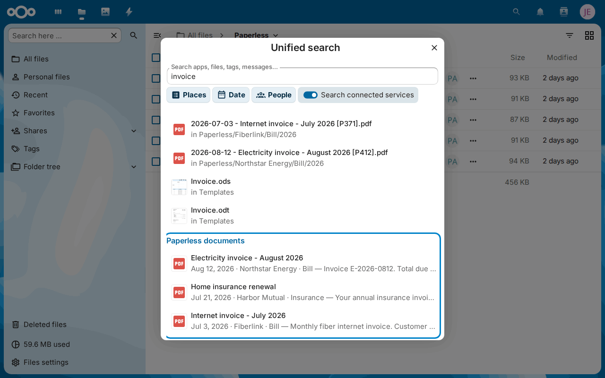

<div align="center">


# Paperless Unified Search

**Find Paperless-ngx documents by the words inside them, right in Nextcloud's search.**

[](https://github.com/Dennis-Otto/paperless-unified-search/releases/latest)
[](https://apps.nextcloud.com/apps/paperless_unified_search)
[](#requirements)
[](https://github.com/Dennis-Otto/paperless-unified-search/actions/workflows/ci.yml)
[](LICENSE)

**English** · [Deutsch](README.de.md)

</div>

Paperless Unified Search brings Paperless-ngx OCR and full-text search into Nextcloud's global search, without Elasticsearch, a second index or another container: Paperless answers, Nextcloud decides who sees the file. Search results open the matching synchronized file directly in Nextcloud's viewer.

<picture>
  <source media="(prefers-color-scheme: dark)" srcset="docs/images/search-and-open-dark.gif">
  
</picture>

<sub>The search of files finds the two invoices by their names. Paperless also finds the home insurance renewal: its text says "invoice", its name doesn't.</sub>

<!-- --8<-- [start:two-apps] -->

Two apps, one archive: [Paperless Sync](https://github.com/Dennis-Otto/paperless-sync) writes every document of Paperless-ngx as a file of one Nextcloud account, the archive account, with the marker `[P<ID>]` in its name. Paperless Unified Search asks Paperless for the documents that match a search and shows each one to whoever can open its file.

<picture>
  <source media="(prefers-color-scheme: dark)" srcset="docs/images/diagrams/two-apps-one-archive.dark.svg">
  
</picture>

<!-- --8<-- [end:two-apps] -->

Paperless Sync is the companion, not a must: [any synchronization](#works-with-any-synchronization) that writes the files with their marker into the archive account works as well, Paperless-ngx's own file names included.

The [documentation website](https://dennis-otto.github.io/paperless-unified-search/) has this documentation on pages to install, configure and use the app, with a troubleshooting guide, a FAQ and a reference for administrators, and a comparison with the alternatives, the architecture, the security design and the roadmap, in English and in [German](https://dennis-otto.github.io/paperless-unified-search/de/index.html), where the architecture, the security design, the decisions, the releases and the changelog stay in English.

<sub>💛 Like it? [Rate it in the App Store](https://apps.nextcloud.com/apps/paperless_unified_search) or [support its development](https://github.com/sponsors/Dennis-Otto).</sub>

[Why](#why-paperless-unified-search) · [Try it](#try-it-in-three-minutes) · [Quick start](#quick-start) · [Troubleshooting](https://dennis-otto.github.io/paperless-unified-search/troubleshooting.html) · [FAQ](https://dennis-otto.github.io/paperless-unified-search/faq.html) · [Reference](https://dennis-otto.github.io/paperless-unified-search/reference.html) · [Compare](docs/compare.md) · [Architecture](https://github.com/Dennis-Otto/paperless-unified-search/blob/main/docs/architecture.md) · [Security design](https://github.com/Dennis-Otto/paperless-unified-search/blob/main/docs/security.md) · [Roadmap](https://github.com/Dennis-Otto/paperless-unified-search/blob/main/docs/roadmap.md) · [Releases](https://github.com/Dennis-Otto/paperless-unified-search/blob/main/docs/releases.md) · [Changelog](https://github.com/Dennis-Otto/paperless-unified-search/blob/main/CHANGELOG.md)

## Why Paperless Unified Search

<!-- --8<-- [start:why] -->

Paperless-ngx has already recognized the text of every document and keeps an index of its words. Paperless Unified Search asks that index whenever someone searches in Nextcloud, instead of building another one:

- **No second index, no second OCR.** No Elasticsearch, no extra container and no copy of the text in Nextcloud. What Paperless finds, Nextcloud's search finds, as soon as the file of the document is in Nextcloud.
- **Nextcloud decides who sees what.** A result appears only for someone who can open its file in Nextcloud, so the shares you already have are the permissions. Nobody needs an account in Paperless.
- **Results open where people work.** In Nextcloud's viewer in the browser and in the Nextcloud apps for iOS and Android, ready to share, download or comment on.
- **New documents come to you.** The dashboard lists the documents that Paperless added last, for everyone who can open them, without a search, and a notification tells you about those that your saved searches find.
- **The search of Paperless, not a copy of its words.** Its ranking, its highlights and its query syntax, such as `correspondent:acme` or `created:[2024 to 2025]`, which also look at the correspondent, the type and the tags of a document.

<!-- --8<-- [start:comparison] -->

The table sets it beside the other ways to find Paperless documents from Nextcloud, as of October 2026. Every way but the web UI of Paperless needs the documents as files in Nextcloud, such as those of Paperless Sync.

| | Searches the OCR text | Nextcloud's shares decide who sees a result | Opens in Nextcloud's viewer and mobile apps | Extra infrastructure | Keeps a second index |
| --- | --- | --- | --- | --- | --- |
| **Paperless Unified Search** | **Yes, in the index of Paperless** | **Yes** | **Yes** | **None** | **No** |
| [Full text search](https://apps.nextcloud.com/apps/fulltextsearch) with Elasticsearch | Only in files with a text layer | Yes | Yes | An Elasticsearch server | Yes |
| [Workflow OCR](https://apps.nextcloud.com/apps/workflow_ocr) | No search of its own: it adds a text layer for another search | — | — | OCRmyPDF, or its backend container | No, but the search it feeds does |
| [Paperless integration](https://apps.nextcloud.com/apps/integration_paperless) | No search: it sends files to Paperless | — | — | None | No |
| [Context Chat](https://apps.nextcloud.com/apps/context_chat) | Only in files with a text layer, as answers to questions | Yes | Its answers link to the files | AppAPI, its backend container and a language model | Yes, of vectors |
| [Findling](https://apps.nextcloud.com/apps/findling) | Yes, with an OCR of its own | Yes | Yes | AppAPI and its backend container | Yes, of words and of vectors |
| The web UI of Paperless-ngx | Yes | No: accounts and permissions of Paperless | No: documents open in Paperless | None | No |

<!-- --8<-- [end:comparison] -->
<!-- --8<-- [end:why] -->

The [comparison](docs/compare.md) explains each of them, and when another one is the better choice.

## Try it in three minutes

<!-- --8<-- [start:try-it] -->

One command starts a real Paperless-ngx and a real Nextcloud in Docker on your own machine, with five synthetic documents, [Paperless Sync](https://github.com/Dennis-Otto/paperless-sync) and this app set up, and ends with a search that finds the documents. Your own Nextcloud and Paperless stay untouched:

```sh
git clone https://github.com/Dennis-Otto/paperless-unified-search.git
cd paperless-unified-search
bash demo/seed.sh
```

It needs Docker with Compose and Bash, Git Bash on Windows, and generates the passwords of the demo on your machine. Both web interfaces listen on 127.0.0.1 alone. Once the script prints the accounts, sign in as `jamie` at <http://localhost:8180> and search for *invoice*: the home insurance renewal is among the results, because its text says "invoice", while its title doesn't. [The guide of the demo](https://github.com/Dennis-Otto/paperless-unified-search/blob/main/demo/README.md) says what else to try, and how to remove it again.

<picture>
  <source media="(prefers-color-scheme: dark)" srcset="docs/images/diagrams/what-the-demo-sets-up.dark.svg">
  
</picture>


<sub>Recorded from the real Paperless-ngx and Nextcloud of the demo, by `bash scripts/screenshots.sh --demo`.</sub>

<!-- --8<-- [end:try-it] -->

<!-- --8<-- [start:quick-start-section] -->

## Quick start

<!-- --8<-- [start:quick-start] -->

1. Install **Paperless Unified Search** from the [Nextcloud App Store](https://apps.nextcloud.com/apps/paperless_unified_search) under *Apps*, or with `occ app:install paperless_unified_search`.
2. In Paperless-ngx, create an account that may read the documents to search, and an API token for it.
3. In Nextcloud, open **Administration settings → Paperless Unified Search**, enter the Paperless URL and the token, and select **Test connection and save**. When Nextcloud reaches Paperless at an address of your local network or by the name of its Docker service, such as `http://192.168.1.20:8000` or `http://paperless:8000`, also select **Paperless runs in my local network**. With [Paperless Sync](https://github.com/Dennis-Otto/paperless-sync) installed, the account it writes the archive with is the **Archive account**; otherwise enter the account that owns the synchronized files.
4. As the archive account, share the archive read-only with the users who may find its documents, as any folder in Nextcloud. The archive account itself finds them all.
5. Search in Nextcloud, switch on **Search connected services** and look under **Paperless documents**. A result appears for every document whose synchronized file you can open: a file of the archive account with `[P<ID>]` in its name, your own if you are that account, or one it shared with you. [Paperless Sync](https://github.com/Dennis-Otto/paperless-sync) creates such files.

<picture>
  <source media="(prefers-color-scheme: dark)" srcset="docs/images/diagrams/setting-up-the-search.dark.svg">
  
</picture>

<!-- --8<-- [end:quick-start] -->

The third step takes seconds, and **Try a search** shows at once that it worked:

<picture>
  <source media="(prefers-color-scheme: dark)" srcset="docs/images/setup-dark.gif">
  
</picture>

<sub>Recorded by `bash scripts/screenshots.sh`, with the stand-in for Paperless of the end-to-end tests and its token.</sub>

[Configuration](#configuration) and [Usage](#usage) have the details, and [occ](#set-up-and-check-it-with-occ) sets the app up without a browser.

<!-- --8<-- [end:quick-start-section] -->

No Paperless documents in the search, or a test of the connection that fails? The [troubleshooting guide](https://dennis-otto.github.io/paperless-unified-search/troubleshooting.html) finds the cause step by step, and the [FAQ](https://dennis-otto.github.io/paperless-unified-search/faq.html) answers the common questions.

## Screenshots

Each screenshot below but those of the phone has a dark version, which a dark theme shows, and so do the animations of the search and of the set-up; the one of the demo is light only.

### Paperless results in Nextcloud's global search

<picture>
  <source media="(prefers-color-scheme: dark)" srcset="https://github.com/Dennis-Otto/paperless-unified-search/raw/main/screenshots/01-unified-search-dark.png">
  
</picture>

### A search result opened in Nextcloud's PDF viewer

<picture>
  <source media="(prefers-color-scheme: dark)" srcset="https://github.com/Dennis-Otto/paperless-unified-search/raw/main/screenshots/02-nextcloud-pdf-viewer-dark.png">
  
</picture>

### Paperless results narrowed by date

<picture>
  <source media="(prefers-color-scheme: dark)" srcset="https://github.com/Dennis-Otto/paperless-unified-search/raw/main/screenshots/12-date-filter-dark.png">
  
</picture>

A custom range of the date filter keeps the documents that Paperless dates within it, here July 2026, in Nextcloud's filtered list. *Files* filters by the day a file last changed, so it finds none of the files of the demo, which were added later. [Narrow the results by date](#narrow-the-results-by-date) explains the filter.

### On a phone

<p>
  
  
</p>

Nextcloud in the browser of a phone. The Nextcloud apps for iOS and Android open a result in their own viewer.

### Paperless documents in the smart picker

<picture>
  <source media="(prefers-color-scheme: dark)" srcset="https://github.com/Dennis-Otto/paperless-unified-search/raw/main/screenshots/07-smart-picker-dark.png">
  
</picture>

<picture>
  <source media="(prefers-color-scheme: dark)" srcset="https://github.com/Dennis-Otto/paperless-unified-search/raw/main/screenshots/08-smart-picker-link-dark.png">
  
</picture>

Type `/` in a note of Text and choose *Paperless documents*: the picker finds the documents by their text and inserts the link to the file you pick, which Text shows as the file itself to everyone who can open it.

### The newest documents on the dashboard

<picture>
  <source media="(prefers-color-scheme: dark)" srcset="https://github.com/Dennis-Otto/paperless-unified-search/raw/main/screenshots/11-dashboard-dark.png">
  
</picture>

*New in Paperless* on Nextcloud's dashboard lists the documents that Paperless added last and that you can open, without a search.

### Paperless in every search of your own

With **Always search my Paperless documents** in the personal settings, every search of yours includes Paperless without the switch *Search connected services*, which Nextcloud turns off on every page that loads.

### The archive, shared read-only

<picture>
  <source media="(prefers-color-scheme: dark)" srcset="https://github.com/Dennis-Otto/paperless-unified-search/raw/main/screenshots/10-share-read-only-dark.png">
  
</picture>

The archive account shares its folder *Paperless* with *View only*, and Jamie finds its documents. The shares decide who sees which document: nobody needs an account in Paperless.

### Secure server-side administration

<picture>
  <source media="(prefers-color-scheme: dark)" srcset="https://github.com/Dennis-Otto/paperless-unified-search/raw/main/screenshots/03-admin-settings-dark.png">
  
</picture>

Each message of the settings says in one sentence of your language what happened, in the colour and with the icon of a success or an error, and *Disconnect* is on only while something is stored to disconnect.

### Problems of the search

<picture>
  <source media="(prefers-color-scheme: dark)" srcset="https://github.com/Dennis-Otto/paperless-unified-search/raw/main/screenshots/06-search-problems-dark.png">
  
</picture>

The end of the settings counts the failed searches and the requests that only their second try answered, and lists the latest of them with their errors, also where the hoster keeps the log of Nextcloud from administrators.

<p>
  
</p>

On a phone, the settings fit the screen, and each problem of the search is a card whose lines name what they show.

### Try a search

<picture>
  <source media="(prefers-color-scheme: dark)" srcset="https://github.com/Dennis-Otto/paperless-unified-search/raw/main/screenshots/10-try-a-search-dark.png">
  
</picture>

*Try a search* at the end of the settings answers the most common question, "why don't I see this document?", without a shell: it searches Paperless as a user and names for each document whether it shows to them, and if not, why.

<!-- --8<-- [start:how-it-works] -->

## How it works

<picture>
  <source media="(prefers-color-scheme: dark)" srcset="docs/images/diagrams/how-a-search-finds-its-documents.dark.svg">
  
</picture>

1. Nextcloud forwards an enabled external-search query to Paperless-ngx.
2. Paperless returns results from its native OCR/full-text index, with only the fields that a result shows: not the whole OCR text of each document, only the excerpt around the term.
3. The app maps each Paperless document ID to a synchronized file of the archive account whose name contains the unique marker `[P<ID>]`, for example `[P123]`, with one search of Nextcloud's file cache for all documents of a page. The archive account is the one that owns the synchronized files: the account of Paperless Sync, or the one of the settings.
4. A result is returned only if the current Nextcloud user can access that file: the archive account itself, or a user it shared the file with read-only. A file with the marker in its name that belongs to another account stands for no document, and neither does a file of the archive account that the user may change, or one in a folder where the user may add files: through a share with write permission, the user could have given it the marker.
5. A page of results holds as many results as Nextcloud asks for while Paperless has more: when documents that the user can't open rank first, the app asks Paperless for its next pages, up to four pages of 25 hits per search, so that Paperless results still show and **Load more results** keeps working.
6. Each result shows the preview of its file, or the icon of its type, and below its title the date of the document in the language of the user, its correspondent, its type, up to two of its tags and the words around the term, as [What a result shows](https://dennis-otto.github.io/paperless-unified-search/usage.html#what-a-result-shows) describes.
7. Selecting a result opens the synchronized file in Nextcloud, not Paperless. Browsers use Nextcloud's
   `/f/{fileId}` viewer route. The official iOS app receives its native `nextcloud://open-file` deep link,
   while Android receives the file ID and user-relative path required by its in-app viewer.

Who sees document 412, when `paperless` is the archive account and has shared its archive read-only with `jamie` and with write permission with `alex`:

<picture>
  <source media="(prefers-color-scheme: dark)" srcset="docs/images/diagrams/who-sees-document-412.dark.svg">
  
</picture>

This app does not synchronize documents itself. The companion app [Paperless Sync](https://github.com/Dennis-Otto/paperless-sync) does, natively and with settings of its own, and [any other synchronization](#works-with-any-synchronization) that writes the marker into the file names works as well. Both apps use the same stable `[P<ID>]` marker and are designed to work together without coupling their release cycles.

<!-- --8<-- [end:how-it-works] -->
<!-- --8<-- [start:any-sync] -->

## Works with any synchronization

The search needs one thing from a synchronization: each document of Paperless-ngx as a file of the archive account in Nextcloud, with the marker `[P<ID>]` of the document in the name of the file. [Paperless Sync](https://github.com/Dennis-Otto/paperless-sync) writes such files, with folders by correspondent, type and year, and so can any other way:

1. **Let Paperless put the marker into its file names.** The [file name format](https://docs.paperless-ngx.com/advanced_usage/#file-name-handling) of Paperless has the placeholder `{{ doc_pk }}`, the ID of the document. In the environment of Paperless, such as its `docker-compose.env`:

    ```text
    PAPERLESS_FILENAME_FORMAT={{ created_year }}/{{ correspondent }}/{{ title }} [P{{ doc_pk }}]
    ```

    Paperless then stores document 412 as `2026/ACME/Invoice [P412].pdf`. Its command [`document_renamer`](https://docs.paperless-ngx.com/administration/#renamer) renames the documents it already has, and each [storage path](https://docs.paperless-ngx.com/advanced_usage/#storage-paths) of Paperless needs the marker as well.

2. **Copy the files to the archive account, one way, from Paperless to Nextcloud.** The folder `media/documents/archive` of Paperless holds the PDFs with their recognized text, `media/documents/originals` the files as they came in.

    - **rclone**, or another WebDAV client, on a timer or in a container next to Paperless, with an [app password](https://docs.nextcloud.com/server/latest/user_manual/en/session_management.html#managing-devices) of the archive account `paperless`:

        ```sh
        rclone config create nextcloud webdav vendor=nextcloud \
          url=https://cloud.example.com/remote.php/dav/files/paperless/ \
          user=paperless pass=app-password --obscure
        rclone sync /path/to/paperless/media/documents/archive nextcloud:Paperless
        ```

    - **The Nextcloud desktop client**, signed in as the archive account, on a copy of the folder rather than the folder itself: it syncs both ways, and Paperless loses track of a file that is moved or deleted in its media folder.
    - **An external storage** with the files, mounted for the archive account alone and shared from there. A mount can't be shared until **Enable sharing** is switched on in its options, behind the gear of the storage under *External storage* in the administration settings. Nextcloud's search finds only the files it has scanned, so let a timer run `occ files:scan` for the storage. On a storage mounted for every user, each user owns the files they see there, and such a file stands for no document.

3. **Share the archive read-only** with the users who may find its documents, and enter the archive account in the settings, as in the [configuration](#configuration).

<!-- --8<-- [end:any-sync] -->
<!-- --8<-- [start:requirements] -->

## Requirements

- Nextcloud 33 to 35
- PHP 8.2 or newer as supported by the corresponding Nextcloud release
- A reachable Paperless-ngx 2.16 or newer, 3.x included, with API access. The app asks for version 9 of its API, which Paperless-ngx 2.16 and newer and 3.x speak; contract tests check the app every week against real Paperless-ngx, the last release of 2.20 and the newest release of 3.x; the [compatibility](https://dennis-otto.github.io/paperless-unified-search/reference.html#compatibility) says it in detail.
- Synchronized files whose names contain `[P<ID>]`, owned by one Nextcloud account, the archive account, and shared read-only with the users who may see them, for example those of Paperless Sync or of [any other synchronization](#works-with-any-synchronization). Without them, the search shows no Paperless documents.

<!-- --8<-- [end:requirements] -->
<!-- --8<-- [start:configuration] -->

## Configuration

1. Create a dedicated Paperless account, neither **Superuser** nor **Admin**, with only the permissions to view that the search needs: **View** for **Document**, for **Correspondent**, **DocumentType** and **Tag**, whose names the results show, and for **UISettings**, from which the test of the connection learns what the account may do. Let it view the documents, correspondents, types and tags that another user owns, such as an administrator who adds them; [A Paperless account for the search](https://dennis-otto.github.io/paperless-unified-search/configure.html#a-paperless-account-for-the-search) shows each step in Paperless, with a workflow that does it for every new document.

    <picture>
      <source media="(prefers-color-scheme: dark)" srcset="https://github.com/Dennis-Otto/paperless-unified-search/raw/main/screenshots/14-paperless-account-dark.png">
      
    </picture>

2. Create an API token for that account, in **My Profile** of Paperless, signed in as the account.
3. In Nextcloud, open **Administration settings → Paperless Unified Search**.
4. Enter the Paperless base URL and API token.
5. When Nextcloud reaches Paperless at an address of your local network or by the name of its Docker service, such as `http://192.168.1.20:8000` or `http://paperless:8000`, select **Paperless runs in my local network** ([below](#paperless-in-your-local-network)).
6. Under **Archive account**, enter the Nextcloud account that owns the synchronized files, or leave it blank to use the account that Paperless Sync writes the archive with. The settings store the ID as Nextcloud spells it, whatever its case, and warn when the account doesn't exist.
7. Optionally enable **Always include Paperless in global search** to treat the configured Paperless server as trusted.
8. Leave **Let users include Paperless in all their searches** on to let each user include Paperless in every search of their own, in their personal settings, or turn it off.
9. Choose with **Let users ask for notifications about new documents** whether each user can save searches for notifications about new documents in their personal settings. Until you choose, it is on only where Nextcloud has a memory cache.
10. Select **Test connection and save**. Nextcloud asks for your password when you haven't confirmed it in the last 30 minutes, as for its own settings of this kind; so does **Disconnect**.

Leave the token blank to keep the stored one. The stored token goes only to the Paperless server it was saved for: when the URL names another server, with another scheme, host or port, the settings ask for the token again, so that the token never reaches a server it wasn't meant for. Another path on the same server keeps it. When Nextcloud can no longer decrypt the stored token, as after a move or a restore with another `secret` in `config.php`, the settings say so and ask for it again, and until then the search shows no Paperless documents.

The test of the connection also asks Paperless what the account of the token may do. The settings save the token in any case, and warn below it when the account is a superuser or an admin of Paperless or may add, change or delete documents, since whoever gets hold of such a token may do the same, and when it may not view correspondents, document types or tags, or those of the newest documents that another user owns, whose names the results then lack. Paperless says this only to an account that may view its UI settings; for any other, the settings warn about nothing. `occ paperless_unified_search:check` and the overview of the administration settings repeat the warnings until the next test, and [Troubleshooting](https://dennis-otto.github.io/paperless-unified-search/troubleshooting.html) says what to do about each.

The configuration is global. Access control remains user-specific because the app discards every Paperless hit for which the searching Nextcloud user can't open a matching file of the archive account. Share the archive read-only with the users who may see its documents. Without an archive account, the search shows no Paperless documents. Below the archive account, the settings say with whom it shares its files, such as *Shared read-only: 1 user, 2 groups.*, and warn about each share that allows changes: its recipients don't find the documents in it until it is read-only.

When Paperless documents are missing from the search, look at **Search problems** at the end of the settings, and for a document that Paperless finds but a user doesn't see, use **Try a search** below it: enter the term and the user ID, and it lists the first 20 documents that Paperless ranks for the term, each with its ID, its title, its tags and whether it shows to that user, or why not: *Shared with write permission*, *Not shared with* the user, *Not a file of the archive account*, or *No file with* its marker, such as `[P412]`. It asks the same questions as [`occ paperless_unified_search:search --explain`](https://dennis-otto.github.io/paperless-unified-search/reference.html#explain-a-hidden-document), for administrators of a managed instance without a shell, and answers with the titles and tags alone, without the content or the files of the documents. A failed search shows the users no Paperless documents and no error, and a request that fails before it reaches Paperless, as when the connection fails, is sent a second time before the search gives up; one that waited for a Paperless that hangs is not, so that a search never waits twice. The settings count both, the failed searches and the requests that only their second try answered, and list the latest 20 with the time, the step, asking Paperless or looking for the files in Nextcloud, the kind and the message of the error and how long it took, along with since when searches work again after the last failure. A query that Paperless refuses while it is still being typed isn't a problem and doesn't show up, and during an outage, also one that comes and goes, the problems of one kind are written at most once in 30 seconds, with those in between still counted. This helps where the hoster keeps the log of Nextcloud from administrators. **Clear history** and **Disconnect** forget the history; saving the settings keeps it.

By default, Nextcloud's search in the browser asks Paperless only after the user enables **Search connected services**, and the smart picker only after the user picks **Paperless documents** in it. When the trusted-service option is enabled, every global search term from every Nextcloud user is sent to Paperless automatically and the connected-services switch no longer controls this provider. Reload Nextcloud after changing this option. A user can make the same choice for their own searches alone, in the personal settings, while **Let users include Paperless in all their searches** is on ([Usage](https://dennis-otto.github.io/paperless-unified-search/usage.html#always-search-your-paperless-documents)).

### Paperless in your local network

Nextcloud refuses to connect to addresses of the local network, such as `192.168.1.20`, `paperless.local` or the name of a Docker service, so that no URL that someone enters can reach the services behind its firewall. Most Paperless servers run at exactly such an address. Select **Paperless runs in my local network**, and Nextcloud allows the address for the requests of this app to the Paperless URL of the settings, and for nothing else: those requests follow no redirect, and every other app keeps the protection. Without the switch, **Test connection and save** fails with a message that names it. Enter the address at which Paperless itself answers, such as `https://paperless.example.com` rather than `http://paperless.example.com` when a proxy redirects `http` to `https`: with the switch, Nextcloud follows no redirect, and a redirect makes the test of the connection fail.

Don't set `allow_local_remote_servers` in `config.php` for Paperless: it lifts the protection for every app and every URL that users can enter, such as link previews, webhooks and the servers of federated shares.

If you set `allow_local_remote_servers` in `config.php` for Paperless before, first select **Paperless runs in my local network** and save, and only then remove it from `config.php`. Otherwise the search shows no Paperless documents until the switch is saved.

<picture>
  <source media="(prefers-color-scheme: dark)" srcset="docs/images/diagrams/which-requests-reach-an-address-of-the-local-network.dark.svg">
  
</picture>

The URL may name a Docker service with an underscore, such as `http://paperless_ngx:8000`, an IPv6 address in brackets, such as `http://[fd00::5]:8000`, or an internationalized name, which the settings store in the ASCII form that DNS knows, such as `https://xn--bcher-kva.example` for `https://bücher.example`.

<!-- --8<-- [end:configuration] -->

### When the test of the connection fails

<!-- --8<-- [start:connection-test] -->

**Test connection and save** saves nothing until Paperless answers with a list of documents, and when it doesn't, the message says what failed and what to correct, in the language of your account. The log of Nextcloud gets a warning with the error itself, such as `cURL error 6: Could not resolve host`, without the token and without the query of the URL.

<picture>
  <source media="(prefers-color-scheme: dark)" srcset="docs/images/diagrams/what-the-test-of-the-connection-checks.dark.svg">
  
</picture>

| The message says | What failed | What to do |
| --- | --- | --- |
| Paperless rejected the API token (HTTP 401 or 403) | Paperless doesn't know the token, or its account may not view documents. Or the URL redirects to another scheme, host or port, such as from `http` to `https`, and Nextcloud leaves the token out of the redirect | Copy the token again from the profile of the Paperless account, and give the account the permission to view documents. Enter the address that the URL forwards to |
| This URL answers, but not with the API of Paperless (HTTP 404) | The path of the URL, or a proxy in front of Paperless | Enter the address that opens Paperless in the browser, with the path when Paperless runs under one, such as `https://example.com/paperless` |
| This URL forwards to another address | The URL redirects, and with **Paperless runs in my local network** Nextcloud follows no redirect | Enter the address that it forwards to, such as the one with `https` |
| Paperless is older than 2.16 | Paperless answered HTTP 406: it doesn't speak version 9 of its API, which the app asks for | Update Paperless-ngx to 2.16 or newer |
| Paperless answered with an error | Paperless itself failed, with a status of 5xx | Look into the log of Paperless, or try again later |
| This URL answers, but not like Paperless-ngx | Another service, or the login page of a proxy | Check the address and its path |
| Nextcloud does not connect to addresses of the local network | Paperless runs at an address of the local network | Select **Paperless runs in my local network**, as [Paperless in your local network](#paperless-in-your-local-network) describes |
| Nextcloud does not trust the certificate of Paperless | A certificate of your own authority, a self-signed one, or one for another name | Import the certificate of the authority with `occ security:certificates:import`, or use the name that the certificate is for |
| Nextcloud could not set up an encrypted connection | Mostly `https` at a port that speaks plain HTTP | Enter the URL with `http`, or the port of HTTPS |
| Nextcloud could not find the host of this URL | The name doesn't resolve, as a Docker service outside the network of Nextcloud doesn't | Check its spelling, and put Nextcloud and Paperless into one Docker network |
| Paperless did not answer in time | No connection within 3 seconds or no answer within 10 | Check that Paperless runs and isn't busy, and that no firewall drops the requests |
| Nextcloud could not reach Paperless at this URL | The connection was refused, as at a wrong port | Check the address and the port, and that Paperless runs |
| The settings could not be saved | Something after the test, such as the database | Look into the log of Nextcloud |

The answer of the settings route carries a `code` beside the message, such as `unauthorized`, `not_found` or `unknown_host`, for scripts that save the settings.

When Nextcloud itself can't take the request, the page says so in one sentence instead of showing the page of the error:

| The message says | What happened | What to do |
| --- | --- | --- |
| Nextcloud is in maintenance mode | Nextcloud is being upgraded or maintained, and answers every request with HTTP 503 and a header that says so | Try again in a few minutes |
| Your session has expired | The session of your login ended, or its request token is no longer valid (HTTP 401 or 412) | Reload the page and try again |
| Nextcloud could not be reached | The browser lost its connection to Nextcloud | Check your connection and try again |
| The request failed (HTTP 502) | A proxy in front of Nextcloud answered with an error of its own, such as 502, 503 or 504, or Nextcloud found a problem with its own setup, such as a data folder it can't write to. Without a status, the page itself met an error | Check that Nextcloud runs, its log and the log of the proxy, and reload the page |
| Confirm your password to change the settings | The dialog that asks for your Nextcloud password was closed, or didn't confirm the password | Select **Test connection and save** or **Disconnect** again, and confirm with your Nextcloud password |
| Nextcloud gave an unexpected answer | Something in front of Nextcloud, such as the login page of a proxy, answered instead of the app | Reload the page and try again |

<!-- --8<-- [end:connection-test] -->
<!-- --8<-- [start:languages] -->

### Languages

The app speaks English, German, French, Spanish and Dutch, each account in its language: the search and its results, the widget on the dashboard, the personal and the administration settings with their messages, the warnings of the overview, and its listing in the App Store. German says *du* to accounts set to *Deutsch (Persönlich: Du)* and *Sie* to accounts set to *Deutsch (Förmlich: Sie)*; French says *vous*, Spanish *tú* and Dutch *je*, as Nextcloud does in these languages. In every other language, the app speaks English.

The French, Spanish and Dutch texts were drafted with the help of an AI, with the words of Nextcloud's own translations, such as *Rechercher dans les services connectés* for **Search connected services**, and wait for native speakers to read them. [Translate](https://dennis-otto.github.io/paperless-unified-search/translate.html) shows how to correct a text or add a language.

<!-- --8<-- [end:languages] -->
<!-- --8<-- [start:usage] -->

## Usage

Open Nextcloud's global search, enable **Search connected services**, and select **Paperless documents**. Nextcloud 32 and later turn the switch off again whenever a page loads, so that no term goes to another server without your choice. To skip it, select **Always search my Paperless documents** in your personal settings, as [below](#always-search-your-paperless-documents); an administrator can include Paperless in the search of every user instead, with trusted-service mode.

Documents without a synchronized `[P<ID>]` file of the archive account are intentionally omitted. This also keeps Inbox-only documents out of Nextcloud search when the synchronization process does not export them.

### Always search your Paperless documents

Under **Personal settings → Paperless**, select **Always search my Paperless documents**, and every search of yours asks Paperless without the switch, from the next page that you open. Your search terms then go to the Paperless server of your Nextcloud with every search, also when you look for a file or a contact; the searches of everybody else stay as they are. Clear the checkbox, and the switch decides again.

The section shows once Paperless is connected with an archive account. Administrators can turn off **Let users include Paperless in all their searches** in the administration settings: the section then disappears, and the search ignores what users chose until it is on again. While **Always include Paperless in global search** is on, every search includes Paperless anyway, and the section shows the checkbox ticked and greyed out.

<picture>
  <source media="(prefers-color-scheme: dark)" srcset="docs/images/diagrams/when-a-search-asks-paperless.dark.svg">
  
</picture>

### Narrow the results by date

Pick a span in the date filter of Nextcloud's search, such as **Last 30 days**, **This year** or a custom range, and the Paperless results show only documents whose date in Paperless lies within it, the date that Paperless shows for the document, not the day it was added or synchronized. The span counts in whole days in your timezone: *Last 30 days* picked in Berlin on September 30 finds the documents dated September 1 to September 30. Paperless filters the documents itself, so a narrow span still finds the matching documents further down the ranking, and the results stay in Nextcloud's filtered list instead of *Partial matches*.

<!-- --8<-- [end:usage] -->
<!-- --8<-- [start:what-a-result-shows] -->

### What a result shows

Each result shows the preview of its file, as the results of *Files* do, or else the icon of the type of the file. Below its title, a line names the date of the document in your language, such as *Aug 12, 2026* in English and *12.08.2026* in German, its correspondent, its type and up to two of its tags, such as *Bill · unpaid · tax 2026*, and then the words around the term that Paperless found. Two invoices of the same correspondent thus tell at a glance which one is *paid*. When only a note of the document matched, as for `notes:transfer`, the line shows *Note:* and the words of the note.

<picture>
  <source media="(prefers-color-scheme: dark)" srcset="docs/images/diagrams/what-a-result-shows.dark.svg">
  
</picture>

- **Preview.** Nextcloud draws previews of images and office documents, but of PDF files only once an administrator turns them on, as its [documentation of previews](https://docs.nextcloud.com/server/latest/admin_manual/configuration_files/previews_configuration.html) describes. Until then a result shows the icon of PDF files, as the results of *Files* do.
- **Correspondent, type and tags.** Paperless sends them as numbers. The app asks Paperless for their names with one request for all correspondents, one for all types and one for all tags of a page, and keeps the names for ten minutes, so a name changed in Paperless shows in the results within ten minutes. When the account of the API token may not view correspondents, types or tags, or those that another user owns, or Paperless doesn't answer in time, the results show without them, and the search works as before; the settings, `occ paperless_unified_search:check` and the overview warn about such an account, about those that another user owns when the newest documents name one.
- **Up to two tags.** A result shows the first two tags of its document in the order that Paperless sends them, then how many more it has, such as *unpaid · tax 2026 · +2* for a document with four. It never shows the tag of the inbox, which Paperless gives every new document until someone has looked at it, and which says nothing about the document.
- **Text.** The words around the term come as Paperless marks them up, and the result shows them as plain text. Text of a document in angle brackets, such as `<GmbH>`, shows with a space after `<`, as `< GmbH>`, so that no part of a result can ever act as HTML.

<!-- --8<-- [end:what-a-result-shows] -->
<!-- --8<-- [start:smart-picker] -->

### In Talk, Text, Deck and Mail

Nextcloud's smart picker finds Paperless documents too, wherever you write: type `/` in Text or Collectives, or open the smart picker in a conversation of Talk, a card of Deck or a message of Mail. Choose **Paperless documents**, search, and pick a result: the picker inserts the link to its file. Everyone who can open that file sees its preview; anyone else sees only the link.

The picker searches through the same provider as Nextcloud's search, so it lists the same documents. It asks Paperless once you have chosen **Paperless documents** and typed a term, without the switch **Search connected services**: choosing it is the same consent.

<!-- --8<-- [end:smart-picker] -->
<!-- --8<-- [start:dashboard] -->

### On the dashboard

Add **New in Paperless** to your dashboard with **Customize** at the end of the dashboard. The widget lists the newest documents that Paperless added and that you can open, newest first, without a search: each with the preview of its file, and below its title the day that Paperless added it in your language, its correspondent, its type and up to two of its tags, as a result of the search shows them, such as *Sep 3, 2026 · Example Motors · Receipt · warranty*. Selecting one opens its file in Files. Once the list is full, Nextcloud's dashboard shows six documents and **Files shared with you** below them, which opens all the files that others share with you; with fewer documents it shows them all and no link, and the archive account, which owns the files, gets no such link at all. The apps and the other clients of the dashboard's API get up to seven documents and the link. Nextcloud's dashboard API serves the widget to other clients as well, such as the widgets of the Android app on the home screen of a phone.

<picture>
  <source media="(prefers-color-scheme: dark)" srcset="docs/images/diagrams/the-newest-documents-on-the-dashboard.dark.svg">
  
</picture>

- **Who sees what.** The same rule as in the search: a document shows to whoever can open its file of the archive account. The widget looks at the 25 documents that Paperless added last; when you can open none of them, it says so.
- **How new.** The newest documents are the same for every user, since every request to Paperless carries the token of the settings, so the app asks Paperless for them at most once a minute, for all users together, and keeps them in Nextcloud's distributed cache meanwhile. That needs a memory cache, as Nextcloud recommends: without one, every dashboard that shows the widget asks Paperless, and waits for it during an outage. A document that Paperless adds shows within a minute, and a file shared with you at once.
- **When Paperless doesn't answer** within five seconds, the widget says *Paperless can't be reached right now.*, and the app asks again a minute later. Such a failure goes into the log of Nextcloud, not into the history of the problems of the search.
- **Only where the search works.** The dashboard offers the widget once the settings name a Paperless and an archive account that exists.

<!-- --8<-- [end:dashboard] -->
<!-- --8<-- [start:notifications] -->

### Notifications about new documents

Under **Personal settings → Paperless**, **Notify me about new documents** asks Nextcloud to tell you when Paperless adds a document: **Every new document that I can open**, or only those that your saved searches find, up to 10, one per line, in the [syntax of Paperless](#search-like-in-paperless), such as `correspondent:"tax office"` or `tag:unpaid`. Paperless itself notifies only through workflows that its administrator sets up, which know nothing of the users and the permissions of Nextcloud, and the file notifications of Nextcloud don't fire for new files in a folder that is shared with you.

<picture>
  <source media="(prefers-color-scheme: dark)" srcset="docs/images/diagrams/notifications-about-new-documents.dark.svg">
  
</picture>

- **Who hears what.** The same rule as in the search: you hear about a document only when you can open its file of the archive account. Someone who saved the same search and can't open the file hears nothing, and neither does the owner of a disabled account.
- **One notification at a time.** A run of the job sends you one notification, whatever the number of its documents: with one document, its title; with more, how many they are and the titles of the newest three. Each title opens the file, on the web and in the apps for phones.
- **When.** A background job runs every five minutes, as Nextcloud's cron starts it. A document counts once its file has reached the archive account, so the notification comes with your synchronization, which may take hours. A document whose file doesn't arrive within two days never counts, such as one that the rules of Paperless Sync leave out.
- **What counts as new.** The documents that Paperless takes in from the moment that anybody first asks: a first run only learns how far the IDs go, so nobody hears about the archive of years. Each saved search looks at a document once, as its file arrives, so a tag that someone gives it later brings no notification. Of more than 100 documents between two runs, such as a large import, only the newest count.
- **When Paperless doesn't answer,** the job waits ten minutes, then 20, 40 and at most an hour before it asks again, and the documents keep waiting meanwhile, within their two days. Such a failure goes into the log of Nextcloud, not into the history of the problems of the search. A saved search that Paperless refuses or fails to answer while it answers others finds nothing in that run, and the log counts it without naming it.
- **Only where administrators allow it.** The personal settings offer it while **Let users ask for notifications about new documents** is on. Notifications need the app Notifications of Nextcloud, which comes with it.

<!-- --8<-- [end:notifications] -->
<!-- --8<-- [start:search-syntax] -->

## Search like in Paperless

Nextcloud hands the words of a search to Paperless-ngx as they are typed, so its [search syntax](https://docs.paperless-ngx.com/usage/#document-searches) works in Nextcloud too. Without it, Paperless finds the documents that contain every word, in the text, the title, the correspondent, the type or the tags:

| Search for | Finds |
| --- | --- |
| `invoice 2025` | Documents with both words, in any order |
| `"home insurance"` | The exact phrase |
| `insur*` | Words that begin with `insur` |
| `invoice NOT draft` | Invoices without the word *draft*; the operators are written in capitals |
| `correspondent:acme` | Documents of the correspondent ACME |
| `type:invoice tag:unpaid` | Unpaid invoices, by their type and their tag |
| `created:[2024 to 2025]` | Documents created from 2024 to 2025 |
| `added:yesterday` | Documents that Paperless received yesterday |
| `title:invoice` | Documents with the word in their title; `content:` looks in their text alone |
| `asn:1234` | The document with this archive serial number |
| `notes:callback` | Documents with the word in a note |
| `path:binders` | Documents with this storage path, by its name |
| `custom_fields:gold` | Documents with the word in the value of a custom field |
| `original_filename:scan-0412.pdf` | The document of this file, as Paperless received it, by its whole name |
| `like:[P412]` | Documents similar to the one with the marker `[P412]` in its file name |

`like:` finds the other letters of a case from one of them: Paperless looks for the documents most similar to this one, as **More like this** does in its web interface. The term is `like:` with the ID of the document alone, in the marker of its file or without it, such as `like:[P412]`, `like:P412` or `like:412`, in capitals or not; with a further word or anything else after the colon, such as `like:abc` or `like:[P012]`, it is a search like any other. It works wherever the search does, in the global search, the smart picker and the API, with the date filter and every page of the results, and leaves the document itself out. An ID that Paperless doesn't know, or of a document that its account may not view, finds nothing. Before Paperless-ngx 2.20.13, Paperless doesn't check whether its account may view that document, so one that it may not view still finds similar documents, of those that its account may view. Paperless 3 sends no excerpt for a similar document, so its result names its file instead.

Paperless-ngx 2 also knows `owner:jamie`, the account that owns a document; Paperless-ngx 3 has no such field. [The contract tests](https://github.com/Dennis-Otto/paperless-unified-search/blob/main/tests/e2e/README.md#against-a-real-paperless-ngx) check every row of this table against both.

A field or a quote that is still being typed, such as `tag:` alone, can find nothing; the results come once the search is complete. Paperless 3 refuses a query that it can't parse yet, such as `created:[2026 to` while the range is still being typed; the search then finds the documents of its words in the simple search of Paperless until the query is complete. Neither that nor a page past the last result counts as a problem of the search. Each result is still a document whose file the searching user can open.

<!-- --8<-- [end:search-syntax] -->
<!-- --8<-- [start:scripts] -->

## Use it from scripts and AI assistants

The search is also an API: Nextcloud's OCS search API answers with the same results that its search shows, for the user who asks and the files that user can open. A script, an automation or an AI assistant that can send HTTP requests uses it with an [app password](https://docs.nextcloud.com/server/latest/user_manual/en/session_management.html#managing-devices) of a user:

```sh
curl -u jamie -H 'OCS-APIRequest: true' \
  'https://cloud.example.com/ocs/v2.php/search/providers/paperless_unified_search_documents/search?term=invoice&format=json'
```

curl asks for the app password, which keeps it out of the history of the shell; a script hands it over in a file with `--netrc-file`. The answer, shortened:

```json
{
  "ocs": {
    "meta": { "status": "ok", "statuscode": 200, "message": "OK" },
    "data": {
      "name": "Paperless documents",
      "isPaginated": false,
      "entries": [
        {
          "thumbnailUrl": "https://cloud.example.com/core/preview?x=64&y=64&fileId=1234&mimeFallback=1",
          "title": "Home insurance renewal",
          "subline": "Mar 2, 2026 · Harbor Mutual · Insurance · paid — … the premium is due with this invoice …",
          "resourceUrl": "https://cloud.example.com/f/1234",
          "icon": "",
          "rounded": false,
          "attributes": { "fileId": "1234", "path": "/Archive/2026/Home insurance renewal [P412].pdf" }
        }
      ],
      "cursor": null
    }
  }
}
```

Each entry names the document, its date in the language of the user, its correspondent, its type and up to two of its tags with a line of its text that matches, the picture of its file in `thumbnailUrl` as an absolute URL, which is its preview when Nextcloud draws previews of its type and otherwise the icon of that type, the link that opens its file and the file's ID and path for that user. `icon` stays empty: Nextcloud's smart picker would show it in place of the picture, as the name of a CSS class. `limit` sets how many results a page holds, 5 by default and up to 50. To fill a page, the app goes through up to 4 pages of 25 documents that Paperless finds, for at most 3 seconds. A page can still hold fewer results, even none, when the user can open the files of only a few of the documents that Paperless finds, so keep asking with `cursor` set to the `cursor` of the answer while `isPaginated` is `true`. Send the `cursor` back as you got it: it counts the documents of Paperless that the pages before went through. `since` and `until` narrow the results to the documents dated within a span, as the date filter of the search does, each a moment such as `2026-08-01T00:00:00Z` whose day in the timezone of the user counts, so `&since=2026-08-01T00:00:00Z&until=2026-08-31T23:59:59Z` finds the documents of August 2026 for a user in UTC. The switch **Search connected services** belongs to the search in the browser; the API asks Paperless without it.

Give an assistant the app password of a user who sees only what it may read, and revoke the app password in the personal security settings once the assistant no longer needs it.

<!-- --8<-- [end:scripts] -->
<!-- --8<-- [start:automation] -->

## Set up and check it with occ

Four commands of `occ` do without a browser what the settings do, and more: they set the app up for Ansible, Docker and other scripts, test it for monitoring, and say why a user doesn't find a document.

| Command | What it does | Exit code |
| --- | --- | --- |
| `paperless_unified_search:setup` | Tests the connection with the URL and the token, then saves the settings, as **Test connection and save** does | 0 once saved, 1 when Paperless doesn't answer or a setting is wrong, 2 for a wrong call, such as a missing `--url` or an empty token source |
| `paperless_unified_search:test` | Tests the connection with the stored settings, names the version of Paperless and warns about a token that may do more than the search needs or less than the results show | 0 when Paperless answers, 1 otherwise |
| `paperless_unified_search:search <user> <term>` | Searches as the user and says for each document whether it shows to them, with `--explain` why not | 0 once Paperless answered |
| `paperless_unified_search:check` | Tests the connection, what the account of the API token may do and the archive account, counts the documents of Paperless that have a file, and lists how the archive is shared | 0 when the search can show documents, 1 otherwise |

### Set up the app

The token never goes on the command line, where the history of the shell and the list of processes would show it to others: `setup` reads it from the standard input with `--token-stdin`, or from an environment variable with `--token-env=NAME`. An option that you leave out keeps its stored value, and without a token the stored one stays, but only for the server it was saved for, as on the settings page.

| Option | Sets |
| --- | --- |
| `--url=URL` | The address of Paperless, such as `https://paperless.example.com`; required |
| `--token-stdin`, `--token-env=NAME` | The API token, from the first line of the standard input or from the environment variable `NAME` |
| `--archive-account=ID` | The account that owns the synchronized files; empty for the account of Paperless Sync |
| `--allow-local`, `--no-allow-local` | **Paperless runs in my local network** |
| `--always-search`, `--no-always-search` | **Always include Paperless in global search** |
| `--personal-always-search`, `--no-personal-always-search` | **Let users include Paperless in all their searches** |
| `--new-document-alerts`, `--no-new-document-alerts` | **Let users ask for notifications about new documents** |

On a server, as the user of the web server:

```sh
printf '%s\n' "$PAPERLESS_TOKEN" | sudo -u www-data php occ paperless_unified_search:setup \
  --url=https://paperless.example.com --archive-account=paperless --token-stdin
```

With Docker Compose and the image of Nextcloud, from a file that only you can read:

```sh
docker compose exec -T --user www-data nextcloud php occ paperless_unified_search:setup \
  --url=http://paperless:8000 --archive-account=paperless --allow-local --token-stdin \
  < paperless-token.txt
```

With Ansible, from its vault, and without the token in its output:

```yaml
- name: Connect Paperless Unified Search to Paperless-ngx
  ansible.builtin.command:
    argv: [php, occ, paperless_unified_search:setup, --url=https://paperless.example.com,
           --archive-account=paperless, --token-stdin]
    chdir: /var/www/nextcloud
    stdin: "{{ vault_paperless_token }}"
  become: true
  become_user: www-data
  no_log: true
```

### Explain a hidden document

The search leaves out every document that has no file of the archive account that the searching user can open, without a trace: twelve documents that `jamie` may not open look exactly like none. `search` lists the documents that Paperless ranks first, 10 by default and up to 50 with `--limit`, with whether each shows to the user, and `--explain` names the reason of each one that doesn't:

```console
$ occ paperless_unified_search:search jamie invoice --limit=6 --explain
+-----+-----------------------------------+------------+--------------------------------------------------------------------------------+
| ID  | Title                             | Verdict    | File                                                                           |
+-----+-----------------------------------+------------+--------------------------------------------------------------------------------+
| 412 | Electricity invoice - August 2026 | shown      | /Paperless/2026/Electricity invoice - August 2026 [P412].pdf                   |
| 389 | Home insurance renewal            | not shared | /Private/Home insurance renewal [P389].pdf of paperless, not shared with jamie |
| 371 | Internet invoice - July 2026      | shown      | /Paperless/2026/Internet invoice - July 2026 [P371].pdf                        |
| 356 | Water bill 2026                   | no file    |                                                                                |
| 344 | Old invoice                       | not owned  | /Scans/Old invoice [P344].pdf of jamie                                         |
| 330 | Parking receipt                   | writable   | /Inbox/Parking receipt [P330].pdf of paperless, jamie may write it             |
+-----+-----------------------------------+------------+--------------------------------------------------------------------------------+
Paperless found 12 document(s) for "invoice"; 2 of the 6 above show to jamie.
Writable (330): jamie may change the file of the archive account paperless, or add files to its folder, so anyone with that share could have given it the marker of the document. Share it read-only with jamie.
Not shared (389): the archive account paperless has the file, but hasn't shared it with jamie. Share the file, or a folder that holds it, read-only with jamie.
Not owned (344): jamie sees a file with the marker of the document, but only the files of the archive account paperless stand for documents.
No file (356): no file of the archive account paperless has the marker of the document, such as [P356], in its name. The synchronization hasn't written it yet, or names files without it.
```

<picture>
  <source media="(prefers-color-scheme: dark)" srcset="docs/images/diagrams/why-a-document-does-not-show.dark.svg">
  
</picture>

Without `--explain`, `search` decides as the search itself does, with one search of the file cache, and calls every document that doesn't show `hidden`; with it, a search of the file cache follows for each further question, for the documents that are still unexplained. `--json` writes the documents for scripts, each with its `id`, `title`, `verdict`, `path` and `owner`.

### Check the whole set-up

`check` tests the connection, what the account of the API token may do and the archive account, and compares the documents that the account of the API token sees in Paperless with the files of the archive account whose names carry their markers:

```console
$ occ paperless_unified_search:check
✓ Paperless 3.3.0 (API 10) answers at https://paperless.example.com.
✓ The account of the API token may change no document, and may view correspondents, document types and tags.
✓ The archive account is paperless, the account of Paperless Sync.
! Coverage: 1,180 of 1,234 Paperless document(s) have a file of the archive account. Without one, among others: 17, 18, 19, 20, 23, 31, 40, 41, 42, 57.
! Shared: 2 users, 2 groups.
! /Paperless/Inbox is shared with the user sam with write permission, so the search shows sam none of the documents in it. Share it read-only.
```

Documents without a file are no failure, as long as the search can show others: the synchronization may not have written them yet, or leaves some out on purpose. When not one document has a file, as with an archive account that owns none of the synchronized files, `check` exits with 1 and says what to correct. `search --explain` with a term of such a document says why it doesn't show. An account of the token that may change documents, or may not view correspondents, document types or tags, gets a line with `!` and what to change, and so does one of which Paperless doesn't say what it may do, without the permission to view its UI settings; neither fails the check.

Last, `check` lists with whom the archive account shares its files: the users, groups and teams, each once, other recipients such as conversations of Talk, and the public links. Each share that allows changes gets a warning with its path and its recipient, since whoever may write into the archive could give a file the marker of any document, and the search shows them none of the documents in it. `check` exits with 0 all the same, as the search still shows documents to the others.

### In the administration overview

**Administration settings → Overview** checks the app among the other setup checks of Nextcloud, and so does `occ setupchecks`. It warns when the search shows no Paperless documents for a reason that an administrator corrects, and links to the settings of the app: a token that Nextcloud can no longer decrypt, no archive account or one that doesn't exist, or a search that failed with none working since. After these, it warns when the archive account shares files with write permission, and when the last test of the connection found that the account of the token may change documents, or may not view correspondents, document types or tags. Otherwise it names the Paperless that the app is connected to, with the version of its last answer, and how the archive is shared. It reads only what the app stored and the shares in the database of Nextcloud, and sends no request to Paperless, so the overview opens as fast as without it.

<!-- --8<-- [end:automation] -->
<!-- --8<-- [start:security-and-privacy] -->

## Security and privacy

- The Paperless API token is stored only in Nextcloud's server-side credentials manager.
- The token is never returned to browser JavaScript or rendered into HTML.
- The token is sent only to the Paperless server it was saved for; a URL with another scheme, host or port needs it entered again.
- Saving the settings and disconnecting ask for the administrator's password when it wasn't confirmed in the last 30 minutes.
- `occ` takes the token from its standard input or an environment variable, never from the command line, where the history of the shell and the list of processes would show it.
- Nextcloud's protection against addresses of the local network stays on for every app. **Paperless runs in my local network** lifts it only for the requests of this app to the Paperless URL of the settings, which follow no redirect.
- Search results are filtered through the current user's Nextcloud filesystem view.
- A file of the archive account stands for a document only for a user who may only read it: one that the user may change, or one in a folder of the archive account where the user may add files, could carry the marker of any document. The settings, `occ paperless_unified_search:check` and the overview warn about every share of the archive that allows changes.
- The settings show administrators the history of the problems of the search without the API token, the search term or the query of any URL.
- **Try a search** shows administrators which documents a user finds for a term, by their IDs, titles and tags alone, without their content, an excerpt or their files; the audit log of the app *Auditing / Logging* (`admin_audit`) records which administrator tried a search as which user, whatever the log level, and so does the log of Nextcloud at level info, without the term.
- Search terms are sent server-to-server only when connected-services search or trusted-service mode is enabled, when the user chose **Always search my Paperless documents** in the personal settings, after the user chose **Paperless documents** in the smart picker, or when a client asks this search by its ID through the API.
- A link that the smart picker inserts is the link of the file in Nextcloud, which shows its preview only to readers who can open the file.
- The saved searches of the notifications about new documents stay with the account of the user who saved them, and a background job sends them to Paperless once documents with files are new, as the personal settings say above the field. A notification goes only to a user who can open the file, with its title.
- The dashboard widget shows a user only the newest documents whose files they can open. Nextcloud's distributed cache keeps the IDs, titles, correspondents, types and tags of the 25 newest documents for a minute, which are the same for every user, and never their text.
- Administrators can explicitly trust the configured Paperless server to include it automatically in every user's global searches.
- No deployment credentials, private hostnames, internal addresses, or instance configuration belong in this repository.
- Gitleaks scans every push and pull request.
- Dependency Review blocks newly introduced vulnerable or unapproved dependencies.
- Psalm analyzes the PHP code and CodeQL scans the JavaScript on every pull request.
- Every release includes an SPDX SBOM, a detached signature, and public Sigstore build provenance.
- OpenSSF Scorecard audits the repository's supply-chain security every week.

See [SECURITY.md](https://github.com/Dennis-Otto/paperless-unified-search/blob/main/SECURITY.md) for reporting security issues.

<!-- --8<-- [end:security-and-privacy] -->

**Trust:**
[](https://github.com/Dennis-Otto/paperless-unified-search/actions/workflows/e2e.yml)
[](https://github.com/Dennis-Otto/paperless-unified-search/actions/workflows/secret-scan.yml)
[](https://github.com/Dennis-Otto/paperless-unified-search/actions/workflows/codeql.yml)
[](https://github.com/Dennis-Otto/paperless-unified-search/actions/workflows/sbom.yml)
[](https://scorecard.dev/viewer/?uri=github.com/Dennis-Otto/paperless-unified-search)
[](https://www.bestpractices.dev/projects/14256)
[](https://api.reuse.software/info/github.com/Dennis-Otto/paperless-unified-search)

## Development

Install the dependencies and run every check of the CI; the dev container in `.devcontainer/` has the tools ready:

```bash
composer install
bash scripts/check.sh
```

`scripts/check.sh` checks Composer, `appinfo/info.xml` against the schema of the App Store, PHP syntax, the coding standard, Psalm, PHPUnit, the package that krankerl builds with `scripts/check-package.sh`, and, with `scripts/check-project.sh`, the JavaScript with the tests of the settings page, each line and branch of it, the translations, the pictures of the READMEs, a description of its own for every page of the website, and that every diagram runs from top to bottom with a title and a description for screen readers.

When a check fails, it explains itself: what it found, why that matters and how to fix it, with the commands to run, in the summary of the check and in one comment on the pull request, also on a pull request from a fork. The explanations of the checks of this app alone are in [`.github/checks.project.toml`](.github/checks.project.toml): the end-to-end tests `nextcloud`, `paperless (2)`, `paperless (3)` and `coming Nextcloud`, the demo, and the step of `scripts/check.sh` that runs `scripts/check-project.sh`. `scripts/check-project.sh` fails while a required check or a step has no explanation. What a command can fix, a pull request fixes by itself: a JavaScript catalog of `l10n/` that lags its JSON catalog is written anew by `node scripts/check-l10n.mjs --write`, and `bash scripts/versions.sh --write` writes the versions of Nextcloud and PHP of `appinfo/info.xml` into the READMEs, the pages of the website and the descriptions of the App Store, with a column for each version in the tables of compatibility. So the pull request of the upstream bot for a new Nextcloud, which raises only `max-version`, fixes its documentation itself; the [release guide](https://github.com/Dennis-Otto/paperless-unified-search/blob/main/docs/releases.md) shows how.

<picture>
  <source media="(prefers-color-scheme: dark)" srcset="docs/images/diagrams/when-a-check-of-the-app-fails.dark.svg">
  
</picture>

The production archive intentionally excludes tests, release tools, Composer development dependencies, screenshots, and repository metadata. Packaging uses [Krankerl](https://github.com/ChristophWurst/krankerl), and `scripts/check-package.sh` validates the finished archive.

### Mutation tests

Every line of `lib/` runs in a unit test, but a line that runs isn't checked yet. Every week, the Mutation workflow lets [Infection](https://infection.github.io/) change the code in small ways, one mutant at a time, and run the unit tests against each change. The tests notice every mutant except those that change nothing that the app does, 34 of 2,187 in October 2026, which [`infection.json5`](infection.json5) lists with the reason. So the score, the *covered code MSI*, is 100 %, and a mutant that escapes is a gap in the tests, or a change that makes no difference, to explain there.

<picture>
  <source media="(prefers-color-scheme: dark)" srcset="docs/images/diagrams/the-mutation-tests.dark.svg">
  
</picture>

To run them yourself, with PHP 8.3 or newer and pcov or Xdebug, and [the PHAR of Infection](https://github.com/infection/infection/releases):

```bash
composer install
php infection.phar --threads=max
```

While you work on one file, `--filter` changes only that one, such as `--filter=lib/Command/Search.php`, and checks its mutants in seconds. A mutant that escapes gets a test of what a user or an administrator would notice, such as a limit of exactly 50, or a correspondent and a type of document with the same ID that keep their own names; only a change that makes no difference goes into `infection.json5`, by its line and with the reason.

The unit tests run the app against fakes of Nextcloud that behave as Nextcloud does: [`MemoryAppConfig`](tests/Unit/MemoryAppConfig.php) for the configuration of the apps, which, like Nextcloud, gives the default for a lazy value that a read without the lazy flag asks for, and [`MemoryCache`](tests/Unit/MemoryCache.php) for the distributed cache.

### Docker end-to-end tests

The Docker suite starts a clean Nextcloud instance with the app mounted as a Custom App and a deterministic Paperless API mock. It exercises the real OCS search endpoint, user-specific file access, trusted-service metadata, the smart picker and the links it inserts, and browser/iOS/Android result contracts. It sets the app up through occ and checks the explained search, *Try a search* of the settings, which only administrators may call, the check of occ and the warning of the overview. It makes Paperless fail and break off a connection, and checks the history of *Search problems* that the settings then show, without the term or the token. In Chromium, it checks the accessibility of the settings on a laptop and on a phone, their message for every answer, also when Nextcloud is in maintenance mode or out of reach, and *Disconnect*, and goes through the search dialog on a laptop and on a phone, from the term to the file in the Viewer. At its end, it fails on every error of the app in the log of Nextcloud, also an uncaught exception with a trace through `lib/`, on every deprecation, notice and warning of PHP in a file of the app, as the images of Nextcloud run a newer PHP than the unit tests, and on every warning of the app that no test provokes; [the log of Nextcloud](tests/e2e/README.md#the-log-of-nextcloud) explains each finding. A pull request goes through the search dialog on a phone only with the newest supported Nextcloud, which makes the required check faster; a push to `main`, the weekly run and a run started by hand test every size with every version. Beside the tests of each version, [the upgrade from the last release](tests/e2e/README.md#the-upgrade-from-the-last-release) installs the last release of the App Store package, after its signature and provenance are verified, sets it up with occ, and upgrades it with `occ upgrade` to the checkout, packed as a release is packed: the settings page has to show the same settings, the same search has to find the same file with the stored token, which still goes to its own server alone, and each repair step of the app has to run once, so that no update resets an installation. A pull request runs it with the newest supported Nextcloud, everything else with every version.

```bash
bash tests/e2e/run.sh       # one Nextcloud version
bash tests/e2e/run-all.sh   # every supported version at the same time, as the CI does
bash tests/e2e/upgrade.sh   # the upgrade from the last release to the checkout
```

The [contract tests](tests/e2e/README.md#against-a-real-paperless-ngx) run the app against a real Paperless-ngx 2.20 and 3.x instead of the mock, and check that the fields, dates, excerpts, pages and errors of Paperless, the newest documents of the dashboard and the names of correspondents, document types and tags stay as the app reads them:

```bash
PAPERLESS=3 bash tests/e2e/paperless-contract.sh   # or PAPERLESS=2
```

In the CI, the required check `nextcloud` runs the tests against every supported version in one job. A pull request that changes no file the tests cover, such as one that changes only the documentation, passes it in seconds without running them. The contract tests are the required checks `paperless (2)` and `paperless (3)` beside it: they run in every pull request that changes the app or the mock of Paperless, and pass in seconds otherwise. Every Monday the check `nextcloud` also runs without a change of the app, against the newest release behind each image of Nextcloud; when that breaks the app, it opens the issue *A supported Nextcloud release breaks the app* with the versions that broke, and closes it once they pass again. Set `KEEP_E2E=1` to leave the containers running for inspection. See [the mobile test matrix](https://github.com/Dennis-Otto/paperless-unified-search/blob/main/tests/e2e/MANUAL_MOBILE_TESTS.md) for the final checks performed with official clients.

### Screenshots

The screenshots in `screenshots/`, the animations of the search and of the set-up in `docs/images/`, light and dark, and the social preview `.github/social-preview.png`, which GitHub and chats show for a link to the repository, come from a script, so that they show what users see:

```bash
bash scripts/screenshots.sh
```

It starts the Docker suite under a project of its own with a demo: the archive account `paperless`, whose synthetic documents are shared read-only with `jamie`, and a Paperless mock that finds three of them for "invoice". Chromium then searches, opens a result, narrows the search to July 2026 with the date filter, links a document from the smart picker in a note of Text, saves the settings and tries a search in them, light and dark, on a phone and as an animation, which starts on its Paperless results in a frame. A second animation goes through the settings from the empty form to the first search, and starts on where that leads. `scripts/screenshot-media.sh` then makes, in the image of `.github/screenshots/Dockerfile`, the video beside each animation, which the website plays in its place, smaller and pausable, with its first frame, which shows until the video plays, and shrinks every PNG by about a quarter without changing a pixel. Each step checks what its picture shows: the search narrowed by date fails, for one, when a Paperless result outside July shows or the results land under *Partial matches*. The clock of the browser stands at the same morning in every run and the files of the demo were changed two days before it, so two runs render the same pixels. Set `KEEP_SCREENSHOTS=1` to look around in the demo afterwards.

The animation of [Try it in three minutes](#try-it-in-three-minutes) comes from the real Paperless-ngx and Nextcloud of the demo instead. With the demo running, `bash scripts/screenshots.sh --demo` signs in as `jamie` with the password of `demo/.env`, searches for *invoice*, opens the home insurance renewal and writes `screenshots/demo-search-and-open.gif` alone; it leaves the demo and the other pictures as they are. Two fresh demos render the same pixels here too: the clock starts two days after the last change of the archive, the search starts once the whole term is typed, the notifications are read, and Paperless ranks the documents by their text alone. The weekly run of the demo records it as well, compares it by its pixels and, when they changed, keeps one pull request, *docs: update the animation of the demo*, that merges itself once every check passes.

```bash
bash demo/seed.sh
bash scripts/screenshots.sh --demo
```

You rarely need to run it yourself. For a pull request that changes a file of `.github/screenshots-paths.txt`, such as the CSS or a template, the visual check renders the pictures and comments with those that look different: before, after and the changed pixels in red. After the merge, after every release and every week, the screenshot bot renders them on `main` and keeps one pull request, *docs: update the screenshots*, that merges itself once every check passes.

<picture>
  <source media="(prefers-color-scheme: dark)" srcset="docs/images/diagrams/renewing-the-pictures.dark.svg">
  
</picture>

See [CONTRIBUTING.md](https://github.com/Dennis-Otto/paperless-unified-search/blob/main/CONTRIBUTING.md) before opening a pull request.

### Releases

The protected `main` branch requires the checks of the CI, the Docker end-to-end tests against every supported Nextcloud version, the dependency review, CodeQL, the secret scan, the licenses of every file (REUSE), the sign-off of every commit and a Conventional Commit title. Dependabot keeps the dependencies current; routine updates merge on their own once every check passes.

The release bot keeps a pull request for the next release. Its version follows from the titles of the merged pull requests, and what they wrote under *Unreleased* in `CHANGELOG.md` becomes its notes. Merging it publishes the release: the package, checked before and after signing with the app's certificate, its detached signature, an SPDX SBOM and signed build provenance, then the same package in the Nextcloud App Store, verified afterwards as users can verify it. See [the release guide](https://github.com/Dennis-Otto/paperless-unified-search/blob/main/docs/releases.md).

Project decisions and support expectations are documented in [GOVERNANCE.md](https://github.com/Dennis-Otto/paperless-unified-search/blob/main/GOVERNANCE.md), [SUPPORT.md](https://github.com/Dennis-Otto/paperless-unified-search/blob/main/SUPPORT.md), and [CODE_OF_CONDUCT.md](https://github.com/Dennis-Otto/paperless-unified-search/blob/main/CODE_OF_CONDUCT.md).

## License

AGPL-3.0-or-later. See [LICENSE](https://github.com/Dennis-Otto/paperless-unified-search/blob/main/LICENSE).
