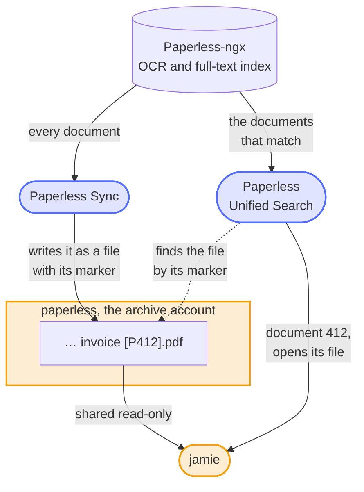
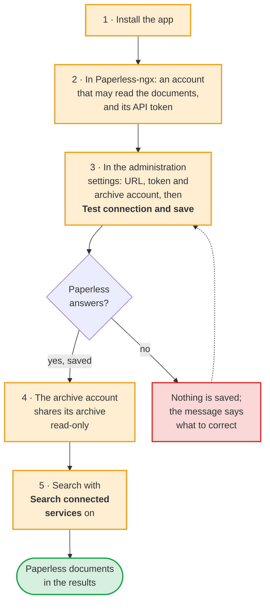
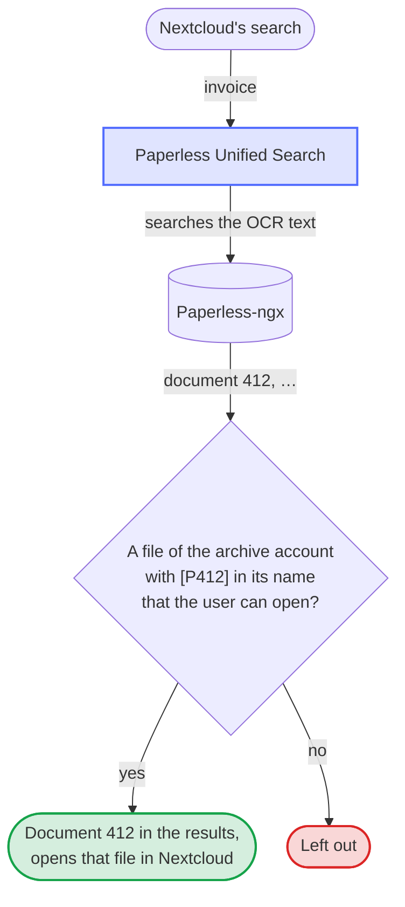
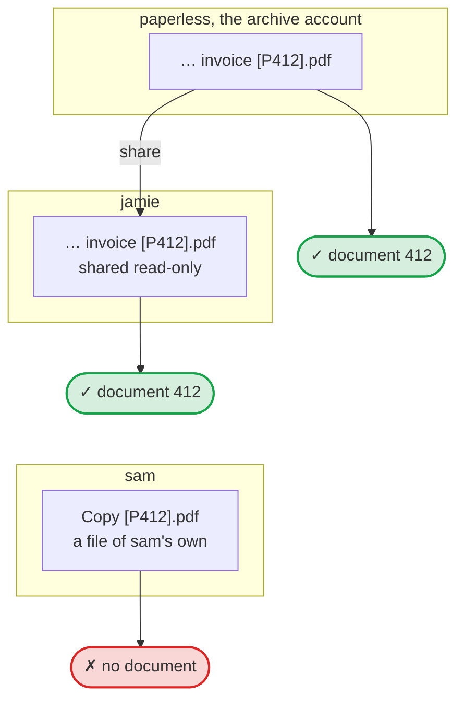

<div align="center">


# Paperless Unified Search

**Find Paperless-ngx documents by the words inside them, right in Nextcloud's search.**

[](https://github.com/Dennis-Otto/paperless-unified-search/releases/latest)
[](https://apps.nextcloud.com/apps/paperless_unified_search)
[](#requirements)
[](https://github.com/Dennis-Otto/paperless-unified-search/actions/workflows/ci.yml)
[](LICENSE)

</div>

Paperless Unified Search brings Paperless-ngx OCR and full-text search into Nextcloud's global search, without Elasticsearch, a second index or another container: Paperless answers, Nextcloud decides who sees the file. Search results open the matching synchronized file directly in Nextcloud's viewer.


<sub>The search of files finds the two invoices by their names. Paperless also finds the home insurance renewal: its text says "invoice", its name doesn't.</sub>

<!-- --8<-- [start:two-apps] -->

Two apps, one archive: [Paperless Sync](https://github.com/Dennis-Otto/paperless-sync) writes every document of Paperless-ngx as a file of one Nextcloud account, the archive account, with the marker `[P<ID>]` in its name. Paperless Unified Search asks Paperless for the documents that match a search and shows each one to whoever can open its file.



<!-- --8<-- [end:two-apps] -->

Paperless Sync is the companion, not a must: [any synchronization](#works-with-any-synchronization) that writes the files with their marker into the archive account works as well, Paperless-ngx's own file names included.

The [documentation website](https://dennis-otto.github.io/paperless-unified-search/) has this documentation as a guide, together with a comparison with the alternatives, the architecture, the security design and the roadmap.

<sub>💛 Like it? [Rate it in the App Store](https://apps.nextcloud.com/apps/paperless_unified_search) or [support its development](https://github.com/sponsors/Dennis-Otto).</sub>

[Why](#why-paperless-unified-search) · [Quick start](#quick-start) · [Compare](docs/compare.md) · [Architecture](https://github.com/Dennis-Otto/paperless-unified-search/blob/main/docs/architecture.md) · [Security design](https://github.com/Dennis-Otto/paperless-unified-search/blob/main/docs/security.md) · [Roadmap](https://github.com/Dennis-Otto/paperless-unified-search/blob/main/docs/roadmap.md) · [Releases](https://github.com/Dennis-Otto/paperless-unified-search/blob/main/docs/releases.md) · [Changelog](https://github.com/Dennis-Otto/paperless-unified-search/blob/main/CHANGELOG.md)

## Why Paperless Unified Search

<!-- --8<-- [start:why] -->

Paperless-ngx has already recognized the text of every document and keeps an index of its words. Paperless Unified Search asks that index whenever someone searches in Nextcloud, instead of building another one:

- **No second index, no second OCR.** No Elasticsearch, no extra container and no copy of the text in Nextcloud. What Paperless finds, Nextcloud's search finds, as soon as the file of the document is in Nextcloud.
- **Nextcloud decides who sees what.** A result appears only for someone who can open its file in Nextcloud, so the shares you already have are the permissions. Nobody needs an account in Paperless.
- **Results open where people work.** In Nextcloud's viewer in the browser and in the Nextcloud apps for iOS and Android, ready to share, download or comment on.
- **The search of Paperless, not a copy of its words.** Its ranking, its highlights and its query syntax, such as `correspondent:acme` or `created:[2024 to 2025]`, which also look at the correspondent, the type and the tags of a document.

<!-- --8<-- [start:comparison] -->

The table sets it beside the other ways to find Paperless documents from Nextcloud, as of October 2026. Every way but the web UI of Paperless needs the documents as files in Nextcloud, such as those of Paperless Sync.

| | Searches the OCR text | Nextcloud's shares decide who sees a result | Opens in Nextcloud's viewer and mobile apps | Extra infrastructure | Keeps a second index |
| --- | --- | --- | --- | --- | --- |
| **Paperless Unified Search** | **Yes, in the index of Paperless** | **Yes** | **Yes** | **None** | **No** |
| [Full text search](https://apps.nextcloud.com/apps/fulltextsearch) with Elasticsearch | Only in files with a text layer | Yes | Yes | An Elasticsearch server | Yes |
| [Workflow OCR](https://apps.nextcloud.com/apps/workflow_ocr) | No search of its own: it adds a text layer for another search | — | — | OCRmyPDF, or its backend container | No, but the search it feeds does |
| [Paperless integration](https://apps.nextcloud.com/apps/integration_paperless) | No search: it sends files to Paperless | — | — | None | No |
| [Context Chat](https://apps.nextcloud.com/apps/context_chat) | Only in files with a text layer, as answers to questions | Yes | Its answers link to the files | AppAPI, its backend container and a language model | Yes, of vectors |
| [Findling](https://apps.nextcloud.com/apps/findling) | Yes, with an OCR of its own | Yes | Yes | AppAPI and its backend container | Yes, of words and of vectors |
| The web UI of Paperless-ngx | Yes | No: accounts and permissions of Paperless | No: documents open in Paperless | None | No |

<!-- --8<-- [end:comparison] -->
<!-- --8<-- [end:why] -->

The [comparison](docs/compare.md) explains each of them, and when another one is the better choice.

<!-- --8<-- [start:quick-start-section] -->

## Quick start

<!-- --8<-- [start:quick-start] -->

1. Install **Paperless Unified Search** from the [Nextcloud App Store](https://apps.nextcloud.com/apps/paperless_unified_search) under *Apps*, or with `occ app:install paperless_unified_search`.
2. In Paperless-ngx, create an account that may read the documents to search, and an API token for it.
3. In Nextcloud, open **Administration settings → Paperless Unified Search**, enter the Paperless URL and the token, and select **Test connection and save**. With [Paperless Sync](https://github.com/Dennis-Otto/paperless-sync) installed, the account it writes the archive with is the **Archive account**; otherwise enter the account that owns the synchronized files.
4. As the archive account, share the archive read-only with the users who may find its documents, as any folder in Nextcloud. The archive account itself finds them all.
5. Search in Nextcloud, switch on **Search connected services** and look under **Paperless documents**. A result appears for every document whose synchronized file you can open: a file of the archive account with `[P<ID>]` in its name, your own if you are that account, or one it shared with you. [Paperless Sync](https://github.com/Dennis-Otto/paperless-sync) creates such files.



<!-- --8<-- [end:quick-start] -->

[Configuration](#configuration) and [Usage](#usage) have the details.

<!-- --8<-- [end:quick-start-section] -->

## Screenshots

Each screenshot below but those of the phone has a dark version, which a dark theme shows; the animation at the top is light only.

### Paperless results in Nextcloud's global search

<picture>
  <source media="(prefers-color-scheme: dark)" srcset="https://github.com/Dennis-Otto/paperless-unified-search/raw/main/screenshots/01-unified-search-dark.png">
  
</picture>

### A search result opened in Nextcloud's PDF viewer

<picture>
  <source media="(prefers-color-scheme: dark)" srcset="https://github.com/Dennis-Otto/paperless-unified-search/raw/main/screenshots/02-nextcloud-pdf-viewer-dark.png">
  
</picture>

### On a phone

<p>
  
  
</p>

Nextcloud in the browser of a phone. The Nextcloud apps for iOS and Android open a result in their own viewer.

### Secure server-side administration

<picture>
  <source media="(prefers-color-scheme: dark)" srcset="https://github.com/Dennis-Otto/paperless-unified-search/raw/main/screenshots/03-admin-settings-dark.png">
  
</picture>

### Problems of the search

<picture>
  <source media="(prefers-color-scheme: dark)" srcset="https://github.com/Dennis-Otto/paperless-unified-search/raw/main/screenshots/06-search-problems-dark.png">
  
</picture>

The end of the settings counts the failed searches and the requests that only their second try answered, and lists the latest of them with their errors, also where the hoster keeps the log of Nextcloud from administrators.

<!-- --8<-- [start:how-it-works] -->

## How it works



1. Nextcloud forwards an enabled external-search query to Paperless-ngx.
2. Paperless returns results from its native OCR/full-text index, with only the fields that a result shows: not the whole OCR text of each document, only the excerpt around the term.
3. The app maps each Paperless document ID to a synchronized file of the archive account whose name contains the unique marker `[P<ID>]`, for example `[P123]`, with one search of Nextcloud's file cache for all documents of a page. The archive account is the one that owns the synchronized files: the account of Paperless Sync, or the one of the settings.
4. A result is returned only if the current Nextcloud user can access that file: the archive account itself, or a user it shared the file with. A file with the marker in its name that belongs to another account stands for no document.
5. A page of results holds as many results as Nextcloud asks for while Paperless has more: when documents that the user can't open rank first, the app asks Paperless for its next pages, up to four pages of 25 hits per search, so that Paperless results still show and **Load more results** keeps working.
6. Selecting a result opens the synchronized file in Nextcloud, not Paperless. Browsers use Nextcloud's
   `/f/{fileId}` viewer route. The official iOS app receives its native `nextcloud://open-file` deep link,
   while Android receives the file ID and user-relative path required by its in-app viewer.

Who sees document 412, when `paperless` is the archive account and has shared its archive with `jamie`:



This app does not synchronize documents itself. The companion app [Paperless Sync](https://github.com/Dennis-Otto/paperless-sync) does, natively and with settings of its own, and [any other synchronization](#works-with-any-synchronization) that writes the marker into the file names works as well. Both apps use the same stable `[P<ID>]` marker and are designed to work together without coupling their release cycles.

<!-- --8<-- [end:how-it-works] -->
<!-- --8<-- [start:any-sync] -->

## Works with any synchronization

The search needs one thing from a synchronization: each document of Paperless-ngx as a file of the archive account in Nextcloud, with the marker `[P<ID>]` of the document in the name of the file. [Paperless Sync](https://github.com/Dennis-Otto/paperless-sync) writes such files, with folders by correspondent, type and year, and so can any other way:

1. **Let Paperless put the marker into its file names.** The [file name format](https://docs.paperless-ngx.com/advanced_usage/#file-name-handling) of Paperless has the placeholder `{{ doc_pk }}`, the ID of the document. In the environment of Paperless, such as its `docker-compose.env`:

    ```text
    PAPERLESS_FILENAME_FORMAT={{ created_year }}/{{ correspondent }}/{{ title }} [P{{ doc_pk }}]
    ```

    Paperless then stores document 412 as `2026/ACME/Invoice [P412].pdf`. Its command [`document_renamer`](https://docs.paperless-ngx.com/administration/#renamer) renames the documents it already has, and each [storage path](https://docs.paperless-ngx.com/advanced_usage/#storage-paths) of Paperless needs the marker as well.

2. **Copy the files to the archive account, one way, from Paperless to Nextcloud.** The folder `media/documents/archive` of Paperless holds the PDFs with their recognized text, `media/documents/originals` the files as they came in.

    - **rclone**, or another WebDAV client, on a timer or in a container next to Paperless, with an [app password](https://docs.nextcloud.com/server/latest/user_manual/en/session_management.html#managing-devices) of the archive account `paperless`:

        ```sh
        rclone config create nextcloud webdav vendor=nextcloud \
          url=https://cloud.example.com/remote.php/dav/files/paperless/ \
          user=paperless pass=app-password --obscure
        rclone sync /path/to/paperless/media/documents/archive nextcloud:Paperless
        ```

    - **The Nextcloud desktop client**, signed in as the archive account, on a copy of the folder rather than the folder itself: it syncs both ways, and Paperless loses track of a file that is moved or deleted in its media folder.
    - **An external storage** with the files, mounted for the archive account alone and shared from there. A mount can't be shared until **Enable sharing** is switched on in its options, behind the gear of the storage under *External storage* in the administration settings. Nextcloud's search finds only the files it has scanned, so let a timer run `occ files:scan` for the storage. On a storage mounted for every user, each user owns the files they see there, and such a file stands for no document.

3. **Share the archive read-only** with the users who may find its documents, and enter the archive account in the settings, as in the [quick start](#quick-start).

<!-- --8<-- [end:any-sync] -->
<!-- --8<-- [start:requirements] -->

## Requirements

- Nextcloud 33 through 35
- PHP 8.2 or newer as supported by the corresponding Nextcloud release
- A reachable Paperless-ngx instance with API access
- Synchronized files whose names contain `[P<ID>]`, owned by one Nextcloud account, the archive account, and shared read-only with the users who may see them, for example those of Paperless Sync or of [any other synchronization](#works-with-any-synchronization). Without them, the search shows no Paperless documents.

<!-- --8<-- [end:requirements] -->
<!-- --8<-- [start:configuration] -->

## Configuration

1. Create a dedicated Paperless account with the minimum read permissions required for document search.
2. Create an API token for that account.
3. In Nextcloud, open **Administration settings → Paperless Unified Search**.
4. Enter the Paperless base URL and API token.
5. Under **Archive account**, enter the Nextcloud account that owns the synchronized files, or leave it blank to use the account that Paperless Sync writes the archive with. The settings store the ID as Nextcloud spells it, whatever its case, and warn when the account doesn't exist.
6. Optionally enable **Always include Paperless in global search** to treat the configured Paperless server as trusted.
7. Select **Test connection and save**. Nextcloud asks for your password when you haven't confirmed it in the last 30 minutes, as for its own settings of this kind; so does **Disconnect**.

Leave the token blank to keep the stored one. The stored token goes only to the Paperless server it was saved for: when the URL names another server, with another scheme, host or port, the settings ask for the token again, so that the token never reaches a server it wasn't meant for. Another path on the same server keeps it. When Nextcloud can no longer decrypt the stored token, as after a move or a restore with another `secret` in `config.php`, the settings say so and ask for it again, and until then the search shows no Paperless documents.

The configuration is global. Access control remains user-specific because the app discards every Paperless hit for which the searching Nextcloud user can't open a matching file of the archive account. Share the archive read-only with the users who may see its documents. Without an archive account, the search shows no Paperless documents.

When Paperless documents are missing from the search, look at **Search problems** at the end of the settings. A failed search shows the users no Paperless documents and no error, and a request to Paperless that gets no answer at all, as when the connection fails, is sent a second time before the search gives up. The settings count both, the failed searches and the requests that only their second try answered, and list the latest 20 with the time, the step, asking Paperless or looking for the files in Nextcloud, the kind and the message of the error and how long it took, along with since when searches work again after the last failure. This helps where the hoster keeps the log of Nextcloud from administrators. **Clear history** and **Disconnect** forget the history; saving the settings keeps it.

By default, Nextcloud's search in the browser asks Paperless only after the user enables **Search connected services**. When the trusted-service option is enabled, every global search term from every Nextcloud user is sent to Paperless automatically and the connected-services switch no longer controls this provider. Reload Nextcloud after changing this option.

<!-- --8<-- [end:configuration] -->
<!-- --8<-- [start:usage] -->

## Usage

Open Nextcloud's global search, enable **Search connected services**, and select **Paperless documents**. Nextcloud 32 and later disable external providers after a page reload, so this switch must be enabled again unless an administrator has enabled trusted-service mode.

Documents without a synchronized `[P<ID>]` file of the archive account are intentionally omitted. This also keeps Inbox-only documents out of Nextcloud search when the synchronization process does not export them.

<!-- --8<-- [end:usage] -->
<!-- --8<-- [start:search-syntax] -->

## Search like in Paperless

Nextcloud hands the words of a search to Paperless-ngx as they are typed, so its [search syntax](https://docs.paperless-ngx.com/usage/#document-searches) works in Nextcloud too. Without it, Paperless finds the documents that contain every word, in the text, the title, the correspondent, the type or the tags:

| Search for | Finds |
| --- | --- |
| `invoice 2025` | Documents with both words, in any order |
| `"home insurance"` | The exact phrase |
| `insur*` | Words that begin with `insur` |
| `invoice NOT draft` | Invoices without the word *draft*; the operators are written in capitals |
| `correspondent:acme` | Documents of the correspondent ACME |
| `type:invoice tag:unpaid` | Unpaid invoices, by their type and their tag |
| `created:[2024 to 2025]` | Documents created from 2024 to 2025 |
| `added:yesterday` | Documents that Paperless received yesterday |

A field or a quote that is still being typed, such as `tag:` alone, can find nothing; the results come once the search is complete. Each result is still a document whose file the searching user can open.

<!-- --8<-- [end:search-syntax] -->
<!-- --8<-- [start:scripts] -->

## Use it from scripts and AI assistants

The search is also an API: Nextcloud's OCS search API answers with the same results that its search shows, for the user who asks and the files that user can open. A script, an automation or an AI assistant that can send HTTP requests uses it with an [app password](https://docs.nextcloud.com/server/latest/user_manual/en/session_management.html#managing-devices) of a user:

```sh
curl -u jamie -H 'OCS-APIRequest: true' \
  'https://cloud.example.com/ocs/v2.php/search/providers/paperless_unified_search_documents/search?term=invoice&format=json'
```

curl asks for the app password, which keeps it out of the history of the shell; a script hands it over in a file with `--netrc-file`. The answer, shortened:

```json
{
  "ocs": {
    "meta": { "status": "ok", "statuscode": 200, "message": "OK" },
    "data": {
      "name": "Paperless documents",
      "isPaginated": false,
      "entries": [
        {
          "title": "Home insurance renewal",
          "subline": "2026-03-02 · … the premium is due with this invoice …",
          "resourceUrl": "https://cloud.example.com/f/1234",
          "attributes": { "fileId": "1234", "path": "/Archive/2026/Home insurance renewal [P412].pdf" }
        }
      ],
      "cursor": null
    }
  }
}
```

Each entry names the document, a line of its text that matches, the link that opens its file and the file's ID and path for that user. `limit` sets how many documents Paperless is asked for per page, 5 by default and up to 50. A page can hold fewer results, even none, when the user can't open the files of some documents, so keep asking with `cursor` set to the `cursor` of the answer while `isPaginated` is `true`. The switch **Search connected services** belongs to the search in the browser; the API asks Paperless without it.

Give an assistant the app password of a user who sees only what it may read, and revoke the app password in the personal security settings once the assistant no longer needs it.

<!-- --8<-- [end:scripts] -->
<!-- --8<-- [start:security-and-privacy] -->

## Security and privacy

- The Paperless API token is stored only in Nextcloud's server-side credentials manager.
- The token is never returned to browser JavaScript or rendered into HTML.
- The token is sent only to the Paperless server it was saved for; a URL with another scheme, host or port needs it entered again.
- Saving the settings and disconnecting ask for the administrator's password when it wasn't confirmed in the last 30 minutes.
- Search results are filtered through the current user's Nextcloud filesystem view.
- The settings show administrators the history of the problems of the search without the API token, the search term or the query of any URL.
- Search terms are sent server-to-server only when connected-services search or trusted-service mode is enabled, or when a client asks this search by its ID through the API.
- Administrators can explicitly trust the configured Paperless server to include it automatically in every user's global searches.
- No deployment credentials, private hostnames, internal addresses, or instance configuration belong in this repository.
- Gitleaks scans every push and pull request.
- Dependency Review blocks newly introduced vulnerable or unapproved dependencies.
- Psalm analyzes the PHP code and CodeQL scans the JavaScript on every pull request.
- Every release includes an SPDX SBOM, a detached signature, and public Sigstore build provenance.
- OpenSSF Scorecard audits the repository's supply-chain security every week.

See [SECURITY.md](https://github.com/Dennis-Otto/paperless-unified-search/blob/main/SECURITY.md) for reporting security issues.

<!-- --8<-- [end:security-and-privacy] -->

**Trust:**
[](https://github.com/Dennis-Otto/paperless-unified-search/actions/workflows/e2e.yml)
[](https://github.com/Dennis-Otto/paperless-unified-search/actions/workflows/secret-scan.yml)
[](https://github.com/Dennis-Otto/paperless-unified-search/actions/workflows/codeql.yml)
[](https://github.com/Dennis-Otto/paperless-unified-search/actions/workflows/sbom.yml)
[](https://scorecard.dev/viewer/?uri=github.com/Dennis-Otto/paperless-unified-search)
[](https://www.bestpractices.dev/projects/14256)
[](https://api.reuse.software/info/github.com/Dennis-Otto/paperless-unified-search)

## Development

Install the dependencies and run every check of the CI; the dev container in `.devcontainer/` has the tools ready:

```bash
composer install
bash scripts/check.sh
```

`scripts/check.sh` checks Composer, `appinfo/info.xml` against the schema of the App Store, PHP syntax, the coding standard, Psalm, PHPUnit, the package that krankerl builds with `scripts/check-package.sh`, and, with `scripts/check-project.sh`, the JavaScript, the translations, the pictures of the README, a description of its own for every page of the website, and that every diagram runs from top to bottom with a title and a description for screen readers.

The production archive intentionally excludes tests, release tools, Composer development dependencies, screenshots, and repository metadata. Packaging uses [Krankerl](https://github.com/ChristophWurst/krankerl), and `scripts/check-package.sh` validates the finished archive.

### Docker end-to-end tests

The Docker suite starts a clean Nextcloud instance with the app mounted as a Custom App and a deterministic Paperless API mock. It exercises the real OCS search endpoint, user-specific file access, trusted-service metadata, and browser/iOS/Android result contracts.

```bash
bash tests/e2e/run.sh       # one Nextcloud version
bash tests/e2e/run-all.sh   # every supported version at the same time, as the CI does
```

In the CI, the required check `nextcloud` runs the tests against every supported version in one job. A pull request that changes no file the tests cover, such as one that changes only the documentation, passes it in seconds without running them. Set `KEEP_E2E=1` to leave the containers running for inspection. See [the mobile test matrix](https://github.com/Dennis-Otto/paperless-unified-search/blob/main/tests/e2e/MANUAL_MOBILE_TESTS.md) for the final checks performed with official clients.

### Screenshots

The screenshots and the animation in `screenshots/` come from a script, so that they show what users see. After a change of the interface, take them again:

```bash
bash scripts/screenshots.sh
```

It starts the Docker suite under a project of its own with a demo: the archive account `paperless`, whose synthetic documents are shared read-only with `jamie`, and a Paperless mock that finds three of them for "invoice". Chromium then searches, opens a result and saves the settings, light and dark, on a phone and as an animation. Set `KEEP_SCREENSHOTS=1` to look around in the demo afterwards.

See [CONTRIBUTING.md](https://github.com/Dennis-Otto/paperless-unified-search/blob/main/CONTRIBUTING.md) before opening a pull request.

### Releases

The protected `main` branch requires the checks of the CI, the Docker end-to-end tests against every supported Nextcloud version, the dependency review, CodeQL, the secret scan, the licenses of every file (REUSE), the sign-off of every commit and a Conventional Commit title. Dependabot keeps the dependencies current; routine updates merge on their own once every check passes.

The release bot keeps a pull request for the next release. Its version follows from the titles of the merged pull requests, and what they wrote under *Unreleased* in `CHANGELOG.md` becomes its notes. Merging it publishes the release: the package, checked before and after signing with the app's certificate, its detached signature, an SPDX SBOM and signed build provenance, then the same package in the Nextcloud App Store, verified afterwards as users can verify it. See [the release guide](https://github.com/Dennis-Otto/paperless-unified-search/blob/main/docs/releases.md).

Project decisions and support expectations are documented in [GOVERNANCE.md](https://github.com/Dennis-Otto/paperless-unified-search/blob/main/GOVERNANCE.md), [SUPPORT.md](https://github.com/Dennis-Otto/paperless-unified-search/blob/main/SUPPORT.md), and [CODE_OF_CONDUCT.md](https://github.com/Dennis-Otto/paperless-unified-search/blob/main/CODE_OF_CONDUCT.md).

## License

AGPL-3.0-or-later. See [LICENSE](https://github.com/Dennis-Otto/paperless-unified-search/blob/main/LICENSE).
