# Architecture

[← README](https://github.com/Dennis-Otto/paperless-unified-search) · [Security design](security.md) · [Roadmap](roadmap.md) · [Releases](releases.md)

Paperless Unified Search is a Nextcloud app in PHP. It adds a provider to Nextcloud's unified search that asks Paperless-ngx and shows the documents whose synchronized files the searching user can read, and offers the same search in the smart picker of Talk, Text, Deck and Mail. It stores no documents and no index of its own, and has no server, daemon or port of its own.

## Components

<picture>
  <source media="(prefers-color-scheme: dark)" srcset="images/diagrams/the-components.dark.svg">
  
</picture>

| Component | Files | What it does |
| --- | --- | --- |
| App | `lib/AppInfo/`, `lib/Migration/`, `appinfo/info.xml` | Registers the search provider, the reference provider, the setup check and the dashboard widget with Nextcloud under the one ID of the app in `AppConstants`, names the commands of occ, and names the repair step that Nextcloud runs after every update, which deletes the keys of the app configuration that version 0.3.0 left |
| Search provider | `lib/Search/PaperlessSearchProvider.php`, `lib/Search/PaperlessPager.php` | Answers a search of Nextcloud: asks Paperless, keeps the results with a readable file, fills the page of results from as many pages of Paperless as it takes, within a budget, and builds each entry with the preview of its file or the icon of its type, its title, a line with its date in the language of the user, its correspondent, its type and an excerpt as text without a tag, and the link that opens the file in the browser, the iOS app or the Android app |
| Dashboard widget | `lib/Dashboard/RecentDocumentsWidget.php`, `lib/Service/RecentDocuments.php` | *New in Paperless* on Nextcloud's dashboard: the documents that Paperless added last, from Nextcloud's distributed cache for a minute for all users, of which each user sees those whose file they can open, with the same picture, names and rules as a result of the search ([The dashboard](#the-dashboard)) |
| Pictures and text | `lib/Service/FilePictures.php`, `lib/Service/PlainText.php` | The preview of a file or the icon of its type, and text of Paperless on one line without a tag of HTML, the same for a result of the search and an item of the dashboard |
| Names | `lib/Service/PaperlessNames.php` | Names the correspondents and the types of the documents of a page, which Paperless sends as IDs: from Nextcloud's distributed cache for ten minutes, and the others with one request per kind; a lookup that fails leaves the names out and fails nothing |
| Reference provider | `lib/Reference/PaperlessReferenceProvider.php` | Lists *Paperless documents* in the smart picker with the icon of the app and names the search provider, through which the picker searches; it resolves no link, so that Nextcloud renders the inserted link of a file with the permissions of whoever reads it |
| Paperless client | `lib/Service/PaperlessApiService.php` | Sends the search term to the full-text search of Paperless through Nextcloud's HTTP client, asks only for the fields that a result shows, and checks the shape of the answer; asks for the names of correspondents and types by their IDs, and for the newest documents of the dashboard; after a test of the connection, asks `/api/ui_settings/` what the account of the token may do, for the warnings about it |
| File locator | `lib/Service/NextcloudFileLocator.php`, `lib/Search/Files/` | Finds the files of the archive account whose names carry the markers `[P<ID>]` of the documents of a page, in one search of the folders that the searching user can read |
| Configuration | `lib/Service/ConfigService.php`, `lib/Model/PublicConfig.php` | Checks and stores the URL of Paperless, the archive account, the switch *Always include Paperless in global search* and whether users may include Paperless in all their searches; the API token goes to Nextcloud's credentials manager, is read from it once per request and is sent only to the server it was saved for; without an archive account of its own it takes the account of Paperless Sync, and it uses the ID of either as Nextcloud spells it |
| Settings page | `lib/Settings/`, `lib/Controller/SettingsController.php`, `templates/settings.php`, `js/settings.js` | The page under *Administration settings → Paperless Unified Search*, a section of its own: save after a test of the connection, reset, the history of the problems of the search, and *Try a search*, which asks the explainer why a document doesn't show to a user; Nextcloud lets only administrators call its routes and checks the CSRF token of every request |
| Personal settings | `lib/Settings/PersonalSettings.php`, `lib/Settings/PersonalSection.php`, `lib/Controller/PersonalSettingsController.php`, `lib/Service/AlwaysSearch.php`, `templates/personal.php`, `js/personal.js` | The section *Paperless* of the personal settings, while the search shows Paperless documents and the administrators let users choose: the checkbox *Always search my Paperless documents*, stored as the preference `always_search` of the user, which makes the provider no connected service for that user; its route takes every user who signed in, with the CSRF token |
| Commands of occ | `lib/Command/` | `setup`, `test`, `search` and `check` of `occ paperless_unified_search:`: the settings page without a browser, with the token from the standard input or the environment, a test of the connection for monitoring, a search as a user that says why a document doesn't show, and a check of the whole set-up ([occ and the overview](#occ-and-the-overview)) |
| Explainer | `lib/Service/SearchExplainer.php` | Says for each document of a search whether it shows to a user, and with `--explain` or in *Try a search* of the settings why not, with one search of the file cache per question |
| Setup check | `lib/SetupCheck/PaperlessSetupCheck.php` | The state of the search in the overview of the administration settings and in `occ setupchecks`, from what the app stored, without a request to Paperless, with the warnings about the account of the token that the last test of the connection found |
| Problems | `lib/Exception/`, `lib/Service/SettingsMessages.php` | Why a setting can't be saved or a request to Paperless failed, as a code: the settings page and occ name each one with a message of its own in the language of the administrator |
| Translations | `l10n/`, `scripts/check-l10n.mjs` | German in two forms, `de` with *du* and `de_DE` with *Sie*, for PHP and for the browser; the check makes sure that every text of the code has its translation in each, with its placeholders |

## Data flow

<picture>
  <source media="(prefers-color-scheme: dark)" srcset="images/diagrams/the-data-flow-of-a-search.dark.svg">
  
</picture>

1. A user searches in Nextcloud. Nextcloud asks the provider when the user has switched on *Search connected services*, or always when an administrator has marked Paperless as trusted or the user chose *Always search my Paperless documents* in the personal settings (`lib/Service/AlwaysSearch.php`). A client that asks for this search by its ID through Nextcloud's OCS search API, such as a script, gets it without the switch.
2. The provider sends the term to the full-text search of Paperless, for a page of 25 hits, and asks only for the fields that a result shows: the ID, the title, the date, the correspondent and the type of each document, and the excerpt of the text that Paperless found. Without them, Paperless would send the whole OCR text of every document, its notes and its permissions as well, half a megabyte for a long document. A date filter of the search goes along on every page, as `created__date__gte` and `created__date__lte` for the first and the last day of the span: Nextcloud sends each bound as a moment, whose day in the timezone of the user is the day that the user picked. The provider names the filters `since` and `until` to Nextcloud (`IFilteringProvider`); Nextcloud's web search sends its date filter only to such a provider, and lists any other one under *Partial matches*, searched without it.
3. The file locator looks for the files of all documents of the answer at once, in one search of the file cache: the files of the archive account with the marker `[P<ID>]` of one of the documents, in the folders of the searching user. Of several files of a document, the one with the first path counts. A document without such a file is left out, and without an archive account Paperless isn't asked at all. A file that fails to answer costs only its own document, not the whole search, and the log notes how many files failed. When the search then shows no document at all, the history of the diagnostics notes it as a failed search of the files.
4. Each remaining document becomes an entry: the preview of its file or the icon of its type, its title, a line with its date, its correspondent, its type and an excerpt of the text that Paperless found, and the link that opens the file in Nextcloud, as [Drawing a result](#drawing-a-result) describes. The provider takes the hits in the order of Paperless until the page of results holds as many entries as Nextcloud asked for, and asks Paperless for its next page when a page runs out first, as [Filling a page of results](#filling-a-page-of-results) describes.
5. A request to Paperless that fails before it has a connection, because the name of the host doesn't resolve, whether cURL or Nextcloud's own lookup reports it, or the connection is refused or not set up within the 3 seconds to connect, is sent a second time: such failures often pass within a moment. A request that fails later, after 3.5 seconds, had a connection and waited for Paperless in vain, as for a Paperless that hangs while it consumes documents or builds its index anew, and gets no second try, which would make the user wait twice as long and load the struggling Paperless twice. Neither does an address that Nextcloud refuses as one of the local network, nor any answer of Paperless, whatever its status. When the second try gets an answer, the client notes the first error in the history of the diagnostics ([decision 0006](decisions/0006-retry-only-before-a-connection.md)).
6. Paperless 3 refuses a query in its advanced syntax that it can't parse with HTTP 400 and the errors of the field `query`, such as `created:[2026 to` while the user still types the range of dates, and every Paperless refuses a page past the last one with HTTP 404, as when the hits change between two pages of a search. Both answer what the user typed, while Paperless works: on HTTP 400 from Paperless 3 or later, the client asks once more with the same term in the simple mode of the search, the parameter `text`, which takes any input and finds the documents of its words; otherwise the search finds nothing more. Neither writes the history of the diagnostics or ends a failure in it, and the log notes them at the level debug. Paperless 2 never gets `text`, which it ignores, listing all documents. The client knows the version from the headers `X-Version` and `X-Api-Version` of the answers: the test of the connection stores it with the settings, and a search stores it again only when it changed, as after an update of Paperless.
7. A search that still fails returns no results, as an empty search does. The provider logs the kind of error and notes the failure in the history: the time, the step, asking Paperless or looking for the files, the kind and the message of the error, and how long it took. The first search that works afterwards notes when searches work again. When a later page of Paperless fails, the page of results keeps the entries of the pages before it, the log notes the error, and the cursor of the next page of results asks for the failed page again.

<picture>
  <source media="(prefers-color-scheme: dark)" srcset="images/diagrams/what-a-request-to-paperless-ends-in.dark.svg">
  
</picture>

## Filling a page of results

Paperless ranks every document that matches, also those whose files the searching user can't open, so a page of Paperless and a page of results rarely hold the same documents. Nextcloud's web search asks for 5 results, shows a provider only when its answer holds some, and offers *Load more results* only when a page holds as many results as it asked for; then it asks again from the start for 5 more. The apps of Nextcloud ask for the next page with the cursor of the page before. So the provider fills each page:

<picture>
  <source media="(prefers-color-scheme: dark)" srcset="images/diagrams/filling-a-page-of-results.dark.svg">
  
</picture>

- **The cursor is an offset.** It counts the hits of Paperless that the pages before went through, documents without a file among them, so the next page goes on with the first hit that the page before didn't go through, also in the middle of a page of Paperless, without repeating or leaving out a document. `lib/Search/PaperlessPager.php` does this arithmetic. Nextcloud and its apps send the cursor back as they got it.
- **Pages of Paperless have one size.** The provider asks for 25 hits at a time, whatever the limit of the page of results, which cost little since a hit carries only the fields that a result shows and the files of a page take one search.
- **A budget bounds each search.** It asks Paperless for at most 4 pages, 100 hits, and for no further page once it has taken 3 seconds; a page that isn't full then goes back with the cursor, so that the apps can go on. A search pages through the first 10,000 hits; a cursor past them finds nothing and asks Paperless nothing.
- **One search is one search.** However many pages of Paperless it asks for, it counts once in the history of the diagnostics.

## Finding the files

<picture>
  <source media="(prefers-color-scheme: dark)" srcset="images/diagrams/finding-the-files-of-a-page-of-documents.dark.svg">
  
</picture>

The database has no index for a part of a name, so every search of the file cache reads the names of all files that the user can see, on every storage and in every share. One search per page of Paperless keeps that to one such scan per page and at most 4 per keystroke, within the [budget of a search](#filling-a-page-of-results), however many documents a page holds, where a search per document took five in the web search and up to 50 in the apps or after *Load more*. The file locator checks the marker of each file it finds once more, so that `[P1]` never counts for `[P12]`, nor `[p12]` for `[P12]`.

## Diagnostics

Users see no difference between a failed search and one without documents, and some hosters keep the log of Nextcloud from administrators. So the settings page shows the history of the problems of the search under *Search problems*.

<picture>
  <source media="(prefers-color-scheme: dark)" srcset="images/diagrams/the-history-of-the-problems-of-the-search.dark.svg">
  
</picture>

The history is one value of the app configuration of Nextcloud, loaded only when it is needed: a search that works reads it only while a value that Nextcloud holds in memory anyway, `diagnostics_pending`, says that a failure may wait for its recovery. A failure that writes the history removes that value after the history, so that a recovery saved meanwhile can't hide the failure, and the recovery sets it to false before it reads the history. It counts the failed searches and the requests that only their second try answered since it began, and keeps the latest 20 of these events, newest first, each with its time, its kind, its step, the kind and the message of the error and how long it took: for a failed search the whole search, for a second try the first request that got no answer. Only problems write to it, and a search that works writes only once after a failure, so searches that keep working write nothing. Problems of one kind write at most once in 30 seconds: during an outage every keystroke of every user fails, and every write of the app configuration empties Nextcloud's cache of it, so the problems in between only count, in Nextcloud's distributed cache, until the next write or the recovery takes them along. A search that works again doesn't end the 30 seconds, so a Paperless that fails every other request writes one failure and one recovery in them, not one of each per request. A query or a page that Paperless refuses, as one that the user is still typing, is no problem and writes nothing. A search whose files fail to answer and that shows no document counts as failed, since the user sees none; one that still shows the documents of other files works, and only the log notes the files it left out. A search that asks Paperless for several pages counts once, and so does its failure. Two problems at the same moment may keep only one of them, which a history for diagnosis can afford.

The message loses the API token and the search term when it has at least three characters, in any case, also of letters beyond ASCII, `Ärger` for `ärger` as well, by the simple case folding of Unicode, which leaves `STRASSE` for `straße`, cURL's pointer to the page of its error codes, and the query and the fragment of every URL, and is cut to 300 characters. A test of properties checks this on 500 random messages and terms of a fixed seed.

## Drawing a result

<picture>
  <source media="(prefers-color-scheme: dark)" srcset="images/diagrams/what-a-result-shows.dark.svg">
  
</picture>

- **The picture.** An entry links the preview of its file, 64 pixels square, when Nextcloud draws previews of the type of the file, as Nextcloud's search of files does, with `mimeFallback`, so that a preview that fails to draw answers with the icon of the type; for another type, it links the icon of the type, and the icon of the app only when Nextcloud has none. The picture is an absolute URL, which the apps for phones load as well, in the thumbnail of the entry, which every client shows. The icon of the entry stays empty: the smart picker shows an icon in place of the thumbnail, as the name of a class of CSS, which a URL isn't. Nextcloud answers a preview only to a user who can open the file.
- **The date.** It is the day that Paperless names, formatted by Nextcloud in the language of the user, *Aug 12, 2026* or *12.08.2026*, in no other timezone: API versions before 9 send the start of the day in the timezone of Paperless, such as `2026-08-12T00:00:00+02:00`, which the timezone of a user west of it would turn into the day before. A text that is no such day stays as it is.
- **The correspondent and the type.** Paperless sends their IDs. `PaperlessNames` takes the names of the documents with a file from Nextcloud's distributed cache, and asks Paperless for the others with one request per kind, `/api/correspondents/?id__in=3,5` and `/api/document_types/?id__in=1,2`, which Paperless-ngx 2 and 3 filter; the cache keeps each name for ten minutes, an ID that Paperless doesn't name as well, by a hash of the URL of Paperless and the ID. A list that Paperless refuses to the token, with HTTP 401 or 403, stays unasked for as long. The request gets one try within 3 seconds and no place in the history of the diagnostics, and after a request without answer the other kind isn't asked for, and that list not for a minute, so that the searches of every keystroke don't wait for it again: when the names fail, the entries show without them.
- **The excerpt.** It is the excerpt of the text, or else, for a search that matched only a note, the excerpt of the notes, marked *Note:*. Paperless marks up the words of the term with tags, `<b>` in Paperless-ngx 3 and `` in 2, and escapes the text of the document as HTML around them, so the tags go first and the entities become characters again; the excerpt then runs on one line and is cut to 180 characters. A `<` before a letter, `/`, `!` or `?` in the whole line, where a tag would start, gets a space after it: the line holds no tag of HTML, whatever the document says, and keeps its text, where removing the tags after decoding would lose `<GmbH>` and everything after `x<y`. The answers of real Paperless-ngx 3.3.0 and 2.20.13 in `tests/Unit/fixtures/` show the markup, and the unit tests check the line for each of them.

## Opening a result

The link of an entry depends on who searches, which the provider tells from the user agent of the request:

<picture>
  <source media="(prefers-color-scheme: dark)" srcset="images/diagrams/the-link-of-a-result.dark.svg">
  
</picture>

Every entry carries the ID of the file and its path in the folders of the user as well; the Android app opens the file with them.

## The smart picker

The smart picker is the menu that `/` opens in Text and Collectives and that a button opens in Talk, Deck and Mail. It lists the reference providers of the apps; the one of this app, *Paperless documents*, names the search provider, and the picker searches through it as the unified search does, with the same rules of who sees which document:

<picture>
  <source media="(prefers-color-scheme: dark)" srcset="images/diagrams/linking-a-document-from-the-smart-picker.dark.svg">
  
</picture>

The term reaches Paperless only after the user chose *Paperless documents*, so the picker needs no switch like *Search connected services*. The inserted link is the link of the result, `/f/<ID>` of the file, which opens it in Nextcloud's viewer.

## Saving the settings

<picture>
  <source media="(prefers-color-scheme: dark)" srcset="images/diagrams/saving-the-settings.dark.svg">
  
</picture>

A test of the connection that fails names its cause ([decision 0005](decisions/0005-name-the-cause-of-a-failed-connection-test.md)): the Paperless client throws a `PaperlessRequestException` with the reason, from the status of the answer, its content or the error of cURL, and the controller answers HTTP 400 with the code of the reason and a message in the language of the administrator that says what to correct, and logs a warning with the error, without the token and the query of the URL. A setting that can't be saved answers the same way, with the code of its problem. The [README](https://github.com/Dennis-Otto/paperless-unified-search#when-the-test-of-the-connection-fails) lists every message.

*Paperless runs in my local network* lets the test of the connection, and then every search, reach the Paperless URL at an address of the local network, which Nextcloud refuses otherwise, without lifting that protection for anything else ([decision 0004](decisions/0004-local-network-opt-in.md)). A token left blank keeps the stored one, but only for the server it was saved for ([decision 0003](decisions/0003-bind-the-token-to-its-server.md)); the page marks the token field as required as soon as the URL names another server. The archive account is stored as Nextcloud spells its ID. A stored token that the credentials manager can't decrypt counts as none, and the page says so. Saving and *Disconnect* ask for the password when it wasn't confirmed in the last 30 minutes. *Disconnect* deletes every setting, the token included, and the history of the diagnostics as well; saving keeps the history.

The page (`js/settings.js`) shows one sentence for every answer, also when Nextcloud answers instead of the app, as in maintenance mode, after the session ended or behind a proxy, and when the browser gets no answer at all. It reads an answer as JSON only when Nextcloud says that it is JSON, so that the HTML page of an error never becomes the message. Each message has the colour and the icon of its kind, pending, success or error. After a save or *Disconnect*, the page shows the settings as Nextcloud stored them, such as the URL without the slash at its end, and *Disconnect* is on only while a token or a URL is stored.

<picture>
  <source media="(prefers-color-scheme: dark)" srcset="images/diagrams/what-the-settings-page-shows-for-an-answer.dark.svg">
  
</picture>

The Node.js tests in `tests/js/settings.test.mjs` run `js/settings.js` against a stand-in for the page and every kind of answer, and each line and branch of the script runs in one of them; `tests/Unit/Templates/SettingsTemplateTest.php` renders `templates/settings.php` in every state with values that would break out of the page if they weren't escaped.

## occ and the overview

Four commands of `occ` and a setup check serve the administrators who script their set-up or look for the cause of a problem ([decision 0007](decisions/0007-occ-takes-no-token-as-an-argument.md)). `setup` runs what saving the settings runs: it checks the URL, the token and the archive account with the configuration, has the Paperless client test the connection and saves only when Paperless answers, with the messages of the settings page. It takes the token from its standard input or from an environment variable and never from an argument, and an option that is left out keeps its stored value. `test` and `check` test the connection with the stored settings and store the version of the answer, which the overview then shows; `check` also asks the file locator for the IDs of all documents that a file of the archive account in its own folders stands for, in one search of the file cache, and compares them with the IDs that Paperless lists in the field `all` of its answer.

`search` asks Paperless for the first page of hits, as a search does, and has the explainer decide for each document whether it shows to the user. Without `--explain`, that is one search of the file cache, as in the search. With it, each further question costs one more search of the file cache, only for the documents that are still unexplained:

<picture>
  <source media="(prefers-color-scheme: dark)" srcset="images/diagrams/why-a-document-does-not-show.dark.svg">
  
</picture>

*Try a search* of the settings page asks the same questions for the first 20 documents, through the route `POST /settings/try`, for administrators without a shell. Its answer carries the ID, the title and the verdict of each document and nothing more, neither the path nor the owner of a file, and the audit log of the app *Auditing / Logging* (`admin_audit`) records which administrator tried a search as which user, whatever the log level, as does the log of Nextcloud at level info.

The search itself never runs these questions: it keeps its one search of the file cache per page of Paperless, and the explainer's lookups exist only for occ and *Try a search*.

The setup check runs whenever an administrator opens the overview, so it reads only what the app stored: a token that can't be decrypted, the archive account, the history of the problems of the search, the version of the last answer of Paperless and the warnings about the account of the token that the last test of the connection found. It warns, with a link to the settings of the app, when the search can show no Paperless documents for a reason that an administrator corrects, then when the account of the token may change documents or may not view what the results show ([decision 0010](decisions/0010-warn-about-what-the-token-may-do.md)), and passes otherwise, also when the app isn't connected yet, which Nextcloud shows only in `occ setupchecks`.

## The dashboard

<picture>
  <source media="(prefers-color-scheme: dark)" srcset="images/diagrams/the-newest-documents-on-the-dashboard.dark.svg">
  
</picture>

- **Offered where the search works.** The widget is a conditional one (`IConditionalWidget`): Nextcloud asks it, as it builds the dashboard, whether the settings name a Paperless with a token and an archive account that exists, and offers it only then, without a request to Paperless.
- **Items without a script.** It answers version 2 of the dashboard's API (`IAPIWidgetV2`), from which Nextcloud's dashboard draws the widget itself, and which its apps read as well; the icon is the dark one of the app, which the dark theme inverts (`IIconWidget`).
- **One request a minute.** Every request to Paperless carries the token of the settings, so the newest documents are the same for every user: `RecentDocuments` asks Paperless for the 25 that it added last, `ordering=-added`, with only the ID, the title, the moment that Paperless added it and the IDs of the correspondent and the type, and keeps them in Nextcloud's distributed cache for a minute, by a hash of the URL of Paperless. Without a memory cache, Nextcloud gives the app a cache that keeps nothing, so every dashboard asks Paperless, and a failure doesn't rest either. The dashboard waits for the answer, so the request gets one try within 5 seconds and no place in the history of the diagnostics, which is about searches; a Paperless that fails rests for a minute, and the widget says so.
- **What a user may open.** What the cache holds goes through the file locator for each user, in one search of the file cache, as a page of results does: only the documents with a file of the archive account that the user can open become items, at most as many as the dashboard asks for, 7 by default. A new share shows at once; the cache holds no answer of a user.
- **An item is drawn like a result.** The preview of the file or the icon of its type comes from `FilePictures`, the names of the correspondent and the type from `PaperlessNames`, and the line below the title, the day that Paperless added the document, formatted by Nextcloud in the language and the timezone of the user, and the names, goes through `PlainText`, so that it holds no tag of HTML either. The item links the file in Files, and its `sinceId` is the moment that Paperless added the document, after which the dashboard can ask for newer ones. A file that fails to answer costs only its own item.
- **More in Files.** The link opens the files that others share with the user (`IButtonWidget`); the archive account, which owns every file, gets none. Nextcloud's web dashboard draws it only once the list is full, and then shows one item less, six of the seven; the apps and the other clients of the API get the seven items and the link.

## Design decisions

- **Nextcloud decides who sees a file.** The app shows a document only through a file that the searching user can read in Nextcloud, and opens that file, not Paperless.
- **Paperless does the searching.** Its OCR and full-text index answer the search; the app keeps no index of its own.
- **Full pages of results.** Each page of results takes as many pages of Paperless as it needs, within a budget of 4 pages and 3 seconds, so that documents that the user can't open don't hide the others, and *Load more results* of Nextcloud's web search keeps working ([Filling a page of results](#filling-a-page-of-results)).
- **One search of the file cache per page**, for the markers of all its documents, since each search reads the names of all files of the user ([Finding the files](#finding-the-files)). Nextcloud's public API has only the interfaces of such a search, so the app brings its own small classes for it in `lib/Search/Files/`, and never uses Nextcloud's private ones. Nextcloud adds methods to these interfaces even in a maintenance release, and PHP refuses a class that lacks one with a fatal error that no `catch` sees. So before each search the file locator compares the methods of the interfaces with those of its classes, without loading them, and when Nextcloud asks for more, it searches once per document by text, as before, and logs a warning: slower, but every search still answers.
- **The marker `[P<ID>]`** in the file name ties a file of the archive account to its document. [Paperless Sync](https://github.com/Dennis-Otto/paperless-sync) writes such files, and the two apps work together without depending on each other's releases.
- **The owner, not the name, decides.** Only files of the archive account count, because anyone can give a file the marker of a document ([decision 0002](decisions/0002-trust-the-archive-account.md)).
- **Links of the smart picker are links of files.** The app resolves no link of its own: Nextcloud's provider of file links renders the inserted link for each reader with that reader's permissions, so a link reveals no document to a reader who can't open its file.
- **Only a request that never reached Paperless gets a second try**, and a query that Paperless refuses while the user types finds nothing instead of counting as a failure ([decision 0006](decisions/0006-retry-only-before-a-connection.md)). A Paperless that hangs costs one wait per keystroke, not two, and the history shows only real problems.
- **occ takes no token as an argument**, where the history of the shell and the list of processes would show it, and **the overview asks Paperless nothing**, so that it opens as fast as without the app ([decision 0007](decisions/0007-occ-takes-no-token-as-an-argument.md)).
- **External by default.** Like every provider that sends search terms to another server, the app searches Paperless only when the user asks for it, with the switch in the search, the choice of *Paperless documents* in the smart picker or a request for this search through the API, unless an administrator marks Paperless as trusted or the user chose to include it in every search of their own ([decision 0008](decisions/0008-let-each-user-always-search-paperless.md)).
