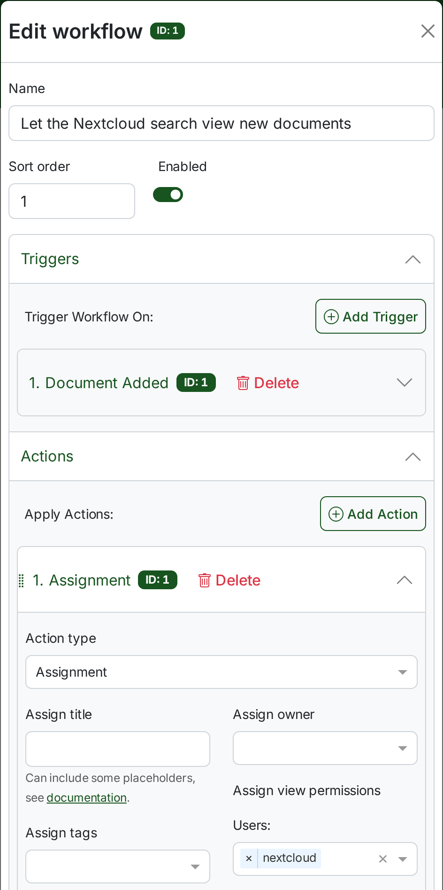
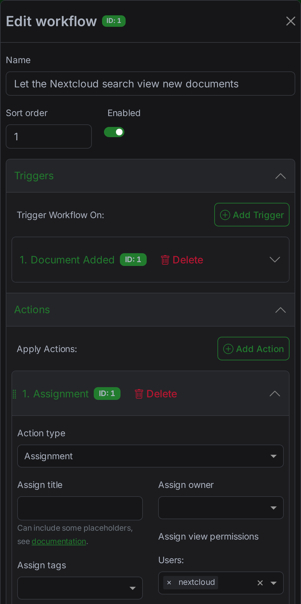
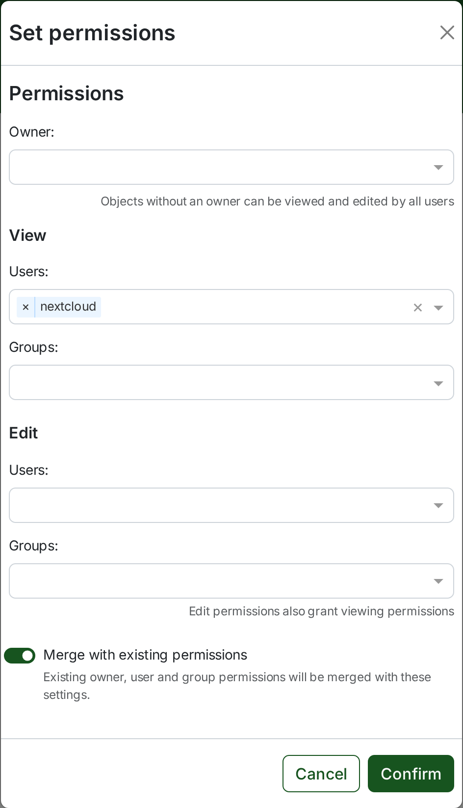
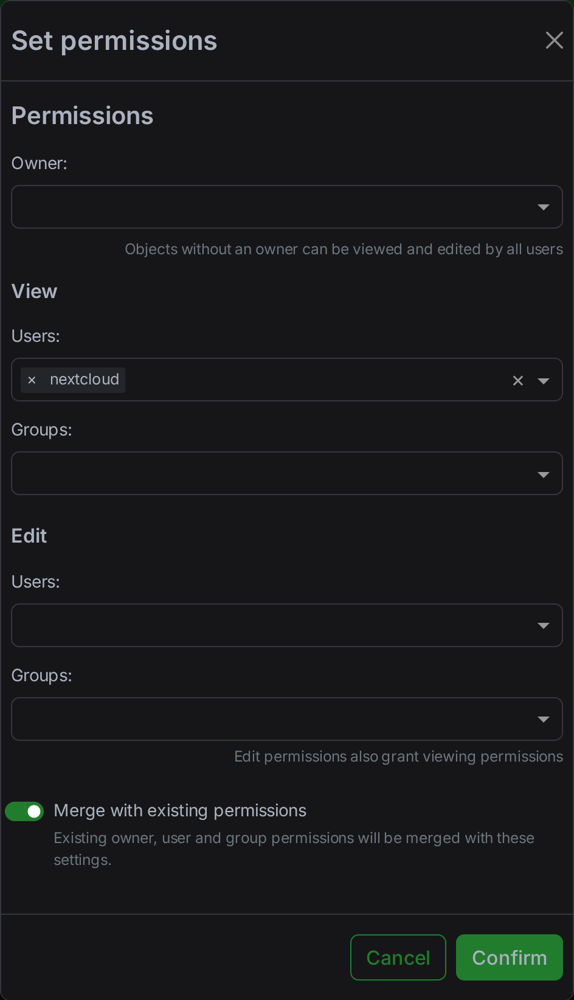
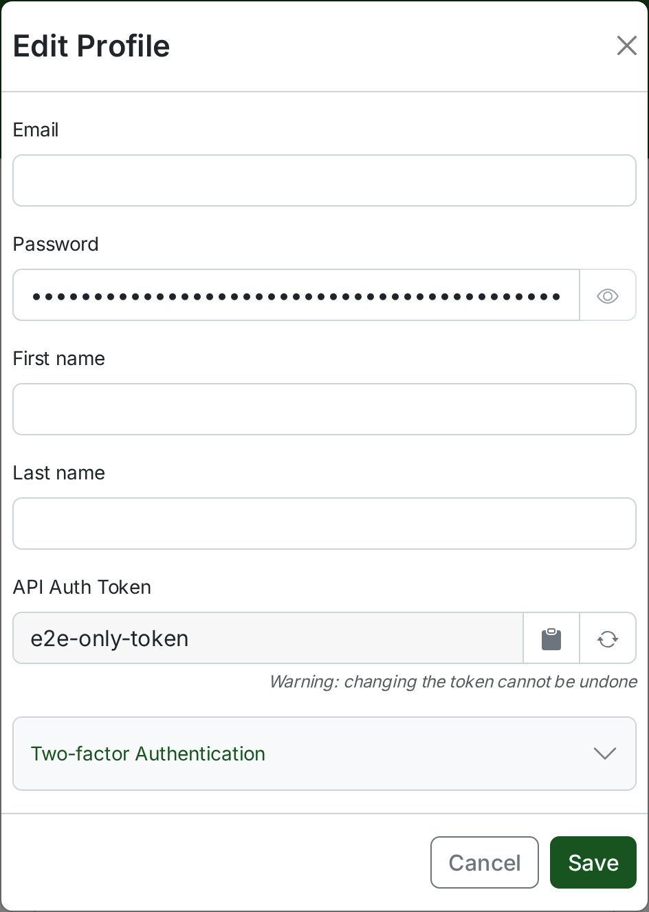
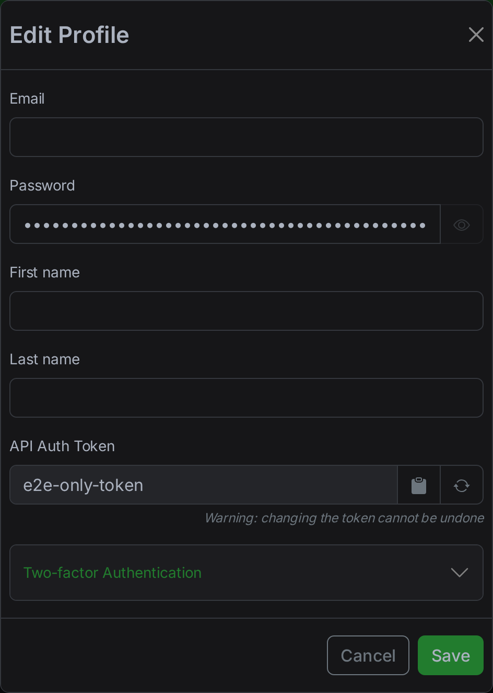
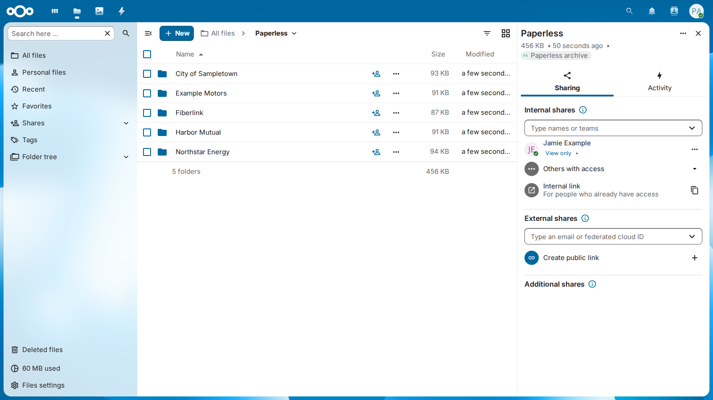
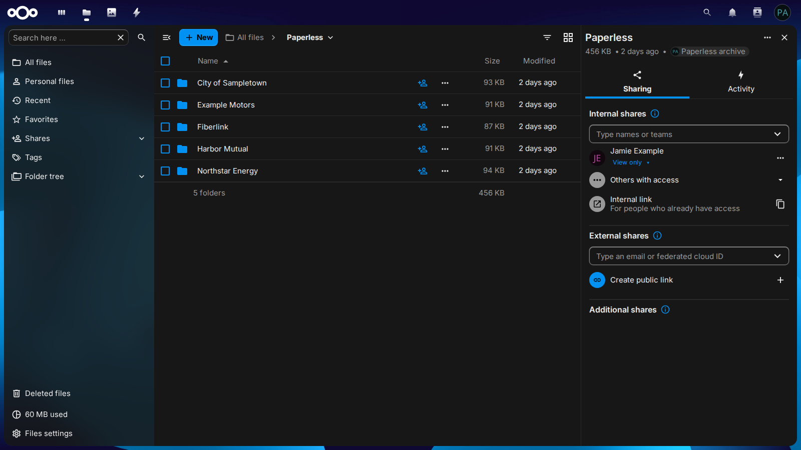
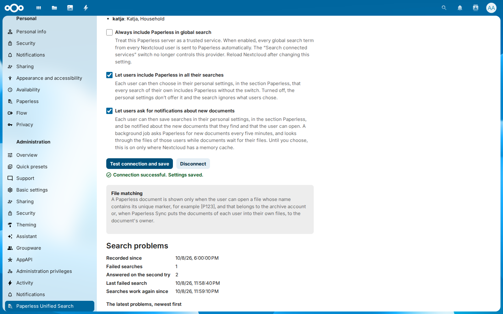
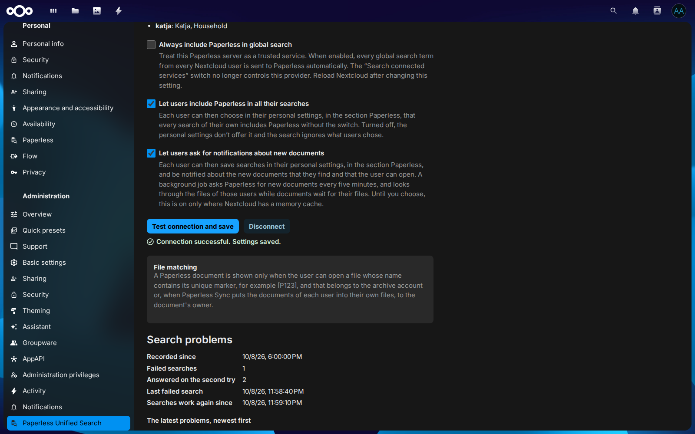

# Einrichten

Drei Dinge lassen Paperless-Dokumente in der Suche von Nextcloud erscheinen: ein Paperless-Konto, das sie ansehen darf und dessen API-Token in die Einstellungen der App kommt; die Dokumente als Dateien eines Nextcloud-Kontos, des Archiv-Kontos; und Freigaben dieses Archivs für die Benutzer, die sie finden dürfen. Diese Seite richtet alle drei ein, sobald die App [installiert](install.de.md) ist.

<picture>
  <source media="(prefers-color-scheme: dark)" srcset="images/diagrams/setting-up-the-search.de.dark.svg">
  
</picture>

<div class="pus-animation" markdown>
<div class="pus-animation__light" markdown="span">![Wohin die Einrichtung führt, in den Einstellungen der App: Suche ausprobieren listet die drei Dokumente auf, die Paperless für invoice findet, jedes für jamie sichtbar. Dann die Einrichtung von Anfang an, im leeren Formular: Die URL http://paperless.lan:8080 wird getippt, Paperless läuft in meinem lokalen Netzwerk wird ausgewählt, das API-Token wird eingefügt und erscheint als Punkte, und das Archiv-Konto paperless wird getippt. Verbindung testen und speichern antwortet Connection successful. Settings saved. Zuletzt listet Suche ausprobieren für invoice als Benutzer jamie die Stromrechnung, die Verlängerung der Hausratversicherung und die Internetrechnung auf.](images/setup.gif)</div>
<div class="pus-animation__dark" markdown="span">![Wohin die Einrichtung führt, in den Einstellungen der App: Suche ausprobieren listet die drei Dokumente auf, die Paperless für invoice findet, jedes für jamie sichtbar. Dann die Einrichtung von Anfang an, im leeren Formular: Die URL http://paperless.lan:8080 wird getippt, Paperless läuft in meinem lokalen Netzwerk wird ausgewählt, das API-Token wird eingefügt und erscheint als Punkte, und das Archiv-Konto paperless wird getippt. Verbindung testen und speichern antwortet Connection successful. Settings saved. Zuletzt listet Suche ausprobieren für invoice als Benutzer jamie die Stromrechnung, die Verlängerung der Hausratversicherung und die Internetrechnung auf.](images/setup-dark.gif)</div>
</div>

<p class="pus-animation__caption">Die Einstellungen der App, vom leeren Formular bis zur ersten Suche. Die Abschnitte unten erklären jeden Schritt.</p>

--8<-- "README.de.md:how-it-works"

## Ein Paperless-Konto für die Suche

Die Suche fragt Paperless mit dem API-Token eines Paperless-Kontos, und Paperless antwortet mit den Dokumenten, die dieses Konto ansehen darf, und keinen anderen. Das Konto setzt also die Grenze dessen, was irgendjemand in Nextcloud finden kann: Ein Dokument, das es nicht ansehen kann, erscheint nie, wer auch immer sucht. Gib der Suche ein eigenes Paperless-Konto, das nur Dokumente ansehen darf, damit ein Token, das in falsche Hände gerät, nichts ändern kann. Die Einstellungen richten es mit einem Klick ein, oder vier Schritte in Paperless tun es, die die Bilder in Paperless-ngx 3 zeigen.

### Mit einem Klick

Öffne unter dem Token **Noch kein Token? Lege das Suchkonto in Paperless an**, gib das API-Token eines Superusers von Paperless ein und wähle **Suchkonto anlegen und speichern**. Die Einstellungen legen dann in Paperless den Benutzer `nextcloud-search` an, der weder **Superuser** noch **Admin** ist und nur Dokumente, Korrespondenten, Dokumenttypen, Tags, Benutzer und seine UI-Einstellungen ansehen darf, mit einem zufälligen Passwort, das niemand erfährt; holen sein API-Token; und speichern damit die Einstellungen, zusammen mit der URL, dem Archiv-Konto und den Schaltern des Formulars, sobald der Test der Verbindung gelingt. Das Token des Superusers richtet nur das Konto ein: Es wird nie gespeichert, protokolliert oder an den Browser zurückgegeben, und es geht nur an die Paperless-URL des Formulars, ohne Weiterleitungen ([Entscheidung 0012](decisions/0012-create-the-search-account-with-a-one-time-superuser-token.md)). Wie beim Speichern fragt Nextcloud nach deinem Passwort, wenn du es in den letzten 30 Minuten nicht bestätigt hast.

Zwei Wahlen, beide anfangs an, sagen, was sich in Paperless sonst ändert. Jede fügt nur das Konto hinzu: Wer etwas ansehen oder ändern darf, behält das.

- **Jedes neue Dokument ansehen lassen** fügt den Workflow *Nextcloud search: view new documents* hinzu, mit dem Auslöser *Dokument hinzugefügt* (*Document Added*) und einer Aktion *Zuweisung* (*Assignment*), die dem Konto die Berechtigung zum Ansehen gibt, wie unter [Seine Dokumente](#seine-dokumente).
- **Alles ansehen lassen, was Paperless hat** fügt das Konto zur Berechtigung zum Ansehen jedes Dokuments, Korrespondenten, Dokumenttyps und Tags von Paperless hinzu, wie es der Massenbearbeiter mit eingeschaltetem **Mit vorhandenen Berechtigungen zusammenführen** (*Merge with existing permissions*) tut.

Einen Benutzer `nextcloud-search`, den Paperless schon hat, lassen die Einstellungen, wie er ist: Speichere die Einstellungen mit seinem Token, oder lösche den Benutzer in Paperless und versuche es erneut. Paperless gibt einen Namen nur einem Workflow, daher bleibt auch ein Workflow *Nextcloud search: view new documents*, wie er ist, etwa der einer früheren Einrichtung, deren Benutzer du gelöscht hast, und die Einrichtung hält an, bevor sie etwas ändert: Lösche auch den Workflow in Paperless, oder schalte **Jedes neue Dokument ansehen lassen** aus. Eine Einrichtung, die auf halbem Weg scheitert, entfernt den Benutzer und den Workflow wieder, damit ein zweiter Versuch von vorn beginnt; lehnt Paperless auch das ab, nennt die Meldung den Benutzer oder den Workflow, der bleibt. Korrespondenten, Typen und Tags, die jemand später in der Weboberfläche von Paperless anlegt, brauchen das Konto weiterhin in den **Standard-Anzeigeberechtigungen** (*Default View Permissions*) dieser Person, wie [unten](#die-namen-von-korrespondenten-typen-und-tags) steht. Paperless übernimmt neue Berechtigungen einen Moment später in den Index seiner Suche, daher findet eine Suche gleich nach der Einrichtung für einige Sekunden womöglich ein paar Dokumente weniger. Paperless-ngx 2 mit seiner Standard-Datenbank SQLite aktualisiert die Dokumente jeder Änderung der Berechtigungen in einer eigenen Aufgabe und lässt eine Änderung, die währenddessen kommt, scheitern; die Einrichtung nimmt diese Änderung dann nach einer Pause erneut vor, bis zu fünfmal innerhalb einer Viertelminute, bevor sie aufgibt. `occ paperless_unified_search:setup --create-account` tut dasselbe in einem Skript ([Die App einrichten](reference.de.md#die-app-einrichten)). Mit **Alles ansehen lassen, was Paperless hat** ändert Paperless die Berechtigungen jedes Dokuments, bevor es antwortet, daher kann die Einrichtung in einem Archiv von Zehntausenden Dokumenten Minuten dauern, länger, als ein Reverse Proxy vor Nextcloud von Haus aus wartet (60 Sekunden bei nginx). Die Seite zeigt dann einen Netzwerkfehler, während die Einrichtung weiterläuft; lade sie neu, bevor du es erneut versuchst, denn das Konto gibt es dann womöglich schon. Nimm für ein solches Archiv `occ`, das kein Proxy abbricht, oder erhöhe die Wartezeit des Proxys.

Die Schritte unten richten dasselbe Konto von Hand ein, für Administratoren, die das Token eines Superusers lieber nicht in Nextcloud eingeben.

### Das Konto

Öffne als Administrator von Paperless **Benutzer & Gruppen** (*Users & Groups*) und füge einen Benutzer hinzu, etwa `nextcloud`, der weder **Superuser** noch **Admin** (*staff*) ist. Gib ihm unter **Berechtigungen** (*Permissions*) **Anzeigen** (*View*) für **Dokument** (*Document*), **Korrespondent** (*Correspondent*), **Dokumenttyp** (*DocumentType*), **Tag** (*Tag*) und **UI-Einstellungen** (*UISettings*) und nichts anderes, wie das Bild bei Schritt 1 der *Konfiguration* weiter unten zeigt. Die Suche liest nichts anderes: Sie fragt nach den Dokumenten zu einem Begriff und von jedem nur nach der ID, dem Titel, dem Datum, den IDs seines Korrespondenten, seines Typs, seiner Tags und seines Eigentümers und dem Ausschnitt um den Begriff; nach den Namen dieser Korrespondenten, Typen und Tags, die die Treffer zeigen; und beim Test der Verbindung danach, was das Konto darf, was Paperless nur einem Konto sagt, das seine UI-Einstellungen ansehen darf. Wenn [Paperless Sync jedem Benutzer die Dokumente gibt, die ihm gehören](troubleshooting.de.md#paperless-sync-gibt-jedem-benutzer-ein-eigenes-archiv), gib ihm auch **Anzeigen** für **Benutzer** (*User*): Die Suche liest dann die Liste der Benutzer von Paperless und behält von jedem nur die ID und den Benutzernamen, die sagen, wessen Dateien für die Dokumente eines Eigentümers stehen. [Was jede Berechtigung der Suche gibt](#was-jede-berechtigung-der-suche-gibt) sagt, was jede von ihnen bewirkt.

### Seine Dokumente

Paperless lässt einen Benutzer seine eigenen Dokumente ansehen, die ohne Eigentümer und die, deren Berechtigungen dem Benutzer oder einer seiner Gruppen das Ansehen erlauben. Dokumente eines anderen Eigentümers, etwa jedes Dokument, das ein Administrator hochlädt, brauchen die Berechtigung zum Ansehen für das Konto oder für eine Gruppe, in der es ist:

- **Neue Dokumente:** Öffne **Workflows** und füge einen Workflow hinzu mit dem Auslöser *Dokument hinzugefügt* (*Document Added*) und einer Aktion *Zuweisung* (*Assignment*), die das Konto oder seine Gruppe unter **Anzeigeberechtigungen zuweisen** (*Assign view permissions*) nennt. Paperless lässt das Konto dann jedes Dokument ansehen, sobald es das Dokument hinzufügt.
- **Die Dokumente, die Paperless schon hat:** Wähle sie in der Liste der Dokumente aus und gib dem Konto mit der Massenbearbeitung unter **Berechtigungen** (*Permissions*) die Berechtigung, sie anzusehen, mit eingeschaltetem **Mit bestehenden Berechtigungen zusammenführen** (*Merge with existing permissions*), das die Berechtigungen behält, die sie schon haben.

<figure markdown="span">
  { width="360" }
  { width="360" }
  <figcaption>Ein Workflow, der das Konto jedes neue Dokument ansehen lässt</figcaption>
</figure>

### Die Namen von Korrespondenten, Typen und Tags

Die Berechtigung, Korrespondenten, Dokumenttypen und Tags anzusehen, wirkt wie die für Dokumente: Das Konto sieht die Namen derer, die ihm gehören, die keinen Eigentümer haben, und derer, die es ansehen darf. Wer einen Korrespondenten, einen Typ oder einen Tag in der Weboberfläche von Paperless anlegt, dem gehört er. Bis das Konto sie ansehen darf, zeigen die Treffer und das Dashboard also keinen Korrespondenten, keinen Typ und keinen Tag. Die Einstellungen warnen davor, wenn die neuesten Dokumente einen nennen, den das Konto nicht sehen kann:

- **Die Korrespondenten, Typen und Tags, die Paperless schon hat:** Öffne **Korrespondenten** (*Correspondents*), wähle alle aus, dann **Berechtigungen** (*Permissions*), füge das Konto unter **Anzeigen** (*View*), **Benutzer** (*Users*) hinzu und wähle **Bestätigen** (*Confirm*) mit eingeschaltetem **Mit bestehenden Berechtigungen zusammenführen** (*Merge with existing permissions*). Mach dann dasselbe unter **Dokumenttypen** (*Document types*) und **Tags** (*Tags*).
- **Neue:** Jeder Administrator von Paperless fügt das Konto unter **Einstellungen** (*Settings*), **Berechtigungen** (*Permissions*), **Standard-Anzeigeberechtigungen** (*Default View Permissions*), **Benutzer** (*Users*) hinzu. Paperless lässt es dann jeden Korrespondenten, jeden Typ und jeden Tag ansehen, den er in der Weboberfläche anlegt.

<figure markdown="span">
  { width="360" }
  { width="360" }
  <figcaption>Die Korrespondenten, die Paperless schon hat, zum Ansehen für das Konto</figcaption>
</figure>

### Sein Token

Melde dich als das Konto bei Paperless an, öffne **Mein Profil** (*My Profile*) im Menü des Kontos und lege das Token mit dem Knopf neben **API Auth Token** an; der Knopf davor kopiert das Token. Ein Administrator von Paperless kann es auch in der Django-Verwaltung von Paperless unter `/admin/` bei *Auth Token* für das Konto anlegen.

<figure markdown="span">
  { width="360" }
  { width="360" }
  <figcaption>Das API-Token des Kontos, in Mein Profil</figcaption>
</figure>

### Was jede Berechtigung der Suche gibt

| Berechtigung des Kontos | Was die Suche damit tut | Ohne sie |
| --- | --- | --- |
| **Anzeigen** für **Dokument** | Findet die Dokumente, die das Konto ansehen darf, mit den Worten um den Begriff, auch die, deren Notiz den Begriff hat, etwa `notes:transfer` | Paperless lehnt das Token ab, und der Test der Verbindung schlägt fehl |
| **Anzeigen** für **Korrespondent** | Zeigt den Korrespondenten jedes Treffers und jedes Dokuments im Dashboard, wenn das Konto diesen Korrespondenten ansehen darf | Kein Korrespondent in den Treffern und im Dashboard, und die Einstellungen warnen |
| **Anzeigen** für **Dokumenttyp** | Zeigt den Typ jedes Treffers und jedes Dokuments im Dashboard, wenn das Konto diesen Typ ansehen darf | Kein Typ in den Treffern und im Dashboard, und die Einstellungen warnen |
| **Anzeigen** für **Tag** | Zeigt bis zu zwei Tags jedes Treffers und jedes Dokuments im Dashboard, von denen, die das Konto ansehen darf, nie den Tag des Posteingangs | Keine Tags in den Treffern und im Dashboard, und die Einstellungen warnen |
| **Anzeigen** für **Benutzer** (*User*) | Liest die Benutzernamen von Paperless, einmal in zehn Minuten und sofort nach dem Speichern der Einstellungen und in `occ paperless_unified_search:check`, wenn Paperless Sync jedem Benutzer die Dokumente gibt, die ihm gehören: Eine Datei des Benutzers, dem Paperless Sync den Eigentümer eines Dokuments gibt, steht dann für es ([Entscheidung 0013](decisions/0013-trust-the-files-of-each-owner.md)) | Die Suche zeigt nur die Dateien des Archiv-Kontos, und die Einstellungen warnen, solange Paperless Sync jedem Eigentümer ein Archiv gibt |
| **Anzeigen** für **UI-Einstellungen** | Lässt den Test der Verbindung Paperless fragen, was das Konto darf, für die Warnungen zum Token | Gar keine Warnungen, und `occ paperless_unified_search:check` sagt, dass Paperless es nicht verrät |
| **Anzeigen** für **Notiz** (*Note*) | Nichts: Die Notizen eines Dokuments passen auch ohne sie | Es fehlt nichts |
| **Hinzufügen**, **Ändern** oder **Löschen** | Nichts: Die Suche liest nur | Es fehlt nichts; die Einstellungen warnen vor jeder davon für Dokumente und davor, Benutzer hinzuzufügen oder zu ändern oder Gruppen zu ändern, da wer ein solches Token in die Hände bekommt, auch Dokumente ändern kann |

Die Vertragstests prüfen diese Tabelle jede Woche und in jedem Pull Request, der die App ändert, gegen echtes Paperless-ngx 2.20 und 3.x, zusammen mit dem Workflow und den Berechtigungen der Schritte oben.

Um zu sehen, was die Suche höchstens finden kann, melde dich als das Konto bei Paperless an und suche dort: Die Suche von Nextcloud findet dieselben Dokumente, von denen jeder Benutzer dann die sieht, deren Dateien er öffnen kann. Ein Token eines Superusers funktioniert auch, aber wer es in die Hände bekommt, kann auch jedes Dokument ändern und löschen: Ein Konto, das nur ansehen darf, ist die sicherere Wahl. Der Test der Verbindung sagt es dir: Die Einstellungen warnen unter dem Token vor einem Konto, das ein Superuser oder ein Admin ist oder Dokumente hinzufügen, ändern oder löschen darf, und vor einem, das keine Korrespondenten, Dokumenttypen oder Tags ansehen darf oder nicht die der neuesten Dokumente, die einem anderen Benutzer gehören, und die [Fehlerbehebung](troubleshooting.de.md#warnungen-zum-api-token) sagt, was bei jeder Warnung zu tun ist.

--8<-- "README.de.md:configuration"

### Wenn der Test der Verbindung fehlschlägt

**Verbindung testen und speichern** speichert die Verbindung erst, wenn Paperless antwortet, und die Meldung sagt, was fehlgeschlagen ist. Solange eine Verbindung gespeichert ist, speichert es das Archivkonto und die drei Schalter trotzdem, damit du sie ausschalten kannst, während Paperless ausgefallen ist; URL, API-Token und **Paperless läuft in meinem lokalen Netzwerk** bleiben, wie sie waren. Die [Fehlerbehebung](troubleshooting.de.md#wenn-der-test-der-verbindung-fehlschlägt) listet jede Meldung mit dem, was dagegen zu tun ist.

--8<-- "README.de.md:languages"

## Das Archiv nur lesend teilen

Das Archiv-Konto entscheidet, wer welches Dokument findet: Ein Benutzer sieht ein Paperless-Dokument, wenn das Archiv-Konto seine Datei mit ihm teilt, allein oder mit einem Ordner darum. Teile nur lesend, damit niemand eine Datei ändert, verschiebt oder löscht, die die Synchronisierung schreibt. Paperless Sync kann das weiter eingrenzen: Ein Benutzer, den es nur die Dokumente mit bestimmten Tags sehen lässt, findet von den geteilten Dokumenten nur die, die einen davon tragen, wie *Tags, die ein Benutzer sehen darf* weiter unten erklärt.

1. Melde dich als Archiv-Konto bei Nextcloud an, etwa als `paperless`, und öffne **Dateien**.
2. Öffne die Details des Ordners des Archivs, etwa *Paperless*, und dort den Reiter **Teilen**.
3. Gib den Benutzer oder die Gruppe ein und stelle die Freigabe auf **Nur anzeigen**.

<figure markdown="span">
  
  
  <figcaption>Das Archiv, nur lesend mit einem Benutzer geteilt</figcaption>
</figure>

- **Eine Gruppe** gibt jedem Mitglied die Dokumente auf einmal, auch denen, die später beitreten.
- **Ein Unterordner**, etwa `Paperless/ACME`, gibt jemandem nur die Dokumente darin; Paperless Sync sortiert die Dokumente in Ordner nach Korrespondent, Typ und Jahr.
- **Das Archiv-Konto** findet jedes Dokument ohne Freigabe. Ein Administrator von Nextcloud findet nur, was mit ihm geteilt ist, wie jeder Benutzer: Administrator zu sein öffnet keine Datei.
- **Nur was ein Benutzer nur lesen darf, zählt:** Ein Benutzer, der eine Datei des Archivs ändern oder Dateien in ihren Ordner legen darf, findet keines der Dokumente darin, denn er könnte einer Datei die Kennung eines beliebigen Dokuments geben. Unter dem Archiv-Konto zeigen die Einstellungen, mit wem es seine Dateien teilt, etwa *Nur lesend geteilt: 1 Benutzer, 2 Gruppen.*, und warnen vor jeder Freigabe, die Änderungen erlaubt, ebenso `occ paperless_unified_search:check` und die Übersicht der Verwaltungseinstellungen.

Ein Skript teilt über die OCS-API von Nextcloud, mit einem [App-Passwort](https://docs.nextcloud.com/server/latest/user_manual/en/session_management.html#managing-devices) des Archiv-Kontos: `shareType` ist `0` für einen Benutzer und `1` für eine Gruppe, und `permissions=1` ist nur lesend.

```sh
curl -u paperless -H 'OCS-APIRequest: true' \
  -d path=/Paperless -d shareType=1 -d shareWith=accounting -d permissions=1 \
  'https://cloud.example.com/ocs/v2.php/apps/files_sharing/api/v1/shares'
```

--8<-- "README.de.md:any-sync"

## Prüfen, ob es funktioniert

1. Melde dich als ein Benutzer an, mit dem das Archiv geteilt ist, oder als Archiv-Konto.
2. Öffne die Suche von Nextcloud und suche nach einem Wort aus dem Text eines Dokuments, das nicht in seinem Dateinamen steht.
3. Schalte **Verbundene Dienste durchsuchen** ein: Das Dokument erscheint unter **Paperless-Dokumente**, und ein Klick darauf öffnet seine Datei.

<figure markdown="span">
  
  
  <figcaption>Die Einstellungen nach einem erfolgreichen Test der Verbindung</figcaption>
</figure>

Keine Paperless-Dokumente? Die [Fehlerbehebung](troubleshooting.de.md) findet die Ursache Schritt für Schritt.
