# Send the stored token only to the server it was saved for

- Status: accepted
- Date: 2026-10-13

## Context

The settings keep the Paperless API token in Nextcloud's credentials manager and never show it again; a token field left blank keeps the stored one, so that an administrator can change the other settings without having the token at hand. Saving tests the connection first, with the URL of the form and that token.

Until version 0.4.1 a blank token kept the stored one for any URL ([#99](https://github.com/Dennis-Otto/paperless-unified-search/issues/99)). Whoever could use the session of an administrator, through a stolen cookie, a cross-site scripting hole in another app or an unattended browser, could enter the address of a server of their own, leave the token blank and receive the token with the test of the connection, or switch the URL from `https` to `http` and read it on its way. The token opens every document that its Paperless account can read.

## Options

1. Keep the stored token for any URL. Convenient, and the hole of #99.
2. Ask for the token with every save. Safe, but an administrator who only switches on *Always include Paperless in global search* would have to look up the token again.
3. Keep the stored token only for the same URL. Safe, but moving Paperless to another path of the same server, behind a proxy for example, would ask for the token for no gain: the server that answers there is the same.
4. Keep the stored token only for the same origin, the same scheme, host and port, as browsers draw the line between sites; for another one, ask for the token again.

On top of any of them, Nextcloud's password confirmation can protect the routes that change what the app trusts, as Nextcloud does for its own settings of that kind.

## Decision

Option 4, with the password confirmation for saving and for *Disconnect*.

<picture>
  <source media="(prefers-color-scheme: dark)" srcset="../images/diagrams/which-token-a-save-of-the-settings-uses.dark.svg">
  
</picture>

The origin decides which server receives the token, and with the scheme, whether it travels encrypted. Hosts and schemes count in lower case, and a port that a URL doesn't name is the one of its scheme, so `https://paperless.example.com` and `HTTPS://Paperless.Example.com:443/paperless` are the same server. The settings page marks the token field as required as soon as the URL names another server, so that the administrator learns it before saving.

## Consequences

A hijacked session can no longer collect the stored token, and a typo in the URL no longer sends it to a stranger. Moving Paperless to another host, port or scheme needs the token once more, which the page says next to the field. Applications behind other paths of the same origin receive the token when an administrator enters such a path, as they could reach the same server anyway. Within 30 minutes of a confirmed password, a hijacked session can still change the settings, for example to a server of the attacker with a token of that server, which would receive the search terms; this is the same risk that Nextcloud's own settings carry, and [the security design](../security.md#residual-risks) names it.
