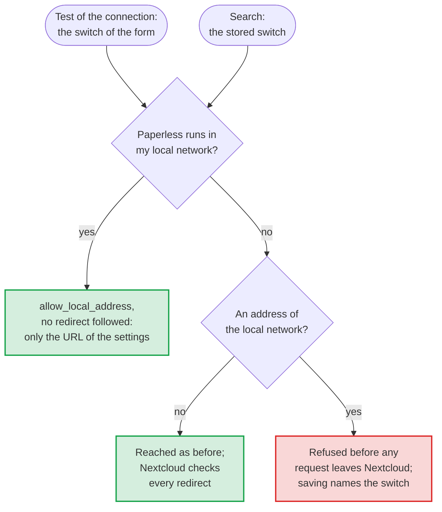

# Allow the local network for this Paperless alone, by a switch of the settings

- Status: accepted
- Date: 2026-10-13

## Context

Nextcloud's HTTP client refuses to connect to addresses of the local network: private and loopback addresses, names without a dot, such as the name of a Docker service, names that end in `.local`, and every name that resolves to such an address. So no URL that someone enters, for a link preview, a webhook or a federated server, can reach the services behind the firewall of Nextcloud, a protection against server-side request forgery. The switch `allow_local_remote_servers` of `config.php` lifts it for every request of every app at once.

Most Paperless servers run at exactly such an address: in the same network as Nextcloud, or in the same Docker network, by the name of their service. Until now, their administrators had two choices ([#117](https://github.com/Dennis-Otto/paperless-unified-search/issues/117)): set `allow_local_remote_servers` and lower the protection of the whole instance, or not use the app. Nothing in the settings or the documentation said so; saving failed with "Could not connect to Paperless", and only the history of problems showed the cause. The end-to-end tests and the screenshots set the switch of `config.php` themselves.

Nextcloud offers an exception for a single request: the option `['nextcloud' => ['allow_local_address' => true]]` of the HTTP client, which Nextcloud 33 to 35 honor in the client and in its pinning of DNS. With it, Nextcloud also follows redirects without checking where they lead.

## Options

1. Document `allow_local_remote_servers`. Nothing to build, but every app and every URL that users enter can then reach the local network.
2. Always allow local addresses for the requests to Paperless. No setting, but whoever changes the settings could point the app at any service of the network unasked, and a public Paperless would lose the protection for no gain.
3. A switch of the settings, off by default, that allows local addresses for the requests of this app to the Paperless URL of the settings, without redirects.
4. A list of allowed hosts or networks in the settings. Finer, but harder to fill in correctly than the URL that the settings already name, which is the one host that the app needs.

## Decision

Option 3. The switch *Paperless runs in my local network* stands right below the URL, and the requests of the app pass `allow_local_address` as it says: the test of the connection with the value of the form, so that it tests what will be saved, and every search with the stored one. A request that allows the local network follows no redirect, since Nextcloud would follow it to any address unchecked: the exception holds for the URL of the settings alone. When Nextcloud refuses an address because the switch is off, saving says so and names the switch.

The stored token goes only to the server it was saved for ([decision 0003](0003-bind-the-token-to-its-server.md)). So whoever takes over the session of an administrator can't send it to a service inside the network either: for another host, the settings ask for the token again before any request leaves Nextcloud. The settings also accept the URLs of such setups that PHP's filter of URLs refused: names of Docker services with an underscore, such as `http://paperless_ngx:8000`, and internationalized names, stored in punycode.

## Consequences

A Paperless in the local network or in Docker works with one switch, and `allow_local_remote_servers` can stay off, as on a fresh installation; the end-to-end tests run so on every supported version of Nextcloud and check that a save without the switch fails. A Paperless behind a proxy that redirects, for example from `http` to `https`, needs the address that it answers at when the switch is on. With the switch on, an administrator, or a session of one taken over within 30 minutes of a confirmed password, can let the test of the connection probe whether something answers at an address of the network as Paperless does; [the security design](../security.md#residual-risks) names this risk, which is small next to what an administrator of Nextcloud can do anyway.
