# Security design

[← README](https://github.com/Dennis-Otto/paperless-unified-search) · [Architecture](architecture.md) · [Roadmap](roadmap.md) · [Releases](releases.md)

What Paperless Unified Search protects, what it trusts and which risks remain. [SECURITY.md](https://github.com/Dennis-Otto/paperless-unified-search/blob/main/SECURITY.md) says how to report a vulnerability and how to verify a release, and argues why the repository and its releases are safe.

## What you can expect

- Only administrators of Nextcloud can see and change the settings. Every request passes Nextcloud's login and its CSRF check, and saving and *Disconnect* ask for the password when it wasn't confirmed in the last 30 minutes.
- The Paperless API token is stored in Nextcloud's credentials manager and goes only to the Paperless server it was saved for: no response, page or message of the app contains it, and a URL with another scheme, host or port needs the token entered again ([decision 0003](decisions/0003-bind-the-token-to-its-server.md)).
- `occ paperless_unified_search:setup` takes the token only from its standard input or from an environment variable, never from an argument, which the history of the shell and the list of processes would show to other users of the server; no output of occ contains it.
- A stored token that can't be decrypted, as after a move of Nextcloud with another secret in `config.php`, counts as none: the settings ask for it again, and the search shows no Paperless documents instead of failing.
- Nextcloud's protection against addresses of the local network stays on. *Paperless runs in my local network* lifts it only for the requests of this app to the Paperless URL of the settings, which then follow no redirect, never for another app or another address, and only an administrator who confirmed the password can select it ([decision 0004](decisions/0004-local-network-opt-in.md)).
- A Paperless document appears in the results of a user only when that user can open a file of the archive account whose name carries its marker `[P<ID>]`: their own if they are that account, or one it shared with them. A file that only carries the marker in its name stands for no document. Selecting the result opens that file in Nextcloud.
- Search terms reach Paperless only when the user switches on *Search connected services*, picks *Paperless documents* in the smart picker, chose *Always search my Paperless documents* in the personal settings, when an administrator has marked Paperless as trusted, or when a client of the user, such as a script, asks for this search by its ID through Nextcloud's OCS search API. They travel from server to server, never from the browser to Paperless.
- In the smart picker of Talk, Text, Deck and Mail, a term reaches Paperless only after the user chose *Paperless documents* in it, a choice as explicit as switching on *Search connected services*. The picker searches through the same search provider, with the same rules of who sees which document.
- The link that the smart picker inserts is the link of the synchronized file in Nextcloud, and the app resolves no link itself: Nextcloud renders it with the permissions of whoever reads it, as the preview of the file for a reader who can open it and as the bare link for anyone else.
- The app asks Paperless only for the fields that a result shows: the ID, the title, the date, the correspondent and the type of a document, and the excerpt around the term, and for the names of the correspondents and the types of the documents that the user can open. The whole OCR text, the notes and the permissions of the documents never reach Nextcloud.
- Nextcloud's distributed cache keeps the names of correspondents and types for ten minutes, by the server and the ID, for all users, as they come with the token of the app; a result shows a name only for a document whose file the user can open.
- The dashboard widget *New in Paperless* follows the rule of the search: it shows a user only the newest documents whose file of the archive account the user can open. Nextcloud's distributed cache keeps the newest 25 documents for a minute for all users, as they come with the token of the app, with their IDs, titles, the moments that Paperless added them and the IDs of their correspondents and types, never their text.
- Requests to Paperless go through Nextcloud's HTTP client, which checks TLS certificates.
- *Try a search* in the settings shows an administrator which Paperless documents a user finds for a term and why the others don't show to them, by their IDs and titles alone: no content, no excerpt, no file and no account that owns one. Like every route of the settings, only administrators can call it, and the audit log of the app *Auditing / Logging* (`admin_audit`) records which administrator tried a search as which user, whatever the log level, as does the log of Nextcloud at level info, without the term.
- A failed search is logged with the kind of error only, without the term, the URL or the token. The history of the administration settings shows it with its message as well, as it shows a request that only its second try answered; the message loses the token, the term in any case, also of letters beyond ASCII such as `Ä` and `ä`, and the query of every URL first.
- What a user types can't fill the history of the problems of the search: a query or a page that Paperless refuses, as one still being typed, finds nothing and writes nothing, and the problems of one kind write the history at most once in 30 seconds ([decision 0006](decisions/0006-retry-only-before-a-connection.md)).

## What is protected

| Asset | Where it lives | Protection |
| --- | --- | --- |
| The Paperless API token | Nextcloud's credentials manager | Stored only there; the settings carry only whether a token is configured; saving without a new token keeps the stored one, but only for the server it was saved for |
| The search terms of the users | Sent to Paperless | Only when the user asks for it, in the search or through the API, or an administrator trusts Paperless; never logged by the app; removed from the messages of the history of the diagnostics, as is the query of every URL |
| Documents in Paperless | Paperless | Read through a dedicated account with read access only; shown only through a file of the archive account that the user can read; *Try a search* shows administrators the IDs and titles that a user finds, nothing more, and logs who looked as whom |
| The configuration | Nextcloud's app configuration | Changed only by administrators who confirmed their password in the last 30 minutes, after a test of the connection |
| The services of the local network | Behind the firewall of Nextcloud | Nextcloud refuses their addresses to every request; the app asks for an exception only for the Paperless URL of the settings, when an administrator selected *Paperless runs in my local network*, and follows no redirect then |

## Trust boundaries

<picture>
  <source media="(prefers-color-scheme: dark)" srcset="images/diagrams/the-trust-boundaries.dark.svg">
  
</picture>

1. **Browser → app.** The routes of the settings page pass Nextcloud's login, its CSRF check and the check of the administrator, and saving and *Disconnect* its password confirmation. The URL must use `http` or `https`, name a host, an IPv4 address or an IPv6 address in brackets, and carry no credentials, query or fragment; an internationalized name is stored in punycode. A blank token keeps the stored one only for a URL with the scheme, host and port of the stored URL; the archive account must exist and is stored as Nextcloud spells its ID.
2. **Nextcloud's search → app.** The term and the cursor of a page come from the user, through the unified search or the smart picker: the cursor must be a whole number, the offset of a hit, and a search pages through the first 10,000 hits; a page holds at most 50 results, and one search asks Paperless for at most 4 pages of 25 hits.
3. **App → Paperless.** Nextcloud's HTTP client refuses addresses of the local network unless *Paperless runs in my local network* is selected; then the request reaches the Paperless URL of the settings and follows no redirect. The request names the fields of the documents to send, so that the OCR text stays in Paperless. Every answer is untrusted input. It must be JSON with a list of results; a document without a numeric ID is left out; titles, dates and the names of correspondents and types are used only when they are text, and a date is formatted only when it is a day that exists, as is the moment that Paperless added a document; the excerpt loses the tags of Paperless before its entities become characters again, is cut to 180 characters, and, with the rest of the line below the title, gets a space after every `<` that would start a tag, so that this line holds no HTML tag whatever the document says.
4. **App → files of Nextcloud.** The file locator searches only the folders of the searching user, with Nextcloud's permissions, and takes only files, never folders, and only those that the archive account owns, with the exact marker of a document in their name. The marker in a name is chosen by whoever names the file and proves nothing by itself; the files of the archive account reach other users only through its shares.

## Threats and countermeasures

| Threat | Countermeasure | Evidence |
| --- | --- | --- |
| Another site uses the session of an administrator | Nextcloud checks the CSRF token of every request; no route of the app opts out of it or of the check of the administrator | `testNoSettingsActionOptsOutOfTheChecksOfNextcloud` in `tests/Unit/Controller/SettingsControllerRoutesTest.php` |
| A route loses the check of the administrator or of the CSRF token | A test fails as soon as the controller or a route of it opts out of a check of Nextcloud, by an attribute such as `NoAdminRequired`, `PublicPage` or `NoCSRFRequired` or by an annotation; the end-to-end tests send every request of the settings as a user who isn't an administrator and without a login, and expect 403 and 401 with the settings unchanged | `testNoSettingsActionOptsOutOfTheChecksOfNextcloud`, `testEveryActionOfTheControllerIsARouteOfThisTest`, `tests/e2e/run.sh` |
| An administrator, or whoever takes over their session, learns more of the documents of a user than *Try a search* should show | Only administrators can call the route, which passes the CSRF check; its answer names each document by its ID, its title and its verdict alone, never its content, an excerpt, the path of a file or the account that owns one; the audit log of `admin_audit`, whatever the log level, and the log of Nextcloud at level info record which administrator tried a search as which user, without the term | `testTheAnswerHoldsTheIdsAndTitlesOnly`, `testLogsWhoTriedASearchAsWhomWithoutTheTerm` and `testTellsTheAuditLogWhoTriedASearchAsWhomWithoutTheTerm` in `tests/Unit/Controller/TrySearchTest.php`, `testNoSettingsActionOptsOutOfTheChecksOfNextcloud`, and the end-to-end tests, which expect 403 for a user who isn't an administrator and 401 without a login, and an answer of IDs, titles and verdicts alone |
| An administrator session points the URL at another server to collect the token | A blank token keeps the stored one only for the same scheme, host and port; for another server, saving stops before any request leaves Nextcloud and asks for the token. Saving asks for the password when it wasn't confirmed in the last 30 minutes | `testABlankTokenNeverSendsTheStoredOneToAnotherServer` in `tests/Unit/Service/ConfigServiceTest.php`, `testSaveWithoutATokenNeverSendsTheStoredOneToAnotherServer` in `tests/Unit/Controller/SettingsControllerTest.php`, `testChangingTheConnectionAsksForThePassword`, and the refused save of the end-to-end tests, which no request of the mock follows |
| An administrator session points the app at a service inside the network (server-side request forgery) | Nextcloud refuses addresses of the local network to every request unless *Paperless runs in my local network* is selected, and then only to the requests of this app to the Paperless URL of the settings, which follow no redirect; `allow_local_remote_servers` stays off. The stored token goes only to the server it was saved for, so a host inside the network receives it only when it is entered again, and saving asks for the password | `testSaveAllowsTheLocalNetworkForThisPaperlessOnlyWhenAsked` and `testSaveNamesTheSwitchWhenNextcloudRefusesALocalAddress` in `tests/Unit/Controller/SettingsControllerTest.php`, `testSearchAllowsTheLocalNetworkAsTheSettingsSay`, and the end-to-end tests, which run without `allow_local_remote_servers` and expect a save without the switch to fail before any request reaches the mock |
| A token that can't be decrypted takes down the settings or the search | The token counts as none, one warning without it goes to the log, and the settings ask for it again | `testATokenThatCannotBeDecryptedCountsAsNoneAndIsLoggedOnce`, `testTheFormAsksForTheTokenAgainWhenTheStoredOneCannotBeDecrypted`, `testAStoredTokenThatCannotBeDecryptedShowsNoDocumentsInsteadOfFailing` |
| The API token leaks through the command line of occ | `setup` has no argument or option that takes the token: it reads the token from the standard input or from an environment variable, and its messages leave it out, also the error that `-v` shows | `testTakesTheTokenFromNoArgument` and `testShowsTheErrorWithoutTheTokenWhenAskedTo` in `tests/Unit/Command/SetupTest.php`, and the end-to-end tests, which set the app up through occ and find the token in none of its output |
| The API token reaches the browser | The token stays in the credentials manager; the settings carry only whether one is configured | `testPublicConfigNeverContainsToken` in `tests/Unit/Service/ConfigServiceTest.php` |
| A malformed or hostile answer of Paperless | The answer is checked for its shape; documents without a usable ID are left out; a failing search returns no results instead of an error | `testAWrongAnswerOfPaperlessFails`, `testDocumentsWithoutAUsableIdAreLeftOut`, `testAFailedSearchIsLoggedWithoutItsDetails` |
| A link of the smart picker shows a document to a reader who may not open its file | The inserted link is the link of the file in Nextcloud; the app resolves no link, and Nextcloud's own provider of file links shows the preview only to a reader who can open the file | `testLeavesTheLinkOfAResultToTheProviderOfFileLinks` in `tests/Unit/Reference/PaperlessReferenceProviderTest.php`, and the end-to-end tests, which resolve the link as the archive account, as a user without access and as a user the file was shared with |
| Text of a document runs as script in the search | Paperless escapes the text of a document inside the markup of its excerpt, so `&lt;script&gt;` becomes `` (`tests/Unit/fixtures/`), and the search dialog of the end-to-end tests, which shows the tags and entities of an excerpt of Paperless as text |
| The names of correspondents or types fail or slow down the search | The names come with one request per kind, one try within 3 seconds, and none for the other kind after a request without answer; a failure leaves the names out, writes nothing into the history of the diagnostics, a list that Paperless refuses to the token isn't asked for again for ten minutes, and a list that doesn't answer, as one slower than the timeout, isn't asked for again for a minute, so that the searches of every keystroke don't wait 3 seconds for it each | `testALookupOfNamesWithoutAnswerLeavesOutTheNames`, `testAListThatPaperlessRefusesIsNotAskedForAgain` in `tests/Unit/Search/PaperlessSearchProviderTest.php`, `testAListWithoutAnswerIsNotAskedForAgainForAMinute` and the rest of `tests/Unit/Service/PaperlessNamesTest.php`, `testALookupWithoutAnswerGetsNoSecondTry` in `tests/Unit/Service/PaperlessApiServiceTest.php` |
| A user names a file with the marker of a document that they may not see | Only files that the archive account owns stand for documents, and users receive them only through its shares; without an archive account the search shows no documents and doesn't ask Paperless | `testIgnoresFilesThatTheArchiveAccountDoesNotOwn`, `testAFileOfAnotherAccountShowsNoDocument`, `testWithoutAnArchiveAccountPaperlessIsNotAsked`, and the forged file of the end-to-end tests |
| A slow Paperless blocks the search | A connection timeout of 3 seconds and a timeout of 10 seconds for every request, a second try only for a request that failed within 3.5 seconds, before it had a connection, and never for one that waited for a Paperless that hangs, for an address that Nextcloud refuses or for an answer of Paperless, and no further page of Paperless once a search has taken 3 seconds ([decision 0006](decisions/0006-retry-only-before-a-connection.md)) | `lib/Service/PaperlessApiService.php`, `testARequestThatFailsWithinTheTimeToConnectGetsASecondTry`, `testARequestThatFailsAfterTheTimeToConnectGetsNoSecondTry`, `testAnAddressThatNextcloudRefusesGetsNoSecondTry`, `testAnAnswerOfPaperlessGetsNoSecondTry`, `testASlowPaperlessIsAskedForNoFurtherPageAfterThreeSeconds` |
| A user fills the history of the diagnostics with false failures, to push real problems out of it, or makes Nextcloud write its configuration on every request | A query that Paperless refuses with HTTP 400 for its field `query`, such as an advanced query still being typed or one longer than 4096 characters, and a page past the last one with HTTP 404 find nothing and leave the history untouched; the problems of one kind write it at most once in 30 seconds and only count in Nextcloud's distributed cache in between | `testASearchThatPaperlessRejectsLeavesTheHistoryUntouched`, `testAnswersThatFailStillGoIntoTheHistory` in `tests/Unit/Search/PaperlessSearchProviderTest.php`, `testFailuresWithinThirtySecondsWriteTheHistoryOnce` and `testAPaperlessThatFailsEveryOtherRequestWritesOnceInThirtySeconds` in `tests/Unit/Service/SearchDiagnosticsTest.php`, and the end-to-end tests, which search with an unfinished query and past the last page before they count exactly the one failure and the one retry that they caused |
| A search on Paperless 2 lists every document | The simple mode of the search, the parameter `text`, goes only to Paperless 3 or later, as the headers `X-Version` and `X-Api-Version` of its answer name it; Paperless 2 ignores the parameter and would list all documents | `testOnlyPaperless3GetsTheTermInItsSimpleMode`, `testOnlyPaperless3AndLaterSearchInASimpleMode` |
| A user makes Paperless and the file cache work through every hit | One search asks Paperless for at most 4 pages of 25 hits, each with one search of the file cache, and a cursor past the first 10,000 hits asks nothing | `testASearchAsksPaperlessForAtMostFourPages`, `testACursorPastTheEndAsksPaperlessNothing` in `tests/Unit/Search/PaperlessSearchProviderTest.php`, `tests/Unit/Search/PaperlessPagerTest.php` |
| An administrator learns the search terms of the users or the token from the history of the diagnostics | Every stored message loses the token and the term, in any case, also of letters beyond ASCII such as `Ä` and `ä` by the simple case folding of Unicode, which leaves `STRASSE` for `straße`, and the query and fragment of every URL, and only administrators can open the settings or clear the history | `testAFailureIsRecordedWithoutTheTokenTheTermAndTheQuery` in `tests/Unit/Service/SearchDiagnosticsTest.php`, also for `Ärger` and `ärger`, the test of properties `testNoTokenAndNoTermSurviveInAnyCase` in `tests/Unit/Service/SearchDiagnosticsPropertiesTest.php` on 500 random terms of a fixed seed, `testARetryLeavesOutTheTokenAndTheTerm` and `testARetryOfTheSimpleModeLeavesOutTheTerm` in `tests/Unit/Service/PaperlessApiServiceTest.php`, `testAFailedSearchLeavesOutTheTokenAndTheTerm`, `testARequestThatOnlyItsSecondTryAnswersGoesIntoTheHistory`, and the end-to-end tests, which make Paperless fail and break off a connection, and find neither the terms nor the token on the page of the settings |

The Docker end-to-end tests run the real search endpoint of every supported Nextcloud version against a mock of the Paperless API, with users who may and may not read a file, a file that only carries the marker and a share of the archive account ([tests/e2e/README.md](https://github.com/Dennis-Otto/paperless-unified-search/blob/main/tests/e2e/README.md)).

## Residual risks

- A link of the smart picker carries the ID of the file in Nextcloud. A reader who can't open the file sees that number, but neither its name nor its content.
- An administrator can learn with *Try a search* which document titles a user can see, for any term and any user. The answer holds the titles alone, and the audit log names the administrator and the user, if the app *Auditing / Logging* is enabled (otherwise only the log of Nextcloud does, at level info or lower); an administrator of Nextcloud can see far more anyway, for example by signing in as the user. A hoster who doesn't want this should not make the operators of an instance its administrators.
- The marker `[P<ID>]` ties a file of the archive account to a document. Whoever may write into a folder of the archive account, for example through a share with write permission, can give a file of that account the marker of any document and see its title and excerpt. Share the archive read-only.
- The permissions of the Paperless account decide which documents the search can find. Use a dedicated account with only the read permissions that the search needs, as the [README](https://github.com/Dennis-Otto/paperless-unified-search#configuration) describes.
- With *Always include Paperless in global search* on, every search term of every user reaches Paperless. Turn it on only for a Paperless server that you trust as much as Nextcloud.
- Every search term of a user who chose *Always search my Paperless documents* reaches Paperless, as the hint of the checkbox says; nobody can choose it for another user. Turn off *Let users include Paperless in all their searches* to keep every term that the switch doesn't send away from Paperless; the search then ignores the stored choices ([decision 0008](decisions/0008-let-each-user-always-search-paperless.md)).
- An `http` URL is allowed, for a Paperless in a trusted local network; then the token and the search terms travel unencrypted. Use `https` whenever the connection leaves such a network.
- Within 30 minutes of a confirmed password, whoever takes over the session of an administrator can still change the settings, for example to a server of their own with a token of that server, which then receives the search terms. They can't collect the stored token this way. Nextcloud's own settings carry the same risk; sign out of shared browsers.
- With *Paperless runs in my local network* selected, an administrator, or whoever takes over their session within 30 minutes of a confirmed password, can point the test of the connection at any address and port of the network, with a token of their own, and learn from its result and from how long it takes whether a service listens there, and whether it answers as Paperless does. The request has the path of the Paperless API and follows no redirect; of the answer, the settings show only the kind of failure, such as a host that doesn't resolve, a refused token, a status of HTTP or an answer that isn't the one of Paperless, never its content, and the stored token never goes there. An administrator of Nextcloud can do more than that anyway, for example by installing an app.
- A blank token keeps the stored one for another path of the same server, so an application that the same scheme, host and port serve under another path receives it once an administrator enters that path.
