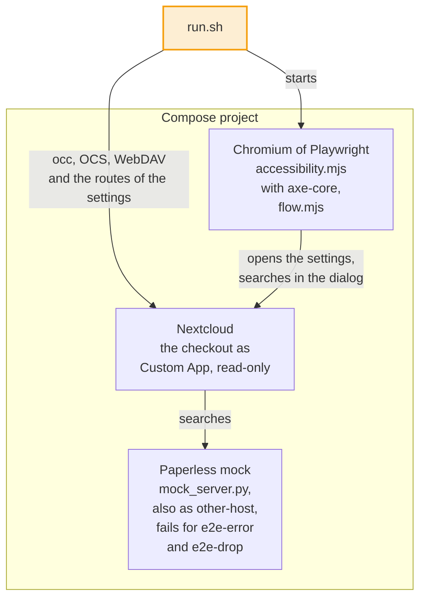
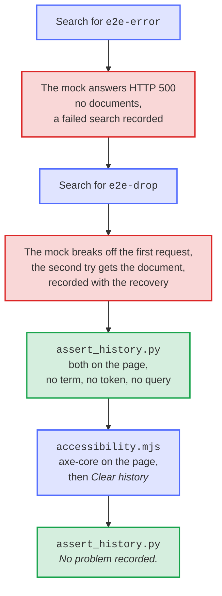
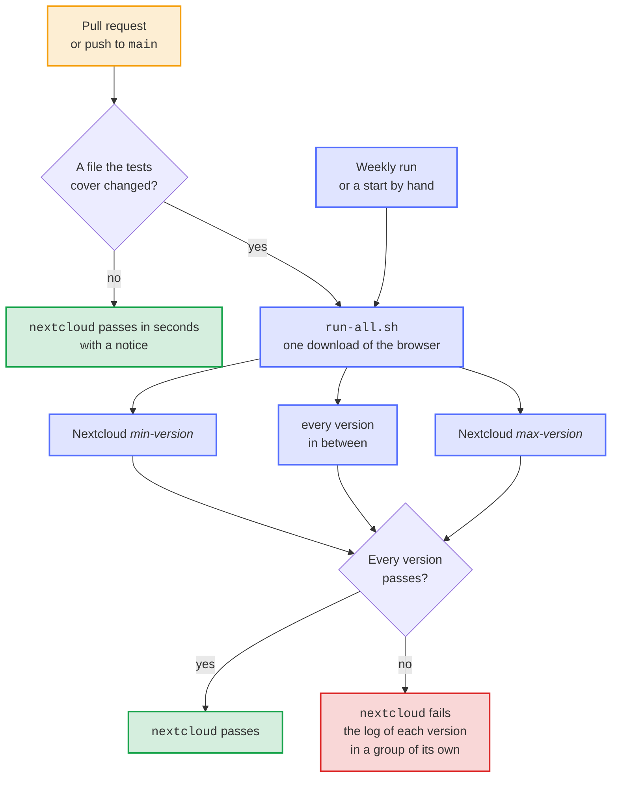
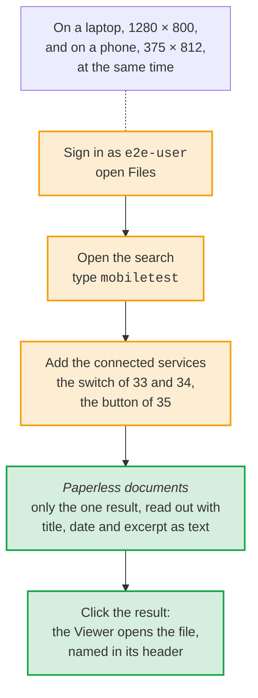

# Docker end-to-end tests

The suite starts Nextcloud with this checkout mounted read-only as a Custom App: `run.sh` the image of `compose.yaml` (set `NEXTCLOUD_IMAGE` to choose another, such as `nextcloud:35-apache`), [`run-all.sh`](#every-supported-version-at-once) and the CI the current release of every version from `min-version` to `max-version` in `appinfo/info.xml` at the same time, and every week also [the coming Nextcloud](#the-coming-nextcloud). A deterministic local HTTP service emulates the small Paperless API surface used by the app. Like Paperless, it sends only the fields of the documents that a request names, and the excerpt of a search with them; unlike Paperless, it answers a request that names none with HTTP 400, so that the suite fails as soon as the app would make Paperless send the whole OCR text of every document. Like Paperless, it answers in pages, of 25 documents unless a request asks for another size, with the absolute link to the next page, and refuses a page past the last one with HTTP 404. Like Paperless, it marks up the words of the term in the excerpt with `<b>` and writes the characters of HTML as entities, such as `&#x27;` and `&quot;`, which the result has to show as text again. And as Paperless or its network sometimes does, it fails: with HTTP 500 for the term `e2e-error`, and for `e2e-drop` it breaks off the connection of the first request without an answer.



The search for `pagetest` checks how the app fills a page of results: the mock ranks 40 documents for it, more than a page of the app's requests to Paperless, and the archive account shares a folder with the files of seven of them, none of the first 19, with `e2e-other`, and keeps one more file to itself. The first page of 5 results takes its documents from both pages of Paperless, and the next page, from the cursor of the first, holds the remaining two, without repeating or leaving out a document.

Besides the search, the suite checks the smart picker: it lists *Paperless documents* with the search provider and the icon of the app, and Nextcloud renders the link of a result as the file for the archive account and for a user the file was shared with, and as the bare link, without the name of the file, for a user who can't open it. It checks the guarantees of the settings as well: every route of the settings answers a user who isn't an administrator with HTTP 403 and a request without a login with 401, and leaves the settings as they are; a save with a blank token for another server answers 400 and sends that server nothing, which the log of the mock shows, as it answers as `other-host` too; and an archive account typed in another case is stored as Nextcloud spells it.

The suite makes the search fail, too, and checks the history of its problems that the administration settings show under *Search problems*, which Nextcloud keeps in its configuration of the apps. A search for `e2e-error` shows no documents and goes into the history as a failed search, with the message *Paperless returned HTTP 500.*; a search for `e2e-drop` shows its document from the second try of the request, which goes into the history as well, with the message of the HTTP client, and shows that searches work again. `assert_history.py` reads the page that Nextcloud renders: neither term appears on it, nor the token, nor the query of the URL that the message of the HTTP client repeats. The browser then clears the history with *Clear history*, after which the page says *No problem recorded.*.



Run:

```bash
bash tests/e2e/run.sh       # one version: the image of compose.yaml
bash tests/e2e/run-all.sh   # every supported version at the same time, as the CI does
```

Optional environment variables:

- `E2E_PORT`: host port for Nextcloud, default `18082`
- `DOCKER_BIN`: Docker CLI path, default `docker`
- `E2E_PROJECT_NAME`: Compose project name, default `paperless_unified_search_e2e`
- `NEXTCLOUD_IMAGE`: the image of Nextcloud, default the release that `compose.yaml` pins
- `KEEP_E2E=1`: keep containers and the test volume running after the suite
- `E2E_IGNORE_MAX_VERSION=1`: enable the app with `--force` on a Nextcloud newer than `max-version`, as `canary.sh` does
- `E2E_SKIP_PLAYWRIGHT_PULL=1`: leave the download of the image of Playwright to the caller, as `run-all.sh` does

`run.sh` downloads the image of Playwright in the background while Nextcloud sets itself up, removes the containers without waiting for them to stop (and leaves them on a runner of GitHub, which is thrown away after the job anyway), and turns off Nextcloud's password policy, which would check every new password against [Have I Been Pwned](https://haveibeenpwned.com/Passwords), so that no test depends on a service outside the machine. Each call of `occ` starts PHP and Nextcloud anew, which takes a few seconds while three versions run at once; so `occ` only installs Nextcloud, trusts its name in the network and enables the app, and the running web server turns off the password policy and creates the users. The web server has to do that itself: it caches the settings of the apps for three seconds and would go on checking passwords right after `occ` turned the policy off. Nextcloud keeps `allow_local_remote_servers` off, as a fresh installation does: the app reaches the mock at its address in the network of the project only through its own switch **Paperless runs in my local network**, which the tests turn on when they save the settings, after a save without it that Nextcloud refuses before any request reaches the mock.

All credentials and document data are synthetic, local to the disposable Compose project, and intentionally unsuitable for production.

## Every supported version at once

`run-all.sh` reads `min-version` and `max-version` of `appinfo/info.xml` and starts `run.sh` for every major version from the one to the other at the same time, each with the image `nextcloud:<version>-apache`, the Compose project `pus_e2e_<version>` and the port `18000 + <version>`, such as `18035` for Nextcloud 35. Each version writes its log to a file of its own; the script notes each version as it finishes and then prints the logs one after another, in the CI each in a group named after the version and its result. The script fails when one version does, and Ctrl-C stops every version and removes its containers. A version that takes longer than `E2E_VERSION_TIMEOUT` seconds, 600 by default and about four times what it needs, stops and fails as well, with its log up to that point and the state of its containers, long before the job of the CI times out.

```bash
bash tests/e2e/run-all.sh                       # every version from min-version to max-version
E2E_VERSIONS="33 35" bash tests/e2e/run-all.sh  # only Nextcloud 33 and 35
```

On a runner of GitHub, with four CPUs and 16 GB of memory, three versions at once take about two and a half minutes and one alone about a minute and a half. The script first downloads the images of Nextcloud and of the mock for every version, and the image of Playwright only while Nextcloud sets itself up, which is faster than downloading them all at once.

## In the CI

The workflow *Docker E2E* (`.github/workflows/e2e.yml`) runs `run-all.sh` in one job, the required check `nextcloud`. A pull request or a push to `main` that changes no file the tests cover passes the check in seconds without running them, with a notice that says so; the job stays and passes, so that the required check reports success. `scope.sh` decides it, and `selftest.sh`, which `scripts/check.sh` runs, tests it with real merge commits and pushes in throwaway Git repositories, and `run-all.sh` with a fake Docker. The tests cover:

- the app: `appinfo/`, `lib/`, `templates/`, `js/`, `css/`, `img/` and `l10n/`
- `composer.json` and `composer.lock`
- the tests themselves, `tests/e2e/`
- the workflow `.github/workflows/e2e.yml`

The weekly run on Mondays and a run started by hand always test every version, so that the newest release behind each image `nextcloud:<version>-apache` is tested even in a week without a change of the app.



## Accessibility

At the end of the suite, `accessibility.mjs` checks the administration settings of the app in Chromium with [axe-core](https://github.com/dequelabs/axe-core) against WCAG 2.1 at levels A and AA, in the light and the dark theme of Nextcloud, in four states: with the problems of the search that `run.sh` caused, in the tables of *Search problems*; with the warning about an archive account that doesn't exist, which `run.sh` stores before; with the URL of another server, for which the token field is required; and with the message after saving. It signs in through the login form and looks only into `#paperless-unified-search-settings`, the element that holds the markup of `templates/`, `js/` and `css/`, so that what Nextcloud draws around it doesn't count. A serious or critical violation fails the suite; the others are listed in the log.

On the way to these states, the script checks what the settings page does in the browser, and a state that differs fails the suite too. The token field asks for the token again for another scheme, host or port, but not for another path of the stored server. Saving another server with its token makes it the stored URL, after which the mock's own name is the other server; and an archive account that exists ends the warning. Last, *Clear history* empties *Search problems* at once and says *History cleared.*. `run.sh` then checks that the settings are stored as the browser saved them, and that the page that Nextcloud renders shows no problem any more.

The results in the global search of Nextcloud are left out: Nextcloud draws them, and the app only gives the title, the line below it and the icon. axe-core does find a serious violation there, *nested-interactive*, but every search provider has it, because Nextcloud puts the link of each result into an option of a list box; only Nextcloud can fix it. [The search dialog](#the-search-dialog) checks what the results show instead.

The browser runs in the image of Playwright that `run.sh` names, inside the network of the Compose project, and reaches Nextcloud as `http://nextcloud`; the suite turns off the first-run wizard of Nextcloud, which would cover the pages. `package.json` and `package-lock.json` pin axe-core and playwright-core. Keep playwright-core at the version of the image: Renovate updates both together (`.github/renovate.json5`), and `scripts/check-project.sh` compares them.

## The search dialog

After the accessibility check, in the same container, `flow.mjs` goes through the search of Nextcloud as a person does, on a laptop, 1280 × 800 pixels, and on a phone, 375 × 812, both at once: signed in as `e2e-user`, it opens Files and the search, types `mobiletest`, adds the connected services and expects the group *Paperless documents* with only the result *Mobile viewer test*, without the document that no file stands for. A screen reader reads the result as its title, the date of the document and its excerpt as text, `O'Brien & "Sons" <GmbH>` from the tags and entities of Paperless. A click on the result opens the file in the Viewer, which names it in its header; the file is a real PDF that `pdf.py` writes, which the Viewer draws, but the check doesn't wait for that, which is Nextcloud's own job and takes Chromium seconds. A group that holds another result, or more than this one, fails the suite with what a screen reader reads in it; a step that doesn't come within a minute fails it with the step that it waited for. The log shows how long each size took: about 11 seconds on a desktop computer, both at once, and about half a minute on a runner of GitHub, where three versions of Nextcloud and their browsers share four CPUs. The phone draws one pixel per CSS pixel, which gives the same layout as a screen with twice the density for a quarter of the work.

The search looks different in each supported version, and `flow.mjs` finds every part of it by its role and its name, as a screen reader does. Nextcloud 33 and 34 open a dialog from a button in the header, which Nextcloud 33 names *Unified search* and Nextcloud 34 *Search apps, files, tags, messages …*, and add Paperless with the switch *Search connected services*. Nextcloud 35 searches in a field of the header, *Apps, files, messages, and more*, a button on a phone, shows the results below it, and adds Paperless with the button *More from connected services*.



`ui.mjs` holds the steps through the pages of Nextcloud that `flow.mjs`, `accessibility.mjs` and the screenshots share: signing in, the search of each version, its results and the Viewer.

## Screenshots

`scripts/screenshots.sh` takes the screenshots and the animation in `screenshots/` with the containers of this suite: Nextcloud and the mock under the Compose project `paperless_unified_search_screenshots`, on port `18083`, and `screenshots.mjs` in the image of Playwright. It writes the synthetic documents of the demo as PDF files into the archive account `paperless`, in folders as Paperless Sync names them, and shares them read-only with `jamie`. For the term `invoice`, the mock returns three of them, with the IDs of their files. `pngjs` and `gifenc` in `package.json` read the screenshots and write the animation, and `ui.mjs` gives the steps through the search that `flow.mjs` checks in every run of the suite.

## The coming Nextcloud

Every Monday, and when started by hand, the workflow also runs the suite against the coming Nextcloud:

```bash
bash tests/e2e/canary.sh
```

The coming Nextcloud is the newest beta or release candidate of the next major version while Nextcloud publishes one, in `https://download.nextcloud.com/server/prereleases/`, and otherwise the daily build of its master branch, `https://download.nextcloud.com/server/daily/latest-master.tar.bz2`. Nextcloud no longer publishes Docker images of betas and release candidates, so the script checks the signature of the package against the release key of Nextcloud, as the official image does, and puts its code into the image of the newest release, `nextcloud:apache`, which keeps its PHP, Apache and start script. The suite enables the app with `--force`, as `max-version` of `appinfo/info.xml` doesn't name that version yet; the upstream bot raises `max-version` once Nextcloud releases the version.

The canary is no required check and blocks nothing. When it fails, it opens the issue *The coming Nextcloud breaks the app* with a link to the run, adds every further failed run to it, and closes it once the tests pass again.

Optional environment variables, besides those of `run.sh`:

- `CANARY_BASE_IMAGE`: the image whose code the coming Nextcloud replaces, default `nextcloud:apache`
- `CANARY_IMAGE`: the local image the script builds, default `paperless-unified-search-e2e:coming`
